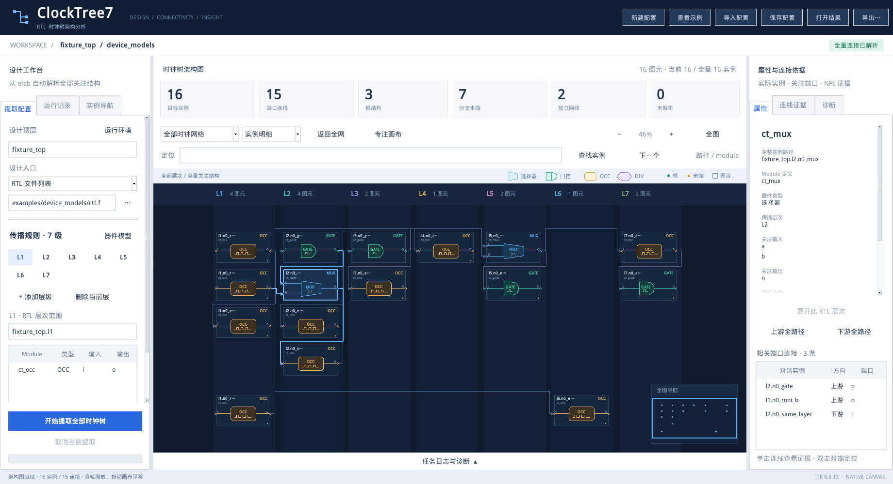
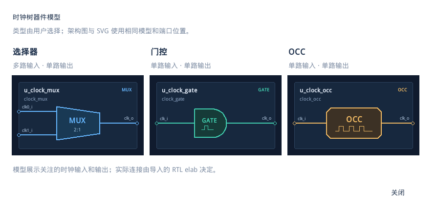
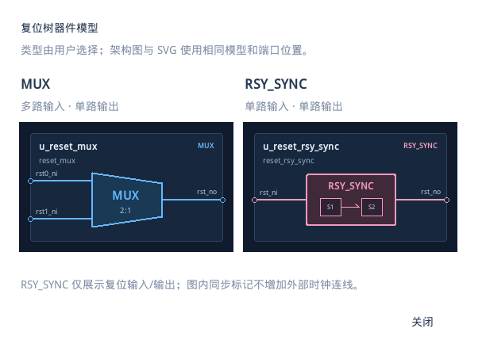

# ClockTree7

**原生 Tk 桌面时钟树 / 复位树架构分析工具：默认两级，可自定义层级，从 RTL elaboration 自动恢复全部关注结构和连接。**

用户填写 RTL 层次范围、module 定义名、器件类型及关注输入/输出端口。工具枚举所有匹配实例，依据实际 elab 网络连接全部扇出、选择器汇合、同层串接及跨层跳接。分支可以在任意已配置层结束；产品名称 ClockTree7 不再表示层级上限。

**[详细 GUI 操作手册](docs/GUI_USER_MANUAL.zh-CN.md)** · [离线 HTML 阅读版](docs/GUI_USER_MANUAL.zh-CN.html) · **[其他 EDA 设备部署与验收](docs/PORTABILITY.zh-CN.md)** · [验证摘要](docs/VALIDATION.zh-CN.md) · [可浏览示例](examples/flexible_layers/README.md)



## 功能

- 原生 Python Tkinter / ttk 工作台，层级配置、历史记录、实例导航、属性与连接依据。
- 默认 L1、L2，支持添加层级、删除当前层并自动重新编号；兼容原有七级配置。
- 独立的 **时钟树 / 复位树** 分析模式，切换时保留各自配置草稿与结果，历史记录按模式显示。
- 启动自动恢复上次模式、配置、选中层级和结果图；支持未导出草稿和本地结果快照，关闭时完成最后一次保存。
- 四类用户选定的器件：**选择器 / 门控 / OCC / DIV 分频器**，带专用模型和实时预览。
- 复位树仅提供 **MUX / RSY_SYNC**，支持专用同步器模型及复位端口配置，不要求填写同步时钟口。
- 自动从 `verdi` 命令定位安装目录，无需每次填写；提取运行时间不设上限。
- 使用目标设备的 EDA 与许可环境；提供离线包、设备自检、真实时钟/复位 golden 验收及本机快捷方式生成。公共只读安装支持用户目录保存记录。
- 同一当前目录可反复运行，旧证据自动归档，每次使用独立 Verdi 工作目录。
- 实例查询直接限定在每层规则的 RTL 路径内；可独立填写“端口追踪根层次”，严格追踪该层次及子层次，范围出口单独标记。
- Linux 提取阶段监测 Verdi 与控制进程的合计 RSS，默认阈值 60 GiB，可在 GUI 修改或填 0 关闭。接近阈值提交断点并轮换 Verdi，触及阈值回退未完成批次并重试；已完成模块查询与追踪保留，不跳过模块。无进展的重复内存失败会停止并保留证据，仍不设置任务运行超时。
- 每条 module 查找规则结束后立即保存独立断点，并在下一条规则开始前额外检查一次实时 RSS；即使多条规则共用同一次 NPI 查询，也逐条提交。重试按规则游标继续，断点记录模块名、层次、匹配数、结果状态及原始数据位置。
- GUI 显示“准备→导入→查找→追踪→拓扑→索引→结果→显示”运行节点、当前 module/实例/端口及最近断点；阶段开始前写持久日志。点击节点筛选记录，“阶段诊断”定位异常退出；支持 `python3 -m clocktree diagnose --run <任务目录> --json` 无 EDA 读日志，GUI 自身的布局/绘图闪退也有独立日志。[详细操作](docs/GUI_USER_MANUAL.zh-CN.md#runtime-stages)。
- 事件逐条处理、队列回收、路径前缀共享、证据与结果索引落盘、JSON 流式导出。Tk 大图先显示概览，展开/点击再取明细；宽层次和连接列表支持翻页，启动恢复配置及结果索引。
- 完整静态结构图，保留多源、全部扇出、汇合、孤立结构及异常。
- 驱动/负载双向 NPI 证据；缺失端口、未知逻辑、逆序层、环路、多驱动等诊断。
- 大图层次概览、逐层展开、全量搜索、缩放平移、全图导航和路径高亮。
- 独立提取进程、日志进度及取消任务。
- 自定义层级配置、全量 JSON 和当前范围 SVG 导出。



大规模设计的内存策略、阈值单位、断点续跑限制和实测数据见 [内存优化与重启续跑](docs/MEMORY.zh-CN.md)。其中的 Python 后处理内存收益不代表 Verdi 导入商业 KDB 的内存收益。

## 先浏览，无需 EDA 安装

运行 GUI 需要 Python 3.6+、系统 Tkinter 和中文字体；不需要第三方 Python GUI 库。

Windows 双击 `launch_gui.cmd`，或在仓库根目录执行：

```powershell
python -m clocktree gui
```

Linux 图形桌面终端：

```bash
bash launch.sh
```

GUI 启动时自动恢复上次使用的模式、配置、选中层级和结果图，两类分析的草稿与结果分别保留。首次升级没有自动记录时，会尝试从当前运行目录读取最近的历史结果；没有历史才显示两级空白配置。“新建配置”可回到当前模式的两级空白规则。

点击“查看示例”打开随附的 `examples/flexible_layers/clocktree.json`，或点“打开结果”选择其他结果。两级四类器件记录样例有 13 个结构、11 条连线、2 个根、4 个末端、2 个网络，未解析为 0。旧七级样例仍保留在 `examples/device_models/`，导入结果会恢复其原有层数。

自动记录写在当前用户的本机状态目录，按 `--runs` 目录隔离。结果另存快照，原结果移走后仍可恢复；缓存无法读取时保留配置并显示提示。恢复只读取已保存数据，RTL 更新后仍需重新提取。手动保存配置和导出 JSON/SVG 用于工程归档与共享。需要隔离检查时，可用 `python -m clocktree gui --no-session` 关闭本次启动的自动恢复及记录。

## 真实提取

在实际运行 GUI 的机器上提供有效 Verdi 安装和许可。复杂设计建议导入已经成功生成的 `kdb.elab++`；也支持通过 RTL filelist 建立 elaboration。

### 重新生成并提取示例

在具有 Verdi 的 Linux 机器、仓库根目录执行：

```bash
python3 scripts/make_flexible_fixture.py validation/fixtures/flexible --layers 2
```

在 GUI 中：

1. 点击“导入配置”，选择生成的 `validation/fixtures/flexible/config.json`。
2. 工具自动定位 `verdi`；“运行环境”只用于查看检测结果，无需填写路径。
3. 点击“开始提取全部时钟树”。
4. 核对绿色完成状态、实例/连线统计和右侧诊断。

也可使用 CLI：

```bash
source scripts/eda_env.sh
python3 -m clocktree extract \
  --config validation/fixtures/flexible/config.json \
  --out validation/runs/my-first-run
python3 scripts/check_golden.py \
  validation/runs/my-first-run/clocktree.json \
  validation/fixtures/flexible/golden.json
```

`--out` 可重复使用；省略时写入当前目录。上次证据保存在 `.clocktree-history/`，本次编译工作区位于 `.clocktree-runs/`。不限制重跑次数，不设置运行超时；旧 `timeout_seconds` 字段也不再生效。Windows GUI 可以浏览和编辑；使用虚拟机内 Verdi 提取时，请在虚拟机运行 GUI。

## 在其他 EDA 设备部署

Linux 目标设备启用自己的 Verdi 环境后，在工具目录运行：

```bash
bash clocktree.sh doctor --self-test --gui
bash launch.sh
```

`doctor --self-test` 实际提取时钟和复位样例并比对全部实例、边和末端；`--gui` 另行检查两类架构的原生画布。无图形会话时省略 `--gui`；Windows 只检查浏览功能可用 `clocktree.cmd doctor --viewer-only --gui`。只有普通 `doctor` 通过并不表示许可和实际提取已验证。

启动器不含固定 EDA 路径或许可证服务器。可写安装继续使用 `validation/runs`；只读安装使用用户状态目录，支持 `CLOCKTREE_RUNS` / `--runs` 自定义。安装/输出路径不适合旧 Verdi 时，自动选择安全临时工作目录并保留位置记录。`design.base_dir` 支持以配置文件为基准解析设计入口；filelist 内容中的 RTL/include 路径需由工程流程正确提供。

离线包由 `python3 scripts/build_portable.py` 生成，附逐文件 SHA256；目标 Linux 上执行 `python3 scripts/install_desktop.py --desktop` 可生成指向实际位置的快捷方式。完整条件、环境入口、迁移步骤与问题定位见 [部署手册](docs/PORTABILITY.zh-CN.md)。真实提取需要 **Linux + Verdi/NPI + 有效许可**，尚未逐一验证其他 Verdi 版本。

## 时钟树规则与模型

### 实例搜索范围与端口追踪根层次

GUI 的 **端口追踪根层次** 对应配置顶层字段 `trace_scope`。例如填写 `soc_top.u_crg`，端口追踪只在该层次及其子层次内进行；各层非空实例搜索路径必须位于该根层次内，留空则使用这个根。跨出根层次的路径记录为 `scope_boundary`，不再追出范围后返回；范围出口不计为真实分支末端，界面显示“范围内连接已解析”。

每层的 `hierarchy` 直接传入 NPI 范围查询，不再全芯片查同名模块后过滤，也不再为统计数量额外枚举全芯片。不存在的路径会报诊断，不回退全芯片。未填写 `trace_scope` 的旧配置保持原有端口追踪行为。时钟/复位各自保存追踪根层次，关闭重开自动恢复。

这能减少实例查找和范围外追踪的额外开销，不能保证减少 Verdi 导入完整 KDB 的基础内存。范围内全部所选实例和连接仍然保留。步骤、边界含义与 JSON 示例见 [操作手册第 23 章](docs/GUI_USER_MANUAL.zh-CN.md#bounded-tracing)。

| 用户类型 | `kind` | 关注输入 | 关注输出 | 图形 |
| --- | --- | --- | --- | --- |
| 选择器 | `mux` | 一个或多个 | 唯一一个 | 蓝色多输入梯形，标注 N:1 |
| 门控 | `gate` | 恰好一个 | 唯一一个 | 青绿色 D 形门控符号 |
| OCC | `occ` | 恰好一个 | 唯一一个 | 琥珀色切角控制块及脉冲图标 |
| DIV 分频器 | `div` | 恰好一个 | 唯一一个 | 紫色六边形分频块，标注 DIV / ÷N |

类型由用户选择。旧时钟配置没有类型时显示“未分类”。Tk 与 SVG 使用相同模型几何及端口锚点。

时钟树规则示例：

```json
{
  "module": "clock_mux",
  "kind": "mux",
  "clock_inputs": ["clk0_i", "clk1_i"],
  "clock_output": "clk_o"
}
```

配置包含从 L1 开始连续编号的任意正数层级，默认两级。空层可没有规则；范围填实际 RTL 路径，层号独立于 RTL 路径深度。DIV 的 ÷N 是器件类型标记，不推断实际分频比。完整示例、字段说明和全部操作见 [GUI 操作手册](docs/GUI_USER_MANUAL.zh-CN.md)。

## 复位树分支

在顶部 **WORKSPACE** 下拉框选择 **复位树**。默认两级，层数可自由增删；MUX 可多个关注复位输入，RSY_SYNC 为一个关注复位输入，两类都只有一个关注输出。连接仍由 elab 自动解析，保留多个复位源、全部扇出、汇合、同层串接、跳层和任意层末端。

切换模式和重新打开 GUI 都会恢复各自的配置草稿和图形。复位模式点 **查看示例** 可直接浏览 [两级复位树记录](examples/reset_tree/README.md)。



复位配置顶层使用 `"tree_type": "reset"`，端口字段为 `reset_inputs` / `reset_output`，类型为 `mux` / `rsy_sync`；没有 `tree_type` 的旧配置继续按时钟树处理。复位输出为 `resettree.json`，保留复位源 `reset_sources` 及双向 NPI 证据。完整步骤与配置示例见 [复位树操作章节](docs/GUI_USER_MANUAL.zh-CN.md#reset-tree)。

```bash
python3 scripts/make_reset_fixture.py validation/fixtures/reset-tree --layers 2
source scripts/eda_env.sh
python3 -m clocktree extract --config validation/fixtures/reset-tree/config.json --out validation/runs/reset-check
```

## 结果边界

结果覆盖配置中的全部目标实例及关注端口。末端表示“当前关注结构网络没有下游目标结构”；范围边界、寄存器/RAM 等负载另行记录。未知逻辑保留为明确断点。GUI 绿色完成状态要求连接完整且结构约束通过。

工具恢复静态结构，不推断 MUX/select/en 的实际工作模式，不执行物理 CTS、时序或毛刺签核。示例 OCC 是用于连接与显示验收的简化脉冲控制器。

## 验证

已完成七层/generate/三类器件样例全集 golden 比对、4096 实例压力样例，以及 PULP SoC、OpenC910 配置关注网络的完整 KDB 提取。OpenTitan 通过的是 `clkmgr` 子系统，整芯片旧编译器兼容问题单独记录。

- Python 检查：75 项通过，Windows 跳过 1 项 Linux 符号链接专项检查。
- 严格范围：普通/数组 generate 路径、根实例自身、generate 根、常量输入、空规则范围、无效根、越界后返回路径均已真实 NPI 验证；范围内完整连接核对及 Tk/JSON/SVG/独立工作区重开通过。
- 迁移：离线包解压到独立的中文/空格路径，以普通用户、只读安装、独立环境完成两类真实 NPI golden 及 Tk 验收；Windows 结果浏览诊断通过。版本和实际限制见部署/验证手册。
- 自动恢复：VM 中以独立进程关闭重开，验证两种模式草稿、器件外观修改、源文件移动、结果缺失处理、旧历史迁移和 6,984 实例大图；恢复过程不启动 EDA。
- 新增 VM 两级/十级四类器件全网 golden 核对、20 级增删控件、同目录连续重跑与失败后恢复验证。
- 复位分支：两级/十级实际 NPI 完整集合比对、RSY_SYNC 单输入校验、时钟口排除、独立工作区和同目录跨模式重跑通过。
- VM 原生 Tk GUI：规则编辑、真实 NPI 提取、类型选择、模型预览、6,984 实例大图操作、证据和导出验收通过。
- 已验证取消 NPI 进程组并保留原结果。
- 测试环境、规模、固定版本及限制：[验证摘要](docs/VALIDATION.zh-CN.md)。

```bash
python -m pytest -q
```

可在 VM 重跑本次新增验收：

```bash
source scripts/eda_env.sh
python3 scripts/check_flexible_gui.py --extract
python3 scripts/check_reset_gui.py --extract
python3 scripts/check_session_gui.py
python3 scripts/check_scoped_trace.py
python3 scripts/check_scoped_gui.py
```

GUI 验收脚本需测试用 Pillow 和系统 X11 工具；浏览器验收脚本需 Playwright。这些不是产品 GUI 运行依赖。

## 目录与本地部署

| 目录/入口 | 内容 |
| --- | --- |
| `clocktree/` | Tk 工作台、器件模型、视图、图分析及提取入口 |
| `npi/extract.tcl` | 基本 NPI 采集 |
| `examples/flexible_layers/` / `examples/device_models/` / `examples/reset_tree/` | 时钟与复位记录示例及 RTL/golden |
| `docs/` | 操作手册、截图、验证摘要 |
| `scripts/` / `tests/` | 样例生成、验证和自动检查 |
| `launch.sh` / `launch_gui.sh` / `launch_gui.cmd` | 默认 Tk GUI 启动 |
| `clocktree.sh` / `clocktree.cmd` | 通用启动器，支持 `doctor` / `gui` / `extract` / `serve` |
| `scripts/build_portable.py` / `scripts/install_desktop.py` | 离线打包/校验、当前用户快捷方式 |
| `launch_web.sh` | 可选 Web 入口 |
| `validation/` | 本机生成数据，Git 默认忽略 |

当前共享部署是 Windows `D:\VMshare\clocktree7` ↔ VM `/mnt/hgfs/VMshare/clocktree7`，同一份源码。大型编译缓存位于 VM `/home/clocktree7-work`。

源码仓库包含工具、详细手册、实际截图和小型示例。大型第三方 SoC 源码、EDA 工具与数据库、许可证、原始运行缓存保留在本机，未打入仓库。第三方项目许可继续适用于各自内容。
