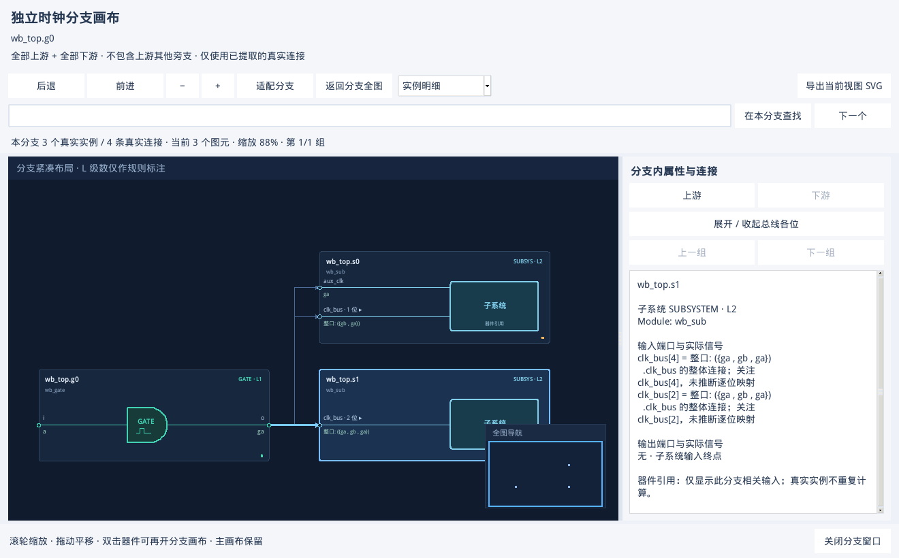

# 独立分支画布验收

日期：2026-11-10。双击时钟树或复位树中的真实器件，新开独立 Tk 窗口，只显示该器件全部上游边与全部下游边的并集。主画布保留；聚合框双击仍展开层次，子系统总线展开改由属性按钮操作。使用说明见 [手册 30.3](GUI_USER_MANUAL.zh-CN.md#branch-canvas)。

## 范围与数据

- MUX 保留全部已解析输入，上游器件的其他旁支排除；原有真实边 ID、端口、连接名和证据保留。子系统引用仅沿其输入，分支中其他子系统也仅显示相关输入。
- 环路、孤立器件、未连接输入和已有 trace 超时状态继续保留，不补画未知连线。
- 小结果在后台筛选；索引结果用 SQLite 前沿遍历，筛选 ID 和临时数据放盘，只复制当前分支的节点/边记录。NPI 证据仍从原始索引按需读取，没有展开/复制全设计路径，也不启动 Verdi。
- 窗口支持缩放平移、搜索、上下游跳转、后退/前进、总线展开、概览/分页和当前视图 SVG。各窗口独立，主图切换结果、关闭另一个分支窗口不影响已经打开的分支。
- 关闭窗口取消后台准备/布局，删除该窗口私有索引。临时窗口不进入启动恢复记录。

## 验证

| 项目 | 实测结果 |
| --- | --- |
| 新增数据回归 | 8 项：内存结果/SQLite 两种路径的旁支排除、MUX 全输入、子系统引用/未连接输入、环路/孤立节点/取消；后台结果清理；父快照关闭后证据仍可回查。 |
| 完整自动测试 | 最终 **254 passed、1 skipped，13.19 秒**；日志 `validation/branch-canvas-20261110-tests-final.log`。 |
| VM 原生 Tk | Python 3.6.8 / Tk 8.5.13，使用保存的 Verdi 2018 真实 NPI 时钟/复位结果；通过真实 Tk 双击事件打开窗口。两种模式各得到 3 实例 / 4 连线，子系统引用进一步得到 2 实例 / 2 连线，与源边 ID 集合一致。 |
| 主窗口与多窗口 | 打开分支前后主画布布局对象、视口和缩放不变；分支内搜索不返回分支外实例；导航、总线展开、连线摘要、SVG、关闭父窗口、切换主图结果、关闭主 GUI 后释放剩余分支窗口均通过。 |
| 8,195 实例实图 | 从已有真实 NPI 结果选择一个末端分支，得到 2 实例 / 1 连线，完整边集合核对通过；窗口准备与布局约 **0.43 秒**。这是结果浏览，未重跑 EDA 提取。 |
| 10 万节点 | 合成图 100,000 实例 / 99,999 连线完整进入分支索引；概览聚合成 2 个图元，约 **5.67 秒**；搜索最末实例、局部定位、返回分支全图及取消准备通过。2 个图元不是只保留 2 个实例。 |
| 反复开关 | 5 次开关局部分支后私有索引均删除，GUI RSS 均为 **80,496 KiB**；未出现持续增长。此为该固定样例结果，不代表所有商业设计的内存上限。 |
| 错误与截图 | 最终 0 Tk callback 错误，标准错误无 Tk 变量析构告警；实际截图检查通过。 |

初次 VM 检查发现已关闭窗口的 `StringVar` 被后台垃圾回收时触发 Tk 线程告警。已改为主线程释放窗口变量与回调，再复测窗口循环、取消及主窗口退出。Windows Conda 的一次重复全量测试在旧 Tcl 配置用例初始化时遇到 `init.tcl` 临时读取失败，失败发生在 `tkinter.Tcl()`；保留原日志，未删改该测试或修改系统 Tcl 设置。



## 复现与记录

原始数据位于共享目录 `validation/branch-canvas-20261110-release/`，日志为 `validation/branch-canvas-20261110-release.log`。本轮重新浏览旧 NPI 结果，不宣称重新跑过所有开源或商业 SoC 的提取。可分享的计数、耗时和环境见 [JSON 报告](BRANCH_CANVAS_VALIDATION.json)。

```bash
python3 scripts/check_branch_gui.py \
  --out validation/branch-canvas-check \
  --clock validation/workbench/subsystem-3/target/clocktree.json \
  --reset validation/workbench/subsystem-edges/reset-target/resettree.json \
  --large validation/resilience/scales/fanout/run/clocktree.json
```

需要图形显示环境；无桌面时可使用 Xvfb。`--clock` / `--reset` 为既有子系统样例结果，`--large` 可省略。上述耗时来自当前 VM，未作跨设备性能承诺。
