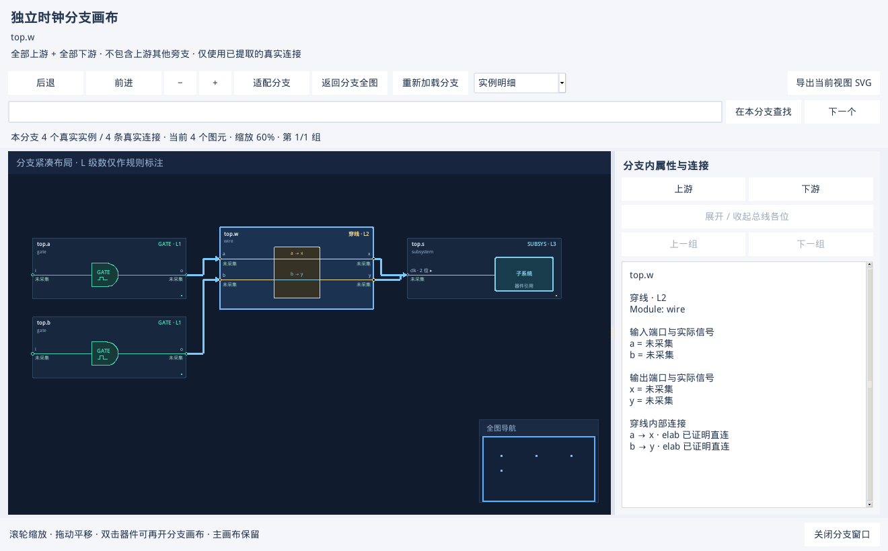
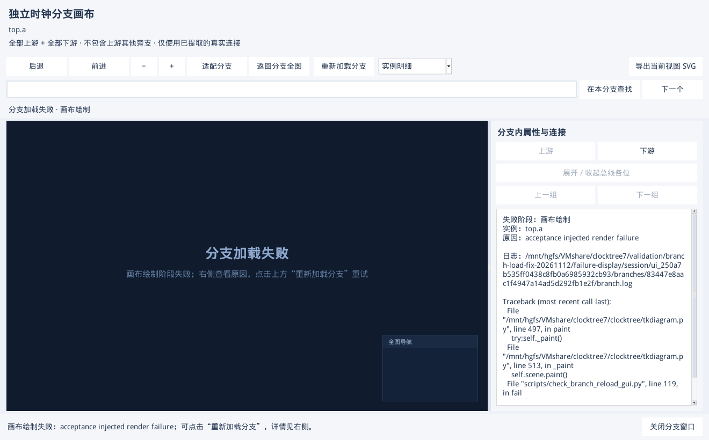

# 独立分支画布加载失败修复与验收

日期：2026-11-12。修改前基线：`fcadd8d`。操作说明见 [GUI 手册 3.11 的独立分支画布](GUI_USER_MANUAL.zh-CN.md#branch-canvas)。

## 问题与确认范围

用户反馈双击器件后新窗口为空、提示加载失败。本轮先检查保存的 Verdi 2018 提取结果：普通打开的 34 个器件在当前 VM 上没有出现该错误。进一步保留索引读取游标再构建含穿线器件的分支，在 Windows 和 VM 上均复现 `sqlite3.OperationalError: database table is locked`。失败位置是端口感知遍历清理临时队列表，旧实现复用了调用方的数据库连接。

修复后的同一 VM 对照用例得到完整、正确的两条分支边，调用方游标继续可用。这个可复现问题已经修复；由于没有用户现场的底层异常或结果库，不能断言它是现场空白窗口的唯一原因。因此同时补齐分支准备、模型加载、布局子进程和绘制异常的可见诊断与重试。

## 修改内容

- 含穿线器件的索引分支遍历使用独立只读连接。读取、临时队列和分支结果各自管理，成功、失败、取消均关闭工作连接，不关闭调用方游标。
- 清理端口遍历节点缓存，避免依赖垃圾回收才释放后台查询资源。原始连接 ID、分支端口范围、穿线独立通道和懒加载 NPI 证据保持原样。
- 分支窗口新增“重新加载分支”。它释放旧窗口快照和布局任务，再从最初的提取结果建立分支；不修改主画布、不启动 Verdi。
- 新窗口为空时显示明确的失败阶段。右侧给出实例、原始错误、日志路径和堆栈；鼠标悬停不会覆盖错误。异常发生在画布加载或异步绘制时也能进入可重试状态。
- 每个分支窗口保存独立 `branch.log`、`branch-events.jsonl` 和 `branch-status.json`。完整堆栈在事件文件中，关闭窗口保留日志并清理临时数据库。
- 清空画布时重置待执行的首次绘制标记，防止旧绘制回调读取已清空的模型。

## 已执行验收

VM 环境：Python **3.6.8**、Tk **8.5.13**、SQLite **3.7.17**；原生 Tk 使用 Xvfb，窗口尺寸 1840 × 1000。源代码在共享目录，分支私有数据库位于系统临时目录。

| 项目 | 实际结果 |
| --- | --- |
| 全量自动测试 | **371 passed，1 skipped，15.50 秒**；Windows 不执行的一项 Linux/Verdi 环境检查按原标记跳过。 |
| 锁冲突前后对照 | 同一 VM、同一合成索引、保留读取游标：旧版本报 `database table is locked`；新版本成功，边 ID 精确等于 `0、2`。 |
| 新增数据回归 | 覆盖活动游标隔离、后台不复用源连接、中途取消后私有文件清理、关闭父快照后穿线分支的原始证据仍可读。 |
| 原生双击与重载 | **42 组**：34 个既有真实 NPI 样例器件，加 8 组内存/只读索引合成样例。每组都通过 Tk 双击事件开窗，再点击重载；实例与边集合和源结果的分支一致。 |
| 器件与模式 | MUX、门控、OCC、DIV、SUBSYSTEM、穿线、RSY_SYNC；时钟树及复位树；包括 L1 虚拟输入、单器件分支、多输入和独立穿线通道。 |
| 四阶段故障注入 | 分支准备、画布模型加载、布局结果读取、画布绘制分别注入异常。全部显示具体错误、写入完整堆栈；移除故障后同窗口重试成功，主图位置与布局不变。 |
| 空白失败画布 | 另一次独立 GUI 启动等待绘制完成，逐一检查四种异常的中央失败说明、右侧详情和重试按钮；全部通过。截图中的异常文字是明确标识的人工注入。 |
| 资源与窗口寿命 | 连续 **20 轮**打开、重载、关闭，暂时禁用 Python 周期垃圾回收，文件句柄始终 **11 个**；每轮旧分支数据库都删除。GUI RSS **58,120～58,424 KiB**。 |
| 多窗口 | 子窗口在父分支关闭和主图切换结果后仍可重载、浏览证据、导出 SVG。取消准备及主 GUI 退出释放分支窗口通过。 |
| 8,195 实例实图 | 浏览已有 NPI 结果，末端分支为 **2 实例 / 1 连线**，边集合一致，打开约 **0.30 秒**。 |
| 100,000 节点 | 合成图完整分支 **100,000 实例 / 99,999 连线**，概览 2 个图元，打开约 **5.59 秒**；搜索末端、返回全分支、取消及反复开关通过。 |
| Tk 错误 | 正常回归及重试后均 **0 个未处理 callback 异常**。故障注入的错误按预期进入分支日志。 |

大图耗时只是该 VM 固定样例的实测，不作为所有商业芯片的性能保证。本轮复用已有的 Verdi 2018 NPI 提取结果检查显示与索引行为，没有重新运行商业芯片或所有开源 SoC 的 elab 提取。

## 操作效果

下图为合成穿线样例的正常分支窗口。输入通道关系是测试数据，截图不作为实际 RTL 提取证明。



下图为人工注入绘制异常后的实际 Tk 窗口：中央有失败提示，右侧有错误原因、实例和日志路径；消除该注入后已通过同窗口重试。



## 复跑与记录

```bash
xvfb-run -a -s "-screen 0 1840x1000x24 -noreset" \
  python3 scripts/check_branch_reload_gui.py \
  --out validation/branch-reload-check \
  --result validation/sv-branch-endpoints-20261112/native/tree/clocktree.json \
  --result validation/wire-20261111/matrix/clock-target/clocktree.json \
  --result validation/wire-20261111/matrix/reset-target/resettree.json
```

不提供 `--result` 时，脚本独立建立合成穿线/子系统图，检查内存和只读索引、原生双击、四阶段故障注入、重试、多窗口及资源清理，可在便携包独立目录执行，不依赖源仓库的结果目录。

共享目录下原始记录：

- `validation/branch-load-fix-20261112/cursor-reproduction.json`：锁冲突前后对照。
- `validation/branch-load-fix-20261112/final/acceptance.json`、`final.log`：42 组及 20 轮资源回归。
- `validation/branch-load-fix-20261112/failure-display/acceptance.json`：独立启动的失败画布可见性检查。
- `validation/branch-load-fix-20261112/large/acceptance.json`：已有分支功能及大图回归。
- `validation/branch-load-fix-20261112/pytest.log`：全量自动测试。

便携包使用 `scripts/build_portable.py` 生成，附带逐文件 SHA-256 清单。发布包在 VM 独立目录运行同一验收脚本，记录放在该包的 `qa/acceptance.json`，不将商业 RTL、KDB 或用户配置放入发布包。可分享的源码验收汇总见 [JSON](BRANCH_LOAD_FIX_VALIDATION_20261112.json)。
