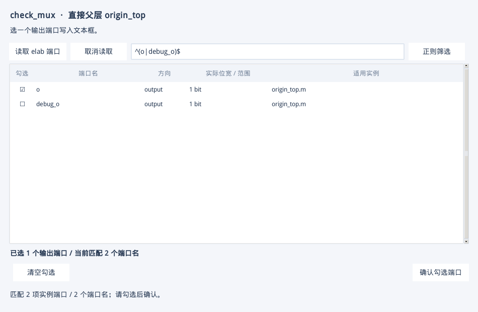
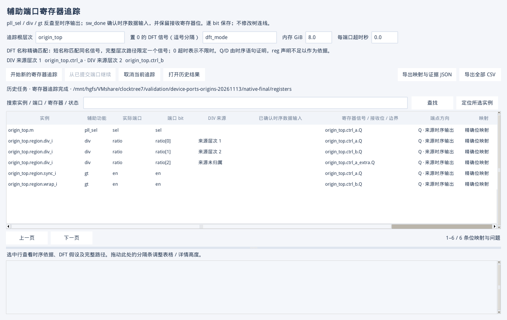

# 任意层起点、端口正则和 DIV 来源验收

2026-11-13 在共享目录的 ClockTree7 上验证。VM 使用 Python 3.6.8、Tk 8.5.13、SQLite 3.7.17、Verdi O-2018.09-SP2 和 VCS O-2018.09-1。操作入口见 [GUI 手册第 36 章](GUI_USER_MANUAL.zh-CN.md#device-ports-and-div-sources)。

| 验收项 | 实测结果 |
| --- | --- |
| 任意层时钟起点 | 实际 KDB 用例的 L1 没有器件规则。目标结构和全负载核验均得到 8 个实例、5 条相同连线，3 个根分别位于 L2、L2、L3。L2 MUX 经 `region.clk_in` 连接到 L3 的 OCC_ROOT。另一个直接来自 `region.raw_in` 的分支显示 L1 接口。 |
| SV 和复位 | 3 个真实分支末端生成 3 段代码。L2 MUX 使用带选择器模板并取 L2 的复位。两类门控按串接顺序绑定 `gt0` 和 `gt1`。SV 通过 VCS 编译和 elaboration。 |
| 原生 Tk 端口编辑 | 8 种时钟模型和 4 种复位模型使用真实 elab 端口。覆盖多选追加和去重、单输出切换、手工修改、MUX 输入顺序、辅助口筛选、输入和输出方向，以及多个实例的 `[3:2]`、`[4:2]` 参数化范围。 |
| 正则勾选回归 | 160 项检查通过。时钟和复位分别验证 10,000 个合成端口名、每个名两条不同位宽的实例记录，以及取消、重读、非法表达式、零匹配和实时计数。真实子系统端口预览来自 Verdi。 |
| DIV 来源 | 4 个辅助端口共 6 条已证明的时序映射。`ratio[0]` 追到 `origin_top.ctrl_a.Q`，归属 1。`ratio[1]` 追到 `origin_top.ctrl_b.Q`，归属 2。`ratio[2]` 追到 `origin_top.ctrl_a_extra.Q`，显示未归属。寄存器表、CSV、证据 JSON 和 SV 候选保留对应关系。 |
| 历史配置 | 两次独立启动恢复两条 DIV 来源路径及原有寄存器结果。切换时钟和复位工作区后，时钟配置可以恢复。旧 JSON 及磁盘索引上的原 L1 起点告警按新规则显示。 |
| 兼容回归 | L1 接口原用例的时钟、复位目标模式和全负载模式通过，未知表达式保留诊断。上一版结果通过真实 Tk 保存对话框生成 15 段 SV，并经 VCS elaboration 验证。 |
| 分支窗口 | 16 组双击、重载和精确边集合比对通过。四阶段故障注入后可重试，5 轮文件句柄数量稳定，Tk 未处理回调错误为 0。 |
| 完整自动测试 | 384 通过，1 项 Linux wrapper / symlink 检查在 Windows 按原标记跳过。 |

两条 DIV 来源路径按源寄存器所属的 RTL 层次分类。路径重叠时取更具体的子层次。标签也可应用到已有寄存器结果。跨多个寄存器的 DIV 向量仍需在 SV 候选中确认，真实位序保留在 `$var_div` 中。测试覆盖本报告的合成设计及仓库已有的真实提取用例。





共享目录的原始记录位于 `validation/device-ports-origins-20261113/`。主测试结果为 `native-final/acceptance.json`、`gui-complete/gui-write.json`、`gui-complete/gui-read.json`。兼容用例见 `legacy-l1-final/acceptance.json`、`legacy-sv/acceptance.json`、`input-selection/acceptance.json` 和 `branch-regression/acceptance.json`。

可用以下命令在具备 VCS、Verdi 和 Tk 的设备上复跑。`--out` 使用新目录。

```bash
python3 scripts/check_device_ports_origins.py --out validation/check-origins-native
xvfb-run -a -s "-screen 0 1840x1000x24 -noreset" \
  python3 scripts/check_device_ports_origins.py --phase gui-write \
  --out validation/check-origins-gui --native validation/check-origins-native
xvfb-run -a -s "-screen 0 1840x1000x24 -noreset" \
  python3 scripts/check_device_ports_origins.py --phase gui-read \
  --out validation/check-origins-gui --native validation/check-origins-native
```
