# ClockTree7 时钟树 / 复位树 GUI 操作手册

**文档版本：3.0 · 更新日期：2026-11-07 · 适用界面：Python Tkinter / ttk 原生桌面版**

本手册依据当前程序、虚拟机中的真实操作和 NPI 提取验收编写。界面截图来自实际 Tk 窗口。用户只需提供层次范围、module 定义名、器件类型及关注的输入/输出端口；实例枚举和实例间连接由工具解析 RTL elab 完成。默认两级，可添加任意数量的层级；支持选择器、门控、OCC 和 DIV 分频器。Verdi 自动定位，任务不设运行超时，同一目录可反复执行。

顶部 **WORKSPACE** 的分析功能可切换 **时钟树 / 复位树**。时钟树支持 MUX、门控、OCC、DIV、SUBSYSTEM；复位树支持 MUX、RSY_SYNC、SUBSYSTEM。SUBSYSTEM 为只有输入的子系统模型，必须在器件编辑期间从 elab 读取端口、筛选并确认。两种分析均默认两级，可自定义层数，分别保存配置草稿、结果和搜索历史。完整新操作见 [第 30 章](#workbench-v3)。

每次启动会自动加载上次的模式、主界面配置、选中层级与结果，两类工作区均可恢复。首次升级尚无自动记录时，会读取当前运行目录中最近可读取的历史结果；无历史时才使用两级空白规则。详见 [第 21 章](#auto-restore)。

**大规模设计默认选“目标结构提取（大设计推荐）”**，从全部关注输入反查驱动，不展开输出全部 load。需要检查普通寄存器负载时，另选“全负载核验”并新建提取。两种模式的证据与末端含义不同，见 [第 28 章](#target-extraction)。本手册旧截图和历史验收中关于 driver/load 双向证据、范围出口与普通负载统计的描述，适用于全负载核验模式。


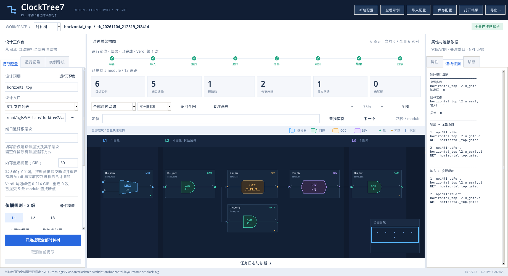

## 目录

1. [用途、术语与结果范围](#scope)
2. [运行准备与启动](#startup)
3. [第一次使用：浏览示例与重新提取](#quickstart)
4. [界面区域与全部主要按钮](#workspace)
5. [配置设计入口和运行环境](#design)
6. [配置自定义层级、范围与模块](#layers)
7. [选择器、门控、OCC、DIV 的填写与预览](#devices)
8. [运行、观察进度、取消任务](#extract)
9. [阅读完整时钟树架构图](#diagram)
10. [大规模设计：层次概览、展开与定位](#large-design)
11. [查看上下游、追踪路径与连接证据](#evidence)
12. [历史记录与实例导航](#history)
13. [保存配置与导出 JSON / SVG](#export)
14. [理解统计、状态和诊断](#diagnostics)
15. [完整两级配置示例](#config-example)
16. [常见操作场景](#scenarios)
17. [故障排查](#troubleshooting)
18. [鼠标操作、快捷键与交付核对](#shortcuts)
19. [目录结构与验证范围](#files)
20. [复位树分支：MUX、RSY_SYNC 与独立工作区](#reset-tree)
21. [启动自动恢复上次配置和结果](#auto-restore)
22. [迁移到其他 EDA 设备](#portable-deployment)
23. [限定实例查找与端口追踪范围](#bounded-tracing)
24. [大图内存优化、结果索引与分页](#disk-index)
25. [监测内存、自动重启 Verdi 并续跑](#memory-restart)
26. [运行阶段节点、日志与闪退定位](#runtime-stages)
27. [闪退后提示原因并从断点继续](#crash-recovery)
28. [大设计：目标结构提取与全负载核验](#target-extraction)
29. [端口 trace 超时与当前例化跳过](#port-trace-timeout)
30. [分支布局、快速导航、搜索历史、子系统与完整问题表](#workbench-v3)

<a id="scope"></a>
## 1. 用途、术语与结果范围

ClockTree7 从 RTL elaboration 数据库恢复所配置关注结构的完整静态时钟网络。一个输出的全部扇出、选择器全部关注输入、同层串接、跨层跳接以及多个独立网络均保留。

先区分以下四组概念：

| 概念 | 含义与例子 |
| --- | --- |
| module 定义名 / 实例路径 | `ct_mux` 是定义名；`fixture_top.l2.n0_mux` 是该定义的一次例化。规则填定义名，图中每个真实节点对应实例。 |
| 传播层 L1–LN / RTL 层次深度 | L1–LN 是用户给定的传播分组；N 为当前配置的层数，默认 2。层次范围是 `fixture_top.l2` 这样的真实路径。工具不按路径中的点数推断传播层。 |
| 根结构 / 外部时钟源 | 根结构没有来自其他已选结构的输入连线。多个根结构可能由同一外部源驱动，因此根数量可以与外部时钟源数量不同。 |
| 分支末端 / 物理时钟叶子 | 末端表示当前关注结构网络中没有下游目标结构。它可能继续连接寄存器、RAM 或范围边界，不表示已经完成物理 CTS 分析。 |

传播规则为：初始时钟进入 L1，后续连接满足“目标层号 ≥ 来源层号”。允许同层连接，允许 L2 直接到 L5，允许分支在任意已配置层结束。层数没有固定上限；产品名称 ClockTree7 不再表示只能配置七级。

选择器会使多个来源共享同一下游节点，所以结果可能是带汇合的有向网络。工具按实际例化保存共享节点，不把同一实例复制成多个节点。所有匹配实例均进入结果，孤立或异常实例也会留下并产生相应诊断。

工具执行静态连接分析；选择器保留各关注输入的可能连接。当前版本不计算选择控制条件下的时钟模式、不仿真门控/OCC 行为、不进行 STA 或毛刺签核。

<a id="startup"></a>
## 2. 运行准备与启动

### 2.1 哪台机器执行提取

| 使用方式 | 可执行的操作 | 所需环境 |
| --- | --- | --- |
| Windows GUI | 浏览已导出的架构图、编辑/保存规则、导出 JSON 和 SVG | Python 3.6+、Tkinter、中文字体 |
| Linux/虚拟机 GUI | 上述操作及调用本机 Verdi 进行真实提取 | Python 3.6+、Tkinter、可用的图形桌面、本机有效 Verdi 及相应许可 |
| Linux CLI | 在无图形会话下执行提取，随后到 GUI 打开结果 | Python 和有效 Verdi；无需桌面显示 |

GUI 中的 Verdi 路径始终指向**运行该 GUI 的机器**。Windows 打开的窗口不会自动通过 SSH 调用虚拟机 Verdi。

已验证的 VM 环境为 CentOS 7.9、Python 3.6.8、Tk 8.5.13、Verdi/VCS O-2018.09-SP2。Windows Tk 8.6.12 的启动和结果浏览也通过检查。推荐桌面分辨率至少 1280×760，1920×1080 或更大更便于看图。

### 2.2 共享目录

当前部署的对应路径为：

| 位置 | 工具目录 |
| --- | --- |
| Windows | `D:\VMshare\clocktree7` |
| 虚拟机 | `/mnt/hgfs/VMshare/clocktree7` |

二者是同一份共享文件。GUI 在虚拟机执行提取时，设计入口、RTL filelist、KDB 及规则中的路径应当是虚拟机可访问的 Linux 路径。

从 GitHub 克隆到其他目录后，下文所有命令先切换到实际仓库根目录；通过生成脚本重新建立本机路径配置。

迁移部署不依赖以上共享目录。目标设备的离线安装、环境自检及快捷方式生成见 [第 22 章](#portable-deployment) 和 [部署手册](PORTABILITY.zh-CN.md)。

### 2.3 在虚拟机启动

在虚拟机桌面双击 **ClockTree7** 快捷方式。也可在虚拟机桌面终端执行：

```bash
cd /mnt/hgfs/VMshare/clocktree7
bash launch.sh
```

`launch.sh` 默认启动原生 Tk GUI；直接入口为 `launch_gui.sh`。只通过 SSH 登录且没有图形显示会话时，建议先用 CLI 提取，再从虚拟机桌面打开 GUI。

### 2.4 在 Windows 启动

双击仓库根目录的 `launch_gui.cmd`。也可在已安装 Python/Tkinter 的环境中运行：

```powershell
cd D:\VMshare\clocktree7
python -m clocktree gui
```

没有本机 Verdi 时，仍可以完整浏览仓库随附的示例结果。点击真实提取前，请切换到具有 Verdi 的机器运行 GUI。

<a id="quickstart"></a>
## 3. 第一次使用：浏览示例与重新提取

### 3.1 三分钟浏览示例，无需 EDA 安装

1. 启动 GUI，程序会先恢复历史工作区；没有历史时显示 L1、L2 两级空白配置。点击顶栏 **查看示例**，打开随附两级四类器件记录样例；新建配置可随时回到两级空白规则。
2. 若当前没有显示样例，点击顶栏 **打开结果**，选择仓库中的 `examples/flexible_layers/clocktree.json`。
3. 顶部应显示下表中的统计值。
4. 查看 L1、L2 两列。蓝色梯形为选择器、青绿色 D 形为门控、琥珀色切角块为 OCC、紫色六边形为 DIV。
5. 点击 L1 的选择器，右侧查看输入 `a`、`b` 和输出 `o`；滚轮向上可放大。
6. 按 F5 恢复全图。切换“全部时钟网络”下拉框，观察两个网络；再切回全部。

| 指标 | 样例值 | 含义 |
| --- | ---: | --- |
| 目标实例 | 13 | 配置覆盖的全部结构例化 |
| 端口连线 | 11 | 真实输出口 → 输入口连接 |
| 根结构 | 2 | 没有已选上游结构的实例 |
| 分支末端 | 4 | L1 有一个、L2 有三个末端 |
| 独立网络 | 2 | 汇合后的两个连通网络 |
| 未解析 | 0 | 没有未解析断点 |

器件数量为选择器 2、门控 5、OCC 3、DIV 3。查看记录结果只是在显示之前的提取数据；它不会重新 elaboration，也不验证当前磁盘上的 RTL 是否已经变化。旧七级三类器件示例保留在 `examples/device_models/clocktree.json`，可通过 **打开结果** 浏览其 16 个实例、15 条连接，验证旧配置兼容。

### 3.2 通过 GUI 重新提取同一示例

在实际执行 Verdi 的机器上，先于仓库根目录生成本机绝对路径配置：

```bash
python3 scripts/make_flexible_fixture.py validation/fixtures/flexible --layers 2
```

然后全部在 GUI 中操作：

1. 点击 **导入配置**，打开生成的 `validation/fixtures/flexible/config.json`。
2. 核对“设计顶层”为 `flex_top`，“设计入口”为 **RTL 文件列表**。
3. 确认路径指向本机的 `validation/fixtures/flexible/rtl.f`。
4. Verdi 安装目录自动检测。可点击左侧 **运行环境** 查看当前命令和安装目录，再点击 **完成**，无需填写。
5. 点击 **开始提取全部时钟树**，等待任务结束。
6. 确认状态为 **全量连接已解析**，统计与上表一致。
7. 在 **运行记录** 中看到新增 `tk_日期_时间_编号` 记录，说明本次已生成独立的结果目录。

随附的 `config.template.json` 用于说明结构。执行提取请导入上面新生成的本机配置，避免模板中的相对路径或旧机器路径影响导入。

<a id="workspace"></a>
## 4. 界面区域与全部主要按钮

| 区域 | 内容 | 主要用途 |
| --- | --- | --- |
| 顶部深色栏 | 新建配置、查看示例、导入配置、保存配置、打开结果、导出… | 新建两级规则、打开四类器件示例和交付文件 |
| WORKSPACE 栏 | 时钟树/复位树切换、顶层、当前记录、状态标识 | 选择分析功能，判断当前显示哪次结果 |
| 左侧“提取配置” | 设计入口、运行环境、动态层按钮、添加/删除层级、规则表、任务按钮 | 填写与执行提取 |
| 左侧“运行记录” | 历史运行列表及状态 | 重新打开结果或日志 |
| 左侧“实例导航” | 实例路径列表、筛选、定位 | 根据名称浏览真实实例 |
| 中间统计卡片 | 实例、连线、根、末端、网络、未解析 | 查看全量结果概况 |
| 中间工具栏 | 网络、视图模式、返回全网、专注画布、缩放、全图、搜索 | 调整观察范围 |
| 中间深色画布 | 当前配置全部层级的器件与连线、右下全图导航 | 阅读时钟树架构 |
| 右侧属性区 | 属性、连线证据、诊断 | 核查具体结构与连接依据 |
| 画布下方日志区 | 任务日志与诊断 | 查看实时进度和错误 |
| 最底部状态栏 | 当前操作、完整路径、反馈 | 查看悬停提示及定位结果 |

分栏之间的竖线可以拖动，调整配置区、画布和属性区宽度。左侧配置内容超出高度时，使用其滚动条或鼠标滚轮；下方提取按钮保持可用。

**打开结果** 会加载该结果内保存的规则快照，替换当前表单内容。切换历史结果前，请先保存尚未交付的规则修改。

<a id="design"></a>
## 5. 配置设计入口和运行环境

### 5.1 设计顶层

“设计顶层”填 elab 库中的完整分析顶层名称，例如 `soc_top` 或 `fixture_top`。它决定导入和分析边界，必须与实际数据库相符。

### 5.2 入口一：已有 elab / KDB

1. 在“设计入口”下拉框选择 **已有 elab / KDB**。
2. 填写已成功生成的 `kdb.elab++` 目录，或点右侧 **…** 选择目录。
3. 核对数据库与当前 RTL、宏定义、参数和文件集一致。
4. 再填写各层规则并开始提取。

典型路径形态为 `/work/project/build/simv.daidir/kdb.elab++`。大型 SoC 建议使用已经成功编译的数据库。

### 5.3 入口二：RTL 文件列表

1. 选择 **RTL 文件列表**。
2. 填写 filelist 的 Linux 绝对路径，或点 **…** 选择 `.f`、`.fl`、`.lst` 文件。
3. 确保源文件顺序、宏定义、include 目录、依赖模块和分析顶层齐全。
4. 工具调用 Verdi 导入并建立 elaboration，再提取连接。

filelist 导入存在编译错误时，结果不能视为完整。优先修复文件集，或改用已验证的 KDB。

### 5.4 运行环境

工具从启动环境的 `PATH` 查找 `verdi` 命令，并解析命令路径及符号链接来找到对应的 NPI 安装目录。无需每次选择或填写 Verdi 路径。点击左侧 **运行环境** 可查看命令、安装根目录和 NPI 检测结果，点击 **重新检测** 再次检查。

当前 `verdi` 命令优先于旧配置中的 `design.verdi_home`，避免导入另一台机器的旧路径后无法运行。没有可用命令时，保留对有效 `VERDI_HOME` 或旧配置安装路径的兼容回退。若检测不到命令，请在已经能执行 `verdi` 的环境中启动 GUI。许可证环境由启动进程继承；当前 VM 的 `launch.sh` 会加载 `scripts/eda_env.sh`。

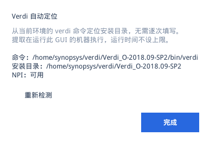

<a id="layers"></a>
## 6. 配置自定义层级、范围与模块

### 6.1 填写层次范围

新建配置默认显示 **L1** 和 **L2**；自动恢复时使用上次层数。点击 **+ 添加层级**，会在末尾增加一级并切换到该层，例如 L3、L4，直至所需层数；按钮自动分行，配置区可滚动。点击 **删除当前层** 会移除选中的层，后续层顺序重新编号；有模块规则的层会先提示确认，至少保留一级。点击顶栏 **新建配置** 回到两级空白规则。导入原有七级或其他层数配置时保留其全部层数。

点击对应的 **L1**、**L2** 等按钮切换。每层填写该层目标模块所在的 RTL 实例范围，例如：

```text
L1  fixture_top.l1
L2  fixture_top.l2
L3  fixture_top.l3
...
L7  fixture_top.l7
```

填写目标 module 例化的**直接父层路径**。只查该路径下直接例化的模块，不进入更深子层次，不把该路径本身作为候选。例如填写 `top.u_clk` 时会查 `top.u_clk.u_gate`，不会查 `top.u_clk.u_sub.u_gate`，也不会匹配同级 `top.u_clk_extra.u_gate`。需要子层或 generate 中的实例时，明确填写对应父层路径，如 `top.u_clk.u_sub`、`top.u_clk.g[0]`。实例数组成员如 `top.u_clk.u_gate[0]` 仍属于本层直接例化。实际所属传播层由配置决定。

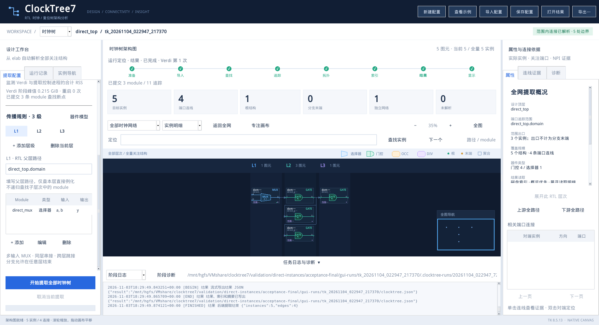

某层没有关注结构时，可以保留该层且不给它添加规则。JSON 中 `layers` 的 `index` 必须从 1 连续递增到 N，条目数量就是层数；不要求七层。层级和模块规则的结构性修改需要重新提取，当前已显示的旧图不会自动产生新连接。

### 6.2 添加模块规则

1. 选择目标层。
2. 点击 **+ 添加**。
3. 选择 **选择器 / 门控 / OCC / DIV 分频器**。
4. 填写 module **定义名**，例如 `ct_gate`，不要填成 `fixture_top.l2.n0_gate` 这样的实例路径。
5. 填关注输入口；多个输入以逗号分隔。
6. 填唯一关注输出口。
7. 查看预览，确认类型与端口数量，点击 **保存规则**。

同一 module 定义可以例化很多次。一条规则会枚举范围中全部匹配例化，用户无需逐个填写实例名。

### 6.3 编辑、删除与跨层填写

- 双击规则，或先选中后点 **编辑**，修改规则。
- 选中规则后点 **删除**，从当前层移除它。
- 切换层按钮会保留已经填写的范围与规则。
- 删除或修改结构性规则后，需要重新提取才能更新连接。
- 误删后可重新添加，或重新导入之前保存的配置；重新导入会替换当前规则表。

同一实际实例应归属唯一传播层。避免用相互重叠的范围把同一实例选入两个层；也应按一致粒度选取结构，避免同时把封装及其内部同一功能结构重复建模。

<a id="devices"></a>
## 7. 选择器、门控、OCC、DIV 的填写与预览

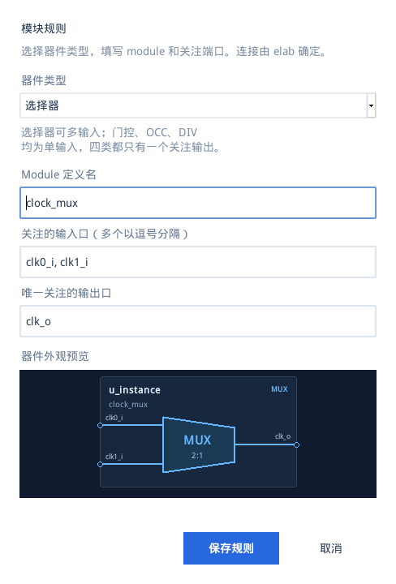

| 类型 | 输入要求 | 输出要求 | JSON `kind` | 图形 |
| --- | --- | --- | --- | --- |
| 选择器 | 一个或多个关注输入 | 唯一关注输出 | `mux` | 蓝色多输入梯形，标注 N:1 |
| 门控 | 恰好一个关注输入 | 唯一关注输出 | `gate` | 青绿色 D 形门控符号 |
| OCC | 恰好一个关注输入 | 唯一关注输出 | `occ` | 琥珀色切角控制块及脉冲图标 |
| DIV 分频器 | 恰好一个关注输入 | 唯一关注输出 | `div` | 紫色六边形，标注 DIV / ÷N |
| 子系统 SUBSYSTEM | 从 elab 读取并确认一个或多个 input | 无输出，字段省略 | `subsystem` | 青蓝色输入终点，可按分支显示器件引用 |

输入口填写实际 RTL 端口名，保持大小写正确。选择器如 `clk0_i, clk1_i`，门控/OCC/DIV 如 `clk_i`。规则弹窗支持中文逗号和英文逗号。DIV 的 ÷N 是器件类型标记，当前只恢复连接，不推断真实分频比、输出频率或时钟模式。

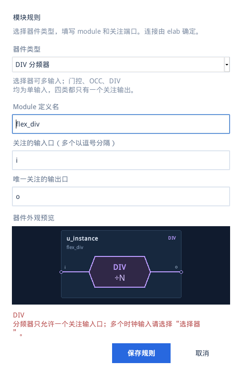

若真实模块还有 enable、select、scan、reset 等端口，只填写此次关注的时钟输入与输出。图形中的内部脉冲图标用于区分器件类别；实际连线来自 elab 中配置的端口。

MUX、门控、OCC、DIV 仍需把向量端口明确到单 bit，例如 `clk_i[0]`。SUBSYSTEM 可以确认整个一维总线口；主提取读取每个实例的实际范围后展开位。无法安全展开的多维接口会保留位宽诊断，不猜测展平后的连线。

### 7.1 保存校验

以下情况会阻止保存规则：

- 没有选择器件类型。
- module 或输入口为空；非 SUBSYSTEM 器件的输出口为空。
- SUBSYSTEM 尚未完成端口确认，或 module、直接父层、正则修改后未重新确认。
- 输入口重复，或同一端口同时作为输入和输出。
- 把多个关注输入填写为门控、OCC 或 DIV。

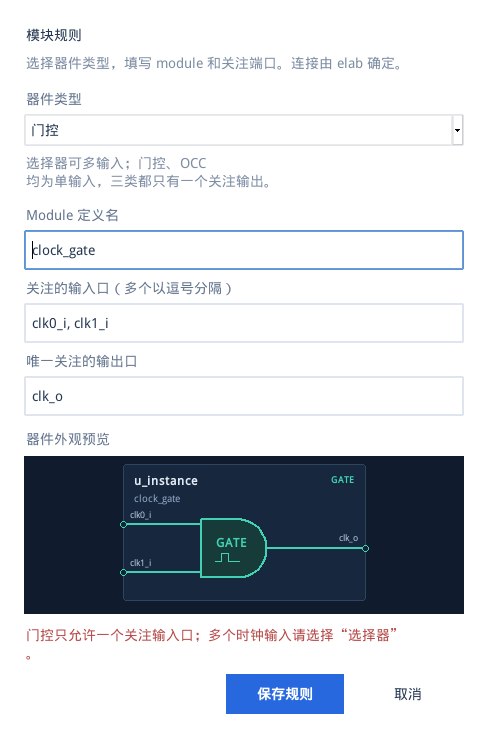

### 7.2 查看模型库

点击“传播规则”右侧的 **器件模型**，查看当前分析类型的全部器件。SUBSYSTEM 不显示输出引脚。

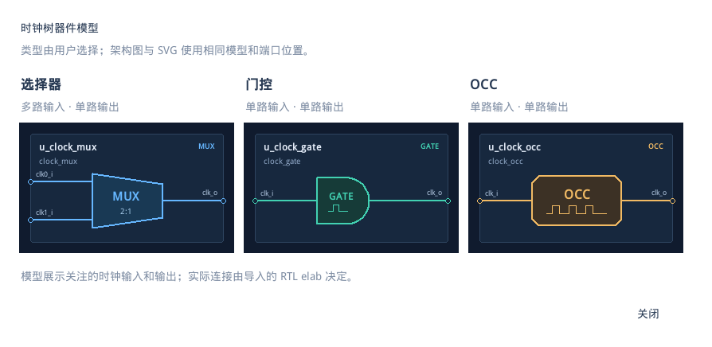

### 7.3 修改类型与历史未分类结果

旧规则未提供 `kind` 时，列表和属性显示“未分类”，画布使用中性模型。编辑该规则并明确选择类型即可补充。

只改变器件类型、且 module、层次范围和端口均未改变时，工具可以复用现有连接证据，立即更新对应实例的模型。修改后的类型可随配置和全量 JSON 导出；原运行目录不会自动被覆盖。

改变 module、端口或层次范围后，当前图仍代表上次提取。状态会提示规则修改，需重新提取后再以新图核查连接。

<a id="extract"></a>
## 8. 运行、观察进度、取消任务

### 8.1 启动真实提取

完成规则后，先点 **保存配置** 留下可复用规则，再点 **开始提取全部时钟树**。程序会检查配置和本机 Verdi，创建新的 `tk_...` 运行目录，然后启动独立提取进程。

**任务没有总运行超时，端口 trace 默认也不限时。** 如需跳过卡住的例化，可设置第 29 章的“端口 trace 超时（秒）”。旧 JSON 中的 `timeout_seconds` 不再生效，GUI 再次保存配置时会移除此旧字段；新端口阈值使用独立字段 `port_trace_timeout_s`。默认也不设 NPI 追踪步数上限；内部已访问对象集合用于避免重复追踪。

同一 GUI 可以连续点击运行，不限制次数，历史任务各自保留。CLI 的 `--out` 目录也可以反复使用；省略 `--out` 就使用当前目录。再次运行时，上次的规则、原始证据、结果和日志自动保存在 `.clocktree-history/时间_编号/`。本次 Verdi 使用 `.clocktree-runs/时间_编号/` 作为独立编译目录，避免旧编译日志污染新结果；目录根下始终为最近一次尝试的输出。失败尝试不会沿用旧的绿色结果。

任务使用启动时的配置快照。建议在任务期间查看已有架构图和日志，等任务结束后再继续编辑规则。

### 8.2 查看日志与进度

任务日志会自动展开。也可点画布下方 **任务日志与诊断** 收起或展开。

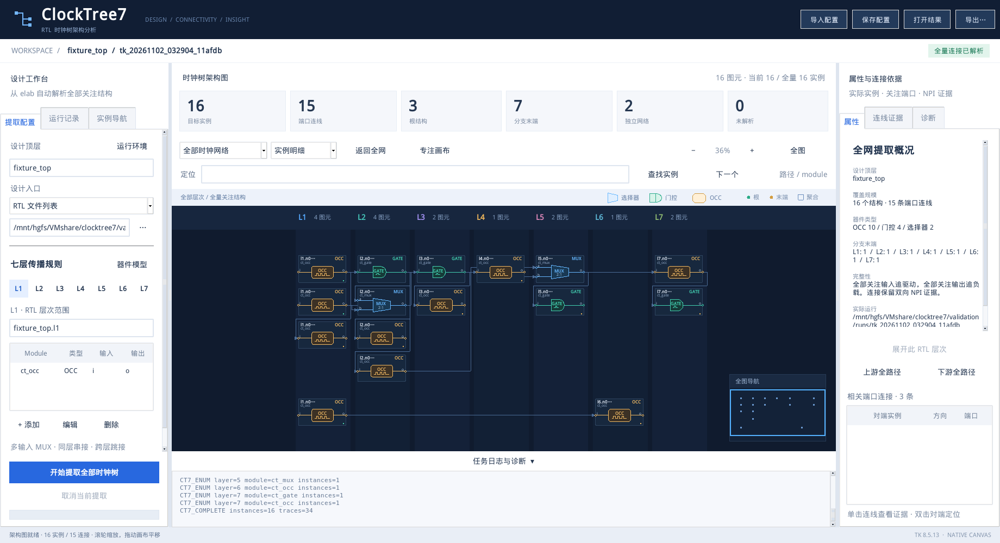

日志中通常依次出现设计导入、目标实例枚举、端口追踪和完成信息。较大任务会显示类似 `CT7_TRACE 100/13968` 的进度。小样例追踪口少于一次进度刷新批次时，可能直接从导入显示为完成。

提取时可以缩放、平移和查看已有图；新的结果在完成后加载。判断本次任务是否成功，应同时查看当前 WORKSPACE 记录名、完成状态及诊断。

### 8.3 取消与关闭

点击 **取消当前提取** 后，程序停止本次提取进程组，保留已经生成的运行目录、日志和原始证据。未完成数据不会自动作为完整结果交付。画布可能继续保留上一次已加载的图，请核对记录名。

关闭正在提取的 GUI 时，程序会先停止该 GUI 启动的任务，再退出。下次打开后可在提示中选择“从断点继续”，也可在运行记录中选择“诊断 / 从断点继续”。此操作沿用原任务配置；重新点击主提取按钮仍会创建新任务。

<a id="high-fanout"></a>
### 8.4 某个输出口的 load 很多、长时间停留在追踪阶段

本版将输出网络改为逐项读取连接，遇到重复网络或端口时在入队前去重，并释放已处理的临时 NPI 句柄。不按 load 数量截断。默认等待端口完整结束；用户启用端口超时后，允许跳过超时例化，但结果明确标为连接不完整，不作为完整提取通过。选择器、门控、OCC、DIV 以及复位树共用这一遍历实现；总线拼接、位选仍保留位对应关系。

运行节点下方会显示当前实例、端口、追踪编号，以及例如：

`已扫描 128 · 已处理 2 · 待处理 127 · 命中/边界 0 · 逐项读取连接`

- **已扫描**：本端口遍历时读取的连接项，包含中间网络与别名，不等于关注模块数，也不等于直接 load 总数。
- **已处理 / 待处理**：已出队对象数和当前队列长度。队列可能随分支发现而增加。
- **命中/边界**：已找到的关注端口、寄存器负载、范围边界等终点数。
- **操作阶段**：打开连接迭代器、逐项读取、穿过透明器件或反向查询驱动。反向查询继续使用原生 NPI 位对应算法，避免每个下游输入重复在 Tcl 中扫描整张高扇出网。

超过 5 秒没有新进度时，显示“距上次进度 N 秒（持续等待）”。这不是超时限制，也不代表已判定死锁。计数持续增加说明外层遍历正在推进；计数不变时可能是在等待一个 NPI 原生调用返回。日志记录的是最后上报的位置，不能据此断言 Verdi 内部的具体函数或根因。

点击 **追踪** 节点查看阶段日志，或点击 **阶段诊断**。日志中的 `context` 增加 `phase`、`api`、`object`、`scanned`、`processed`、`pending`、`duplicates` 和 `elapsed_ms`。`object` 是当时处理的网络/端口；`api` 是迭代或驱动查询入口。详细原始记录为任务工作目录 `attempt-XXXX/worker-events.jsonl`，路径可从阶段诊断中取得。常规进度按时间采样，避免为每一个 load 刷盘。

高扇出或耗时较长的端口一旦完整结束，会立即额外提交断点。若它尚未完成就中断，续跑会从最后已提交的完整端口重新开始；若它已经提交，续跑跳过该大端口。**当前不支持在同一个未完成端口的第 N 个 load 处跨进程续跑**，因为 NPI 句柄及迭代器不能跨 Verdi 进程使用。

限定追踪根仍然生效。尤其是 generate 根，若连线实际使用根之外声明的网络，工具在该出口标记范围边界；需要追踪那段连接时，应扩大“端口追踪根层次”到包含该网络的共同父层。不要用减小范围来掩盖确实需要恢复的分支。

升级后原结果仍可打开，新遍历需要重新提取才生效。未完成的旧版本任务受实现签名保护，不能直接用新引擎续跑；保留旧安装完成原任务，或用新版重新开始。VM 的 2018 版已验证至 8,194 路测试扇出，详见验证摘要；这不等于现场商业 KDB 的卡住问题已被复现或保证消除。

<a id="diagram"></a>
## 9. 阅读完整时钟树架构图

### 9.1 层、节点与连线

- L1–LN 是传播层级区域，N 为当前配置的层数，空层保留为空；同层串接时，一个层级区域可包含多列器件。
- 每个真实器件节点对应一个实际例化，显示实例短名、module 以及关注端口。
- 线条箭头方向为 **输出口 → 输入口**。
- 一个输出可分到多个下游输入，选择器可以有多条上游输入。
- 同层连线和跨层跳接按实际数据库显示。
- 末端可在任何层；不存在下游目标结构时保留其末端状态。

节点短名空间不足时会缩略。悬停可在最底部状态栏查看完整路径；点击后右侧“属性”显示完整路径。

### 9.2 标记

| 标记 | 含义 |
| --- | --- |
| 蓝色梯形 / 青绿 D 形 / 琥珀控制块 | 用户选择的器件类别 |
| 绿色小圆点 | 根结构；聚合框则表示内部包含根结构 |
| 金色小圆点 | 分支末端；聚合框则表示内部包含末端实例 |
| 红色小圆点 | 存在未解析输出 |
| 虚线聚合框 | 多个真实实例组成的 RTL 层次概览 |
| 高亮连线 | 当前实例相关连接或用户选择的追踪路径 |

聚合框内部可以同时包含末端和仍继续传播的器件，因此带末端圆点的聚合框也可能有对外连接。

### 9.3 查看全部独立网络

网络下拉框默认为 **全部时钟网络**。可以切到某一个网络，核查局部结构，再切回全部。切换网络只影响当前显示范围，完整数据保留。

多个根通过选择器汇合时，它们会属于同一个连通网络；多个根由同一外部时钟源驱动时，也会关联到同一个网络。不能把网络数量直接当作时钟源数量。

<a id="horizontal-layout"></a>
### 9.4 同层连接自动横向排列

打开已有结果或完成新的提取后，同一逻辑层内的串接器件会优先按 **输出 → 输入** 从左向右排列。无需新增配置或重新提取数据库。比如 L2 中的 `Gate → OCC → DIV` 会横向展开为三列，仍全部属于 L2；L3 自动移到右侧。标题中的“同层展开”表示该层包含多列器件，不表示增加了传播层级。

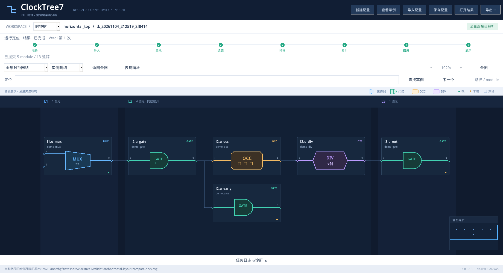

- 单链优先对齐输入/输出的高度，连线尽可能直接水平连接。
- 同一输出的并行分支在不重叠的行内展示，汇合节点位于其同层前驱右侧。独立网络继续分区排列。
- 跳过中间器件列的连线从网络上方绕行，避免穿过无关器件。自环、反馈环路仍显示；环内器件可保留在同一列，环后的串接继续横向展开。
- 同层链较长时，整图会变宽。点击 **专注画布** 增加阅读空间，使用滚轮放大、拖动平移、右下角全图导航，或按完整实例路径定位；点击 **全图** 恢复完整范围。
- 实例明细、层次概览、展开后的局部图和当前范围 SVG 共用该布局。聚合框中的内部器件需展开后才能看到；复位树的 MUX、RSY_SYNC 同样适用。

横向排列只调整图形位置和走线，不改变用户配置的层数、实际 RTL 路径、提取出的连线、端口及 NPI 证据。

<a id="port-signals"></a>
### 9.5 端口旁的实际例化连接信号

新版提取的每个实例，在所有关注输入和唯一关注输出旁显示两行文字：**上行为模块端口名，下行为该实例连接的信号或表达式**。例如 RTL 中 `gate u_gate(.i(source), .o(gated));` 对应输入侧 `i` / `source`，输出侧 `o` / `gated`。用户仍只填写 module 和端口名，连接名由工具自动取得。同一定义的不同实例分别采集，不会共用一个连接名。


1. 使用新版完成一次提取，或打开含有端口连接名的结果。随附的两级时钟、复位示例已更新。
2. 点 **专注画布** 或放大图形，查看端口名下方的绿色连接文字。长名称在图内省略显示。
3. 将鼠标移到端口或连接文字上，底部状态栏显示完整内容；点击器件，在右侧 **属性** 中下滚到 **输入口例化连接 / 输出口例化连接**，可查看和复制完整表达式及可用的完整信号路径。
4. 点击连线，**连线证据** 同时列出来源端、目标端各自的例化连接以及原有双向追踪证据。经过层次边界或别名时，两端的局部名称可能不同。
5. 导出 JSON 保存原始字段；SVG 中的端口文字带完整提示，缩略文本不丢失原名。历史自动恢复及断点续跑均保留字段。

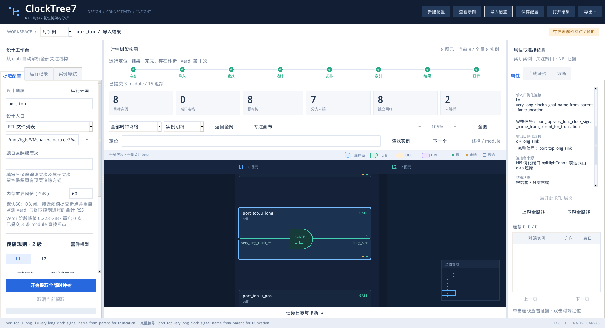

数据来自该实例语言模型端口的 `npiHighConn`，并用 NPI 还原连接表达式。例如 `.i(alias_clk)` 显示 `alias_clk`，不会沿 assign 追到源头后改名；`.i(clk_bus[3])` 显示位选，常量或组合表达式也会保留。表达式与 elab 等价，括号、空格和常量进制写法可能被 NPI 规范化，不保证逐字复制源代码。

| 显示 | 含义与操作 |
| --- | --- |
| `clk_bus[3]`、`alias_clk` 等 | 已取得该实例的实际高层连接 |
| 未连接 | NPI 确认该端口没有高层连接，例如 `.o()` |
| 未取得 | 本次数据库/接口未能返回连接；属性中保留可用原因，不猜测信号名 |
| 未采集 | 旧结果没有该信息；重新提取后补齐，仅重新打开不会生成缺失数据 |
| `整口: …` | 用户关注 `i[0]` 等向量端口的一位，但保存的是 `.i(...)` 的整体连接；属性明确说明，未把拼接/切片整体表达式误当作某一位的信号名 |

这项标注只覆盖用户配置的关注端口，复位树同样适用。聚合框代表多个实例，需展开后查看各自连接。标注不参与连通性判断；已有的未解析逻辑或诊断不会因为显示了名称而消失。提取实现升级后，旧中断任务仍受原有版本一致性校验约束，应使用原版本续跑，或用新版重新提取。

<a id="large-design"></a>
## 10. 大规模设计：层次概览、展开与定位

超过 400 个实例时，默认使用 **RTL 层次概览**。它按实际 RTL 路径、传播层和网络分组，避免把数千个器件一次铺成难以阅读的长图。

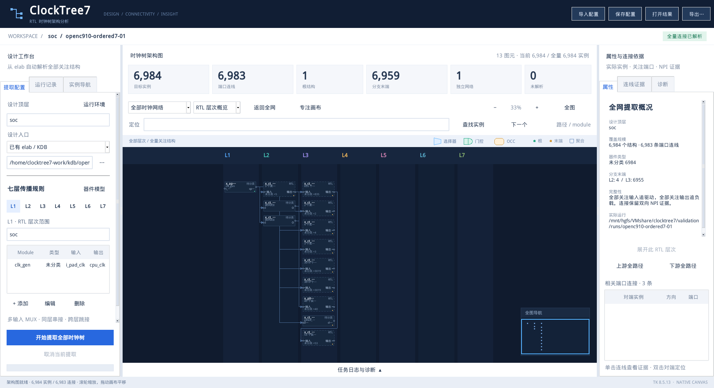

### 10.1 展开层次

1. 在视图下拉框选择 **RTL 层次概览**。
2. 单击虚线框，右侧查看实际实例数、类型分布、内部连接数和路径。
3. 双击虚线框，或点右侧 **展开此 RTL 层次**。
4. 顶部范围提示变为局部 RTL 路径；根据规模进一步聚合或显示实例。
5. 再次展开所需子层，直至看到实际器件。
6. 点 **返回全网** 回到整个设计的默认视图。

聚合图中的一条线可能代表多条真实端口连接。点击后可以逐条查看证据。统计卡片仍反映整个提取结果，工具栏另行显示“当前 / 全量”实例数量。

### 10.2 搜索定位

在“定位”输入框填写完整实例路径、部分路径或 module 名，点击 **查找实例** 或回车。搜索忽略大小写，完整路径精确命中优先。

点击 **下一个** 在匹配项间循环。定位会切换到实例明细并回到全量搜索范围，直接把目标放到可读位置；当前网络筛选和局部层次范围可能随之恢复为全部。

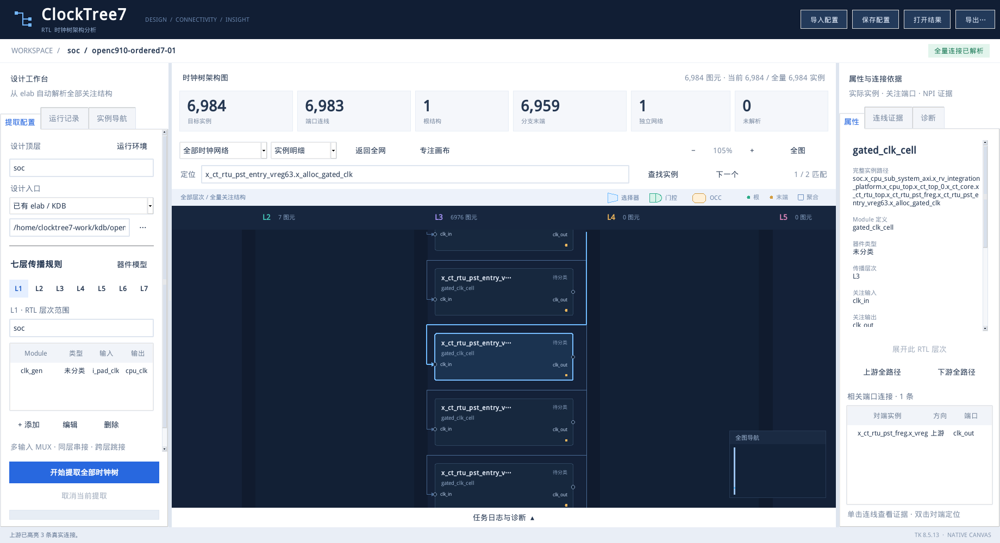

搜索不以实例导航列表的前 500 项为限。即使视口只看见少数器件，完整模型仍保存全部实例和边。

### 10.3 放大画布空间

点击 **专注画布**，收起侧栏及统计区域。点 **恢复面板** 返回正常工作台。

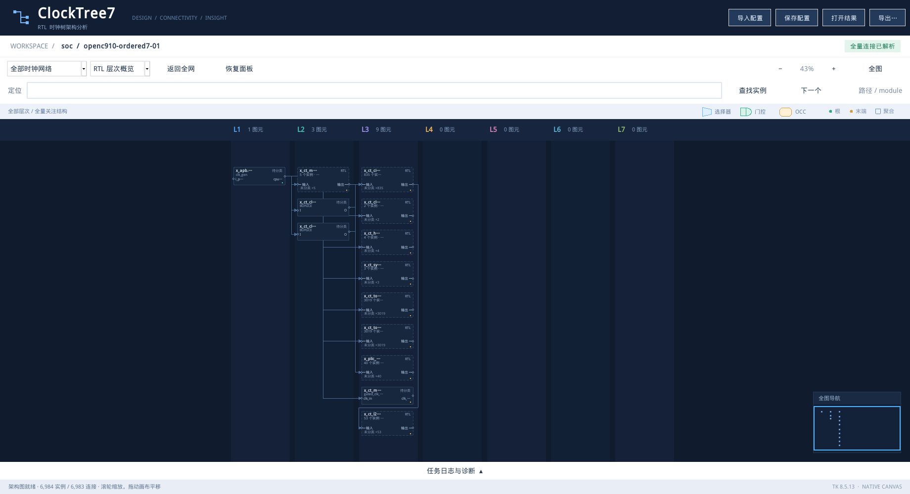

<a id="evidence"></a>
## 11. 查看上下游、追踪路径与连接证据

### 11.1 单击实例

右侧“属性”显示实际路径、module、器件类型、传播层、关注输入/输出、根或末端状态、边界数量和 RTL 来源。

下方“相关端口连接”列出实际对端实例、上下游方向和端口。单击某一连接条目会进入“连线证据”；双击条目可定位对端实例。

### 11.2 跳转上下游与高亮整个分支

1. 先在明细中选择一个真实实例。
2. **上游 (N)**、**下游 (N)** 按钮用于定位邻接器件；N 为器件数。只有一个对端时直接跳转，多个对端时打开可搜索、分页的端口连接列表。
3. 点击 **高亮整个分支**，显示全部上游边与全部下游边的并集，不带入上游其他旁支。MUX 的全部已解析输入路径均保留。
4. 使用 **适配高亮范围** 调整视口，使用 **清除高亮** 退出高亮。定位、分页及切换概览不会清除已经选定的分支。

选择聚合框时，应先展开到真实实例再使用路径追踪。路径高亮改变观察状态，保持原始连接数据。

### 11.3 单击连线并核查 NPI 证据

点击画布连线后，“连线证据”页显示：

1. 来源实例和具体输出口。
2. 目标实例和具体输入口。
3. 两个实例的传播层差。
4. 输入反查证明、双向核验或缺失方向的明确结论。目标模式会写明未执行输出全负载核验。
5. 勾选 **展开原始证据** 后，才读取完整的 driver/load NPI 路径、对象类型与网络名。

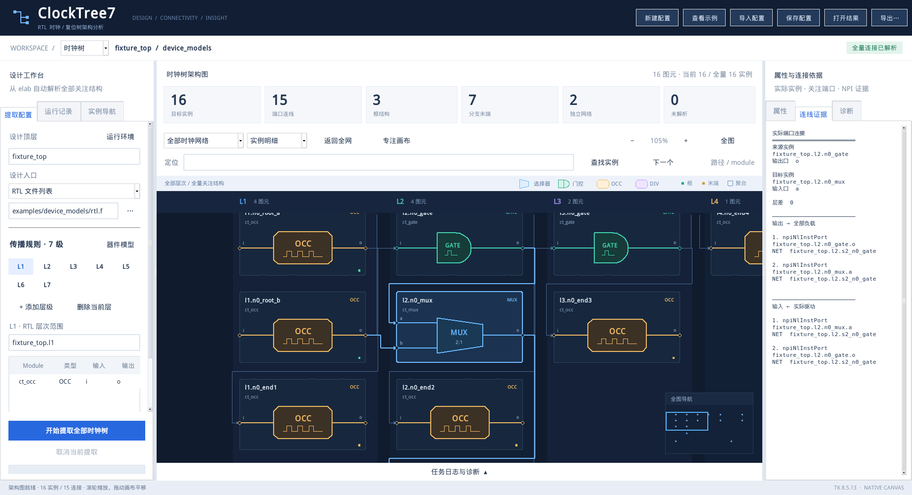

一段公共干线或聚合连线可能对应多条真实连接。先看相关连接总数，再在列表中选择要核对的具体端口边。仅看当前线段的第一条证据，不能代替检查其全部成员。

设计顶层 I/O、未选中的端口和寄存器/RAM 负载会作为边界记录。外部源详情可从导出的 `clock_sources`、`boundaries` 以及原始 `raw.jsonl` 核查。

<a id="history"></a>
## 12. 历史记录与实例导航

### 12.1 运行记录

切换左侧 **运行记录**，查看运行名称、实例数和状态。双击记录或点 **打开所选运行** 加载结果；点 **刷新记录** 重新扫描。

每次 GUI 提取创建独立目录。完整记录可以重新读图；取消或失败记录若没有结果文件，可以查看已有日志。运行记录目录可通过启动参数指定：

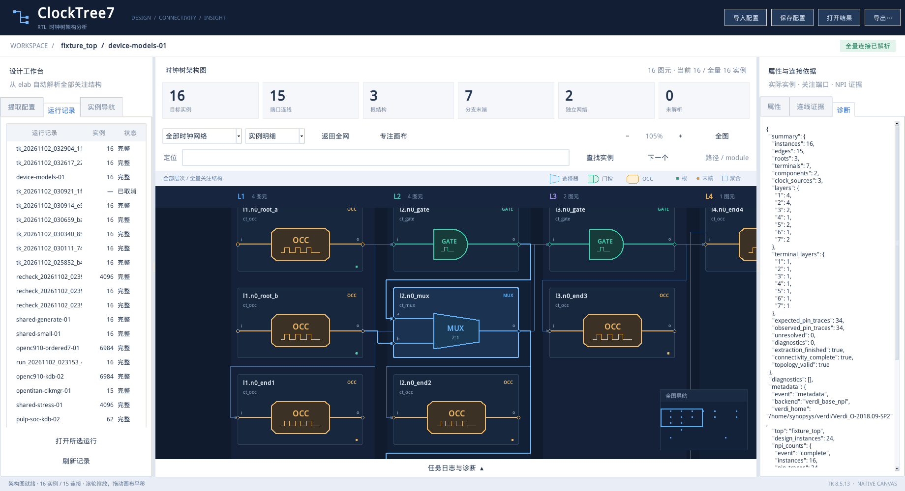

```bash
python3 -m clocktree gui --runs /work/my_clock_runs
```

删除磁盘上的记录会影响以后重新打开结果。GUI 当前没有历史记录删除按钮。

### 12.2 实例导航

切换 **实例导航**，在输入框中填写筛选关键字并点 **筛选**。双击某行或点 **定位所选实例** 即可跳转。

列表最多显示前 500 个匹配项，并注明“显示数量 / 匹配总数”。要找后面的目标，请细化关键字，或使用中间工具栏的全量搜索。

<a id="export"></a>
## 13. 保存配置与导出 JSON / SVG

| 操作 | 入口 | 保存内容 | 后续用途 |
| --- | --- | --- | --- |
| 保存配置 | 顶栏“保存配置”或导出菜单 | 设计入口、自定义层级范围、module、类型、关注端口 | 下次提取、与同事复用规则 |
| 导出全量 JSON | “导出…”→“导出全部结构与连线 JSON” | 全部实例、类型、边、证据、边界、来源、诊断、统计及规则快照 | 再次打开图、程序分析、结果归档 |
| 导出架构 SVG | “导出…”→“导出当前范围架构图 SVG” | 当前范围、当前聚合/明细模式中的全部图元 | 报告插图、评审、缩放查看 |

### 13.1 配置文件

保存配置会先执行有效性校验。空白草稿尚未填写顶层、入口或任何模块规则时，无法保存为可执行配置；先补齐这些字段。

配置 JSON 包含机器路径。在其他机器复用时，重新核对 KDB/filelist；Verdi 由该机器上的命令自动定位。

### 13.2 全量 JSON

即使正在看单个网络、局部层次或只定位了一个节点，全量 JSON 仍导出整个已加载结果。该文件可通过 **打开结果** 重新载入。

导出后建议核对 `summary.instances`、`summary.edges`、`summary.connectivity_complete`、`summary.topology_valid`。器件类型同时保留在规则及实例元数据中；界面补充类型的记录保存在 presentation 元数据内。

### 13.3 SVG

SVG 导出的是**当前范围的全部图元**，包括屏幕外的图元；它不是当前像素视口的截图。聚合模式会导出聚合框，明细模式会导出实际器件。Tk 与 SVG 共用模型和端口锚点。

大型明细图可能很长。评审时可先导出全网概览，再下钻重要层次导出局部明细；同时保留全量 JSON。

### 13.4 推荐归档方式

每次正式提取至少归档：规则 `config.json`、结果 `clocktree.json`、`summary.json`、`raw.jsonl`、Verdi 日志，以及评审使用的 SVG。配置保存和结果导出分别执行，单独保存配置不会保存分析结果。

<a id="diagnostics"></a>
## 14. 理解统计、状态和诊断

### 14.1 状态颜色

| 界面状态 | 解读 | 建议 |
| --- | --- | --- |
| 全量连接已解析，绿色 | 关注连接完整且结构约束通过 | 查看完整统计，再进行评审与导出 |
| 连接完整 · 结构存在异常 | 连接有证据，但可能存在逆序、环路或多驱动等 | 打开“诊断”核对异常 |
| 存在未解析断点 / 诊断 | 端口、模块、追踪或导入等存在缺口 | 根据诊断和日志补齐后重跑 |
| 规则已修改 · 待重新提取 | 表单与当前已加载连接结果可能不同 | 保存规则并重新提取 |
| 正在导入 / 正在追踪 | 新任务尚在执行 | 查看日志和进度 |
| 提取已取消 / 操作失败 | 本次任务未成功交付完整新结果 | 核对当前显示是否仍为旧记录 |

“未解析 = 0”本身不能证明全部有效：仍要检查诊断数量、模块匹配、双向证据及结构异常。

### 14.2 右侧“诊断”页

该页显示 `summary`、`diagnostics` 和 `metadata`。常用字段：

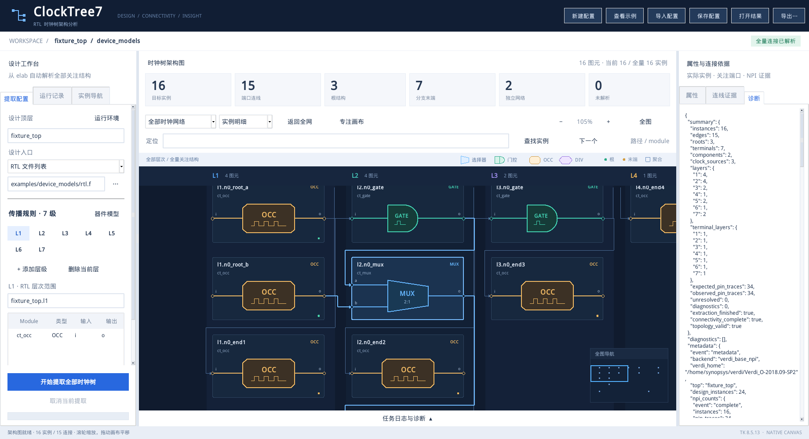

| 字段 | 含义 |
| --- | --- |
| `expected_pin_traces` / `observed_pin_traces` | 配置要求的关注端口追踪数 / 实际观测追踪数 |
| `connectivity_complete` | 全部关注连接是否具备完整证据 |
| `topology_valid` | 层次方向、无环、单驱动等结构约束是否通过 |
| `terminal_layers` | 各层实际末端数量 |
| `clock_sources` | 边界时钟源数量 |
| `design_instances` | 已导入设计的总实例数，可能大于目标结构数 |
| `compiler_error_count` | 导入编译错误数量 |
| `elapsed_seconds` | 提取耗时 |

### 14.3 常见诊断代码

| 代码 | 代表问题 | 首先核对 |
| --- | --- | --- |
| `missing_module` | 范围内没有匹配定义的实例 | module 大小写、层次路径、参数/宏和当前数据库 |
| `missing_pin` | 关注端口不存在或未找到 | 端口声明名、bit 选择及模块版本 |
| `width_requires_bit` | 关注端口宽度超过一个 bit | 改用明确的 `port[bit]` |
| `pin_validation` | 端口方向不符合输入/输出配置 | 是否填反或填写了内部信号 |
| `layer_conflict` | 同一实例匹配到不同层 | 各层范围是否重叠 |
| `root_outside_L1` | 没有已选上游的结构位于 L2–LN | 是否漏配上游、是否分层错误 |
| `reverse_layer` | 连线由较大层号流向较小层号 | 层号定义与实际 RTL 连接 |
| `multiple_drivers` | 一个关注输入出现多个已选驱动 | 多驱动或建模范围 |
| `cycle_or_cycle_downstream` | 环路或受环路影响的节点 | 同层反馈、配置重复、RTL 网络 |
| `trace_mismatch` | 驱动/负载两个方向证据不一致 | 数据库、结构边界及原始追踪 |
| `unknown_cell` / `trace_limit` | 存在未知逻辑或追踪达到限制 | 中间结构是否需加入规则、原始路径与步数 |
| `elaboration_error` / `fatal` | 设计导入或提取中止 | `verdi.log` 和 `.clocktree-runs/本次编号/verdiLog/compiler.log` |

<a id="config-example"></a>
## 15. 完整两级配置示例

以下示例用于理解 JSON 字段。替换设计路径后才可用于自己的项目；同名模块和端口必须确实存在于导入的 elab 中。

```json
{
  "design": {
    "top": "soc_top",
    "elab": "/work/soc/build/simv.daidir/kdb.elab++"
  },
  "layers": [
    {"index": 1, "hierarchy": "soc_top.u_clock_source", "modules": [
      {"module": "clock_mux", "kind": "mux", "clock_inputs": ["clk0_i", "clk1_i"], "clock_output": "clk_o"}
    ]},
    {"index": 2, "hierarchy": "soc_top.u_clock_control", "modules": [
      {"module": "clock_gate", "kind": "gate", "clock_inputs": ["clk_i"], "clock_output": "clk_o"},
      {"module": "clock_occ", "kind": "occ", "clock_inputs": ["clk_i"], "clock_output": "clk_o"},
      {"module": "clock_div", "kind": "div", "clock_inputs": ["clk_i"], "clock_output": "clk_o"}
    ]}
  ]
}
```

`design.filelist` 可以代替 `design.elab`；界面选择哪一种入口，就保存对应字段。列表 `clock_inputs` 内每个元素是一个关注端口；`clock_output` 是单个字符串。

示例没有提供任何实例连线。同层串接、扇出、汇合和末端由实际 elab 决定。需要更多级时，继续添加 `index: 3`、`index: 4` 等条目，或者在 GUI 点击 **添加层级**。原有七级配置可直接导入。

生成两级四类器件验证配置：

```bash
python3 scripts/make_flexible_fixture.py validation/fixtures/flexible --layers 2
```

将 `--layers 2` 改为 `--layers 10` 可生成十级示例。两种配置均已在 VM 完成实际 NPI 提取和全集 golden 核对。

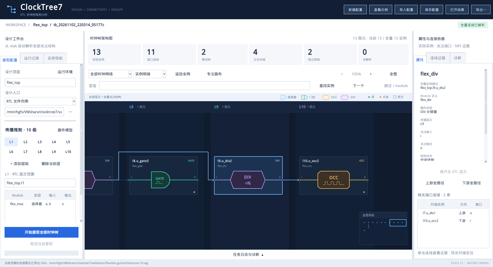

<a id="scenarios"></a>
## 16. 常见操作场景

### 场景 A：检查选择器是否汇入了两个正确来源

搜索并定位选择器 → 核对两个关注输入名 → 在相关连接中分别选择两个上游 → 在证据页检查来源实例/输出口与各自目标输入口 → 查看双向路径 → 导出完整 JSON 留证。

### 场景 B：检查一个门控后的全部扇出

定位门控 → 查看相关连接总数 → 点 **下游全路径** → 适应全图 → 核查各层分支和任意层末端。存在共享下游时，按同一真实节点核对。

### 场景 C：检查分支为什么在 L2 结束

定位末端 → 确认它没有已选下游且没有未解析输出标记 → 查看诊断 → 从结果 JSON 的边界或原始追踪确认后续是范围边界/普通负载，还是需要补充配置的结构。合法提前结束无需添加虚构中间层。

### 场景 D：给旧结果补上四类外观

打开旧结果 → 选对应层 → 编辑规则 → 选择类型且保持原 module/端口/范围 → 保存规则 → 检查实例模型立即更新 → 导出新配置及全量 JSON。若改动了端口或层次，则重新提取。

### 场景 E：把结果交给没有 EDA 工具的同事

导出全量 JSON、全网概览 SVG 和重点局部 SVG → 同事安装 Python/Tkinter 后启动 GUI → 通过 **打开结果** 载入 JSON，即可浏览、定位和看证据。对方无需运行 Verdi 即可读取已有结果；重新提取需要 EDA 环境和对应数据库。

<a id="troubleshooting"></a>
## 17. 故障排查

| 现象 | 排查与处理 |
| --- | --- |
| Windows 双击后窗口立即消失 | 在已安装 Python 的环境中运行 `python -m clocktree gui` 查看错误；核对当前目录和 Tkinter 安装。 |
| 提示没有 display / 无法连接显示 | 从虚拟机图形桌面终端启动；无图形 SSH 会话先用 CLI 提取。 |
| 中文字体不完整 | 使用支持中文的系统字体；当前 VM 已验证 WenQuanYi Micro Hei，Windows 已验证 Microsoft YaHei UI。 |
| 提示未找到 Verdi | 在已能运行 `verdi` 的环境中启动工具；检查 PATH，在“运行环境”查看自动检测结果。 |
| Verdi 许可不可用 | 核对启动环境及本机许可配置，读取 Verdi 日志中的实际功能/连接错误。 |
| filelist 导入报错 | 检查源文件存在、宏、include、依赖包和顶层；先修复编译，或导入已成功建立的 KDB。 |
| KDB 导入失败 | 核对目录、生成工具/配置与本机 Verdi；根据导入日志确认兼容性和完整性。 |
| 有效设计却找不到 module | 核对填的是定义名、范围和大小写，检查实例是否在当前参数/宏配置中生成。 |
| 有图但连线断开 | 打开诊断；查看未知结构、缺失端口、位宽及原始证据，补齐规则后重提取。 |
| 切换层后以为规则丢失 | 每层有独立规则表；切回原层查看。再次导入配置或打开结果会替换当前表单。 |
| 点保存配置失败 | 配置需要合法顶层、入口、至少一条规则、至少一级以及从 1 连续编号的层条目；按提示补齐。 |
| 图很小或很长 | 用层次概览、搜索定位、专注画布及缩放；全图比例受设计规模影响。 |
| 实例导航只看到 500 项 | 这是列表显示上限；缩小筛选范围或使用中间全量搜索。 |
| 根在 L3 被标异常 | 可能漏了 L1 上游结构或层次划分不一致；保留该节点并核查实际驱动。 |
| 取消后仍看到完整图 | 通常是上一次已加载结果。核对 WORKSPACE 名称、本次记录状态及完成时间。 |
| SVG 与当前屏幕取景不相同 | SVG 输出当前范围全部图元；屏幕是可缩放/平移的视口。 |
| 从 GitHub 克隆后没有原来的 SoC 运行记录 | 大型本地验证数据不随源码发布；先打开随附示例，或准备自己的 KDB/RTL 后提取。 |

遇到缺口时，推荐先确认设计导入成功，再核对范围和规则，最后检查逐端口证据。准备问题记录时保留当前配置、summary、相关诊断和日志片段，避免只截取一条局部分支作结论。

<a id="shortcuts"></a>
## 18. 鼠标操作、快捷键与交付核对

### 18.1 操作速查

| 操作 | 效果 |
| --- | --- |
| 滚轮 | 围绕指针缩放画布 |
| 按住左键或中键拖动 | 平移画布 |
| 单击实例 | 属性及相邻连接高亮 |
| 双击真实实例 | 定位并放大到该实例 |
| 双击聚合框 | 展开对应 RTL 层次 |
| 单击连线 | 查看对应实际连接及证据 |
| 单击右下全图导航 | 移动当前观察位置 |
| 回车（搜索框） | 查找实例 |
| Ctrl+O | 导入配置 |
| Ctrl+S | 保存配置 |
| Ctrl+L | 打开结果 |
| Ctrl+加号 / Ctrl+减号 | 缩放 |
| F5 | 适应全图 |
| 弹窗 Esc | 关闭规则弹窗 |

### 18.2 正式交付前核对

1. 当前 WORKSPACE 确实是本次设计和记录。
2. KDB/RTL、顶层、各层范围与规则快照一致。
3. 当前模式的类型和关注端口填写正确；没有重复选入同一实际实例。
4. 当前显示为全量范围，或清楚标明局部视图范围。
5. 检查 `connectivity_complete`、`topology_valid` 和诊断，逐项解释缺口。
6. 核对全部根、网络、扇出、汇合及每层实际末端。
7. 保存配置、全量 JSON、原始证据及所需 SVG。

<a id="files"></a>
## 19. 目录结构与验证范围

```text
clocktree7/
├─ launch.sh / launch_gui.sh      Linux GUI 启动
├─ launch_gui.cmd                Windows GUI 启动
├─ clocktree/                    GUI、模型、图分析及提取入口
├─ npi/extract.tcl               基本 NPI 采集脚本
├─ examples/device_models/       可直接浏览的记录样例、RTL 与 golden
├─ docs/GUI_USER_MANUAL.zh-CN.md  本手册
├─ docs/images/                  手册实际界面截图
├─ scripts/                      样例生成与验证脚本
├─ tests/                        自动检查
└─ validation/                   本机生成的提取和验证数据
```

GUI 默认把新任务放到 `validation/runs`；完整任务目录包括 `config.json`、`rules.tcl`、`raw.jsonl`、结果 JSON、`summary.json`、`verdi.log`、`cli.log`、`gui-job.json`。时钟结果为 `clocktree.json`，复位结果为 `resettree.json`。Verdi 编译日志保留在 `.clocktree-runs/本次编号/verdiLog/`；路径也记录在结果的 `metadata.working_directory`。重用输出目录时，旧证据位于 `.clocktree-history/`。失败或取消任务可能只有其中一部分。

源码仓库包含工具、手册、截图和小型可浏览示例。本地大型 SoC 源码、编译/elab 库、第三方工具、许可证及临时运行数据不属于源码包；当前共享目录的这些文件仍在原处保留。

已验证两级/十级四类器件全集、20 级增删控件、自动定位、同目录重跑与失败恢复，并兼容原有七级数据。此前完成七层全网样例、generate 路径、4096 实例压力样例、PULP SoC 和 OpenC910 的配置关注网络。OpenTitan 通过的是 `clkmgr` 子系统，整芯片受到当前旧版编译器兼容问题阻挡。精确计数、验证方式及边界见 [验证摘要](VALIDATION.zh-CN.md)。

查看 [项目入口与快速启动](../README.md) 或 [随附示例说明](../examples/device_models/README.md)。

<a id="reset-tree"></a>
## 20. 复位树分支：MUX、RSY_SYNC 与独立工作区

### 20.1 进入复位树模式

1. 启动 GUI，在顶部 **WORKSPACE** 右侧下拉框选择 **复位树**。
2. 首次进入显示 L1、L2 两级空白配置，标题为 **复位树架构图**，按钮为 **开始提取全部复位树**。
3. 填写设计顶层和 KDB/RTL filelist。Verdi 自动定位，执行提取的仍是运行 GUI 的本机。
4. 使用 **+ 添加层级** 增加 L3、L4 等，使用 **删除当前层** 删除并重新编号。层数没有固定上限。
5. 为各层填写 RTL 实例范围与模块规则，然后开始提取。

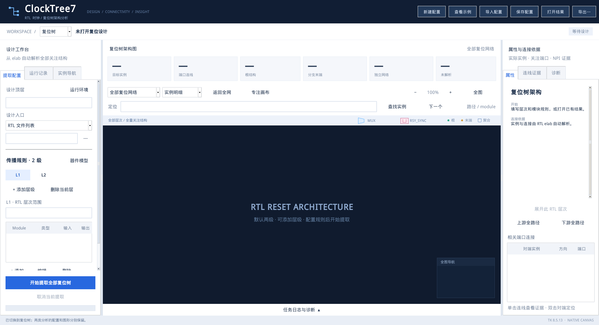

两种分析分别保存草稿和图形。切回时钟树后会恢复其配置和结果，再返回复位树也会恢复复位工作区；关闭后重新启动也会自动恢复。运行或加载结果期间禁止切换分析类型。自动记录用于继续工作；需要工程定稿或共享时，仍可手动保存配置、导出结果。

导入含 `tree_type: "reset"` 的配置，或打开复位结果时，会自动切到复位模式。旧配置没有 `tree_type` 时仍按时钟树处理。直接导入配置或结果会替换该模式的当前表单，尚未保存的修改应先保存。

### 20.2 类型与关注端口

| 类型 | 关注输入 | 关注输出 | JSON `kind` | 器件外观 |
| --- | --- | --- | --- | --- |
| MUX | 一个或多个复位输入 | 唯一一个复位输出 | `mux` | 蓝色梯形，标注 N:1 |
| RSY_SYNC | 恰好一个复位输入 | 唯一一个复位输出 | `rsy_sync` | 粉色同步器方块，含同步级示意 |
| SUBSYSTEM | 一个或多个已确认复位 input | 无输出 | `subsystem` | 输入终点及分支引用 |

点击当前层 **+ 添加**，类型下拉框可选择 **MUX**、**RSY_SYNC** 或 **子系统 SUBSYSTEM**。模块名填写实际 RTL 的 module 定义名，不要求名称与器件类型相同。

RSY_SYNC 只填写关注的复位输入和输出；同步时钟口、测试使能等不应混入关注复位输入。工具按用户配置追踪实际连线，不按端口名字猜测信号功能。输出、输入名保持实际 RTL 大小写，且不能重复。总线应显式选择单个位，例如 `rst_n[0]`。

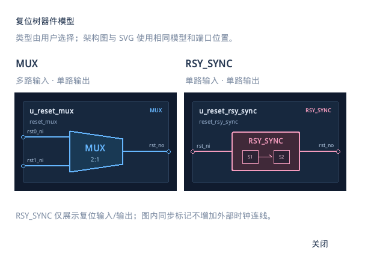

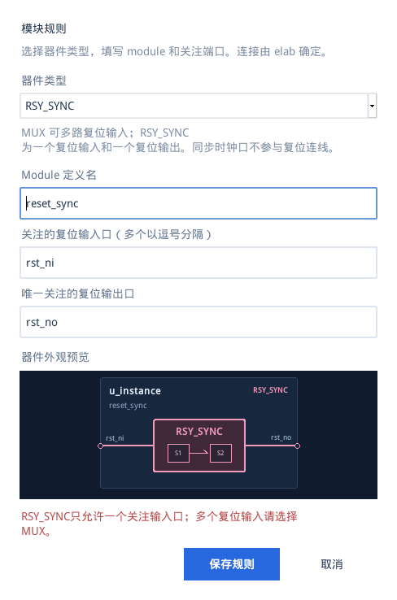

模型中 S1/S2 是同步器示意，不代表已经推断用户模块的真实寄存器级数、复位极性或延迟，也不额外创建外部时钟引脚。实际外部连线只对应配置中的复位端口。

### 20.3 两级完整配置示例

```json
{
  "tree_type": "reset",
  "design": {
    "top": "soc_top",
    "elab": "/work/soc/build/simv.daidir/kdb.elab++"
  },
  "layers": [
    {"index": 1, "hierarchy": "soc_top.u_reset_ctrl", "modules": [
      {"module": "reset_mux", "kind": "mux", "reset_inputs": ["rst0_ni", "rst1_ni"], "reset_output": "rst_no"}
    ]},
    {"index": 2, "hierarchy": "soc_top.u_reset_domains", "modules": [
      {"module": "reset_sync", "kind": "rsy_sync", "reset_inputs": ["rst_ni"], "reset_output": "rst_no"}
    ]}
  ]
}
```

复位模式使用 `reset_inputs`、`reset_output`；不要填成 `clock_inputs`、`clock_output`。工具会拒绝混用字段，以及把门控、OCC、DIV 填入复位规则。`design.filelist` 可以代替 `design.elab`。增加级数时，继续添加连续的 `index: 3`、`index: 4` 等条目。

### 20.4 浏览样例与真实重跑

只浏览：进入 **复位树** 后点击 **查看示例**，打开随附的 `examples/reset_tree/resettree.json`。这次操作读取已记录的 NPI 结果，不会重新运行 elaboration。

实际重跑：在有 Verdi 的机器生成绝对路径配置：

```bash
python3 scripts/make_reset_fixture.py validation/fixtures/reset-tree --layers 2
```

在 GUI 导入生成的 `validation/fixtures/reset-tree/config.json`，核对顶层为 `reset_top`，然后点击 **开始提取全部复位树**。也可使用 CLI：

```bash
source scripts/eda_env.sh
python3 -m clocktree extract --config validation/fixtures/reset-tree/config.json --out validation/runs/reset-check
python3 scripts/check_golden.py validation/runs/reset-check/resettree.json validation/fixtures/reset-tree/golden.json
```

| 样例指标 | 结果 |
| --- | ---: |
| 目标实例 / 连线 | 12 / 12 |
| MUX / RSY_SYNC | 4 / 8 |
| 根 / 末端 / 独立网络 | 2 / 4 / 2 |
| 复位源 | 3 |
| 端口追踪 | 28 / 28 |
| 未解析 / 诊断 | 0 / 0 |

把生成命令中的 `--layers 2` 改成 `--layers 10` 可得到十级版本。两种版本均已在 VM 中完成实际 NPI 提取和实例、端口边、末端全集比对。十级样例包含空的 L6、L7、跨层跳接以及 L1/L2/L8/L10 末端。

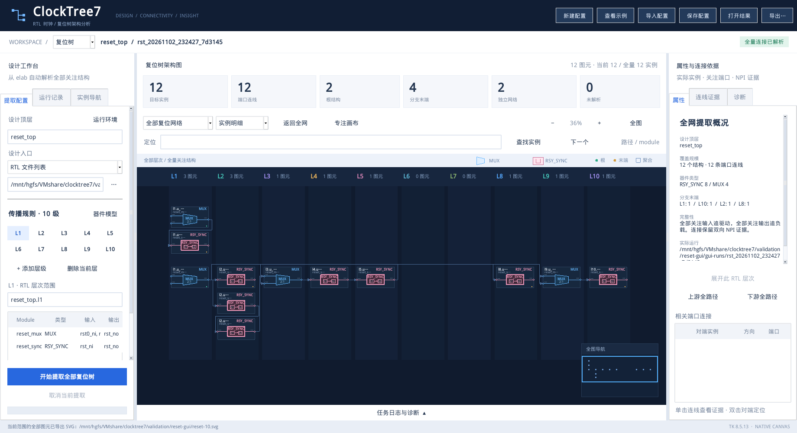

### 20.5 结果、证据与历史记录

- 结果文件为 **`resettree.json`**，顶层及配置均记录 `tree_type: "reset"`，复位源列表为 `reset_sources`；统计中有 `summary.reset_sources`。
- GUI 新复位任务以 `rst_...` 命名。**运行记录** 只列出当前分析类型的任务，打开后恢复该次配置和图形。
- JSON 导出保留全部目标结构、关注端口与边；SVG 导出保留当前范围内全部图元，含 MUX、RSY_SYNC 专用模型及动态层级。
- 点击实例、连线、上游/下游路径和连线证据的操作与时钟树相同。按具体复位输入/输出核对真实 NPI 路径。
- 同目录可重复运行，也可轮流执行时钟和复位分析。旧结果、原始证据与日志先归档，本次输出不混用上次类型的结果文件。提取没有运行超时，仍可主动取消。

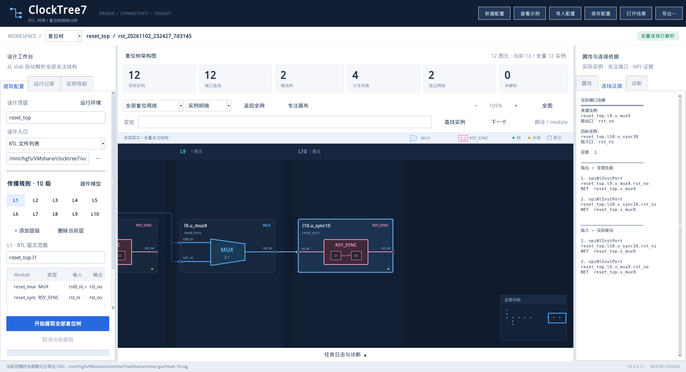

分析覆盖配置中的全部目标实例和端口；未配置的结构按已知边界或未知逻辑记录。绿色状态表示当前配置范围内连接与结构检查通过。此功能恢复静态复位结构，不分析工作模式下的时序、复位释放行为或 RDC 签核。

<a id="auto-restore"></a>
## 21. 启动自动恢复上次配置和结果

### 21.1 日常使用

1. 按平常方式双击快捷方式或执行 `bash launch.sh`。
2. 窗口显示“正在恢复上次工作区”，随后自动显示上次模式、主界面配置和结果。
3. 时钟树与复位树各自的工作内容都会恢复，可用顶部下拉框切换。
4. 编辑后按正常方式关闭窗口。程序会完成最后一次自动写入，再退出；通常不需要任何确认。

恢复内容包括设计顶层、elab/filelist 入口、层数、各层范围、已保存到规则表的 module/类型/关注端口、当前选中层级、完整结果及器件外观修改。尚未导出为配置文件的主界面草稿也会保留。规则弹窗中的新内容应先点 **保存规则**，再关闭窗口。

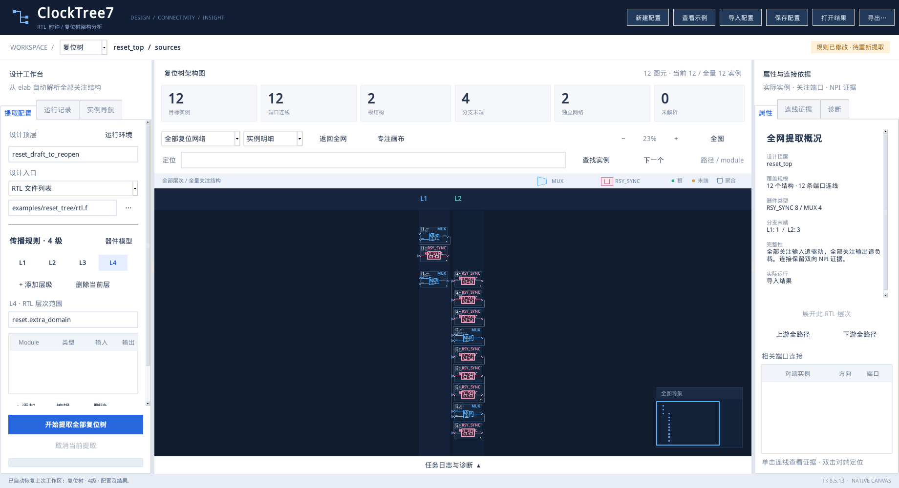

### 21.2 草稿与结果分别恢复

配置修改后尚未重新提取，重开时会同时保留新草稿和原结果，并继续显示“规则已修改 · 待重新提取”。工具不会根据新草稿补造连线。结果按当前窗口尺寸适应全图显示；需要观察某个实例时，可继续搜索和定位。

恢复读取的是上次保存的数据。需要验证当前 RTL 时，请点击 **开始提取全部时钟树 / 复位树**。关闭时已取消的提取任务不自动续跑。


### 21.3 结果文件移动与异常处理

- 自动记录包含独立结果快照。原 `clocktree.json` / `resettree.json` 被移动后，仍可恢复最近缓存的图形和证据。
- 主自动记录无法解析时，尝试读取上一份自动记录。
- 结果快照无法读取时，尝试原结果文件；两者都不可读时，保留配置并在状态栏提示重新打开结果或提取。
- 首次升级没有自动记录时，从当前 `--runs` 目录中为两种模式分别寻找最近可读取的结果，选择最近一次对应的模式。
- 写入错误会显示提示；若关闭时仍无法保存，会询问是否退出，默认保留窗口，便于手动保存和导出。

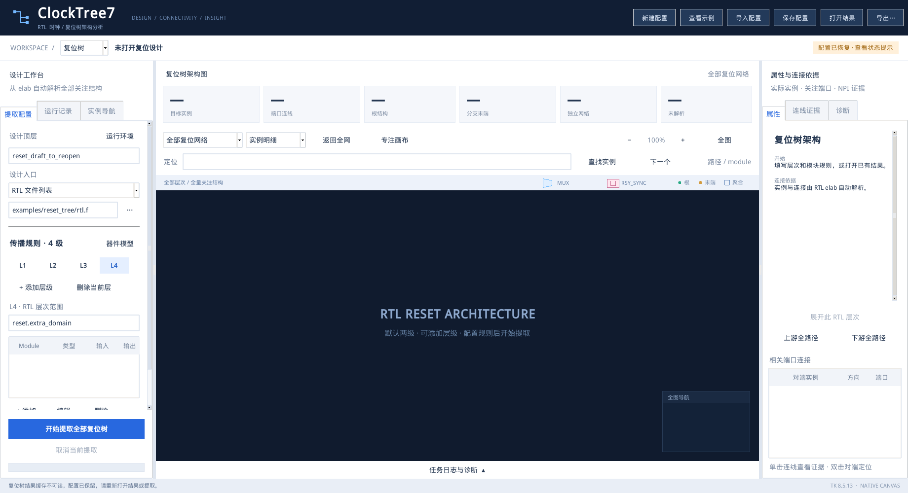

### 21.4 存放位置与启动参数

自动记录按当前用户和 `--runs` 目录隔离，时钟/复位共用同一项目记录。Windows 与虚拟机分别使用各自用户的本地缓存：

| 系统 | 缓存根目录 |
| --- | --- |
| Windows | `%LOCALAPPDATA%\clocktree7\<运行目录标识>\` |
| Linux | `$XDG_STATE_HOME/clocktree7/<运行目录标识>/`；未设置时为 `~/.local/state/clocktree7/<运行目录标识>/` |

目录中的 `session.json` 保存当前记录，`session.previous.json` 保存上一份；结果快照独立保存。大图只在结果变化时写入，编辑普通配置不会重复写整份大图。缓存不进入 GitHub 源码仓库。

显式指定 `--config` 或 `--result` 时，指定文件优先于自动恢复内容。需要完全隔离的查看或测试窗口时：

```bash
python3 -m clocktree gui --no-session
```

该次窗口不读取或写入自动记录。普通使用不需要此参数。新建两级规则可直接点击 **新建配置**，随后编辑和关闭的内容会成为新的自动恢复状态。

<a id="portable-deployment"></a>
## 22. 迁移到其他 EDA 设备

将整个工具目录或离线包复制到目标设备，先启用目标设备自己的 Verdi 环境，然后执行：

```bash
bash clocktree.sh doctor --self-test --gui
```

该命令会真实提取时钟树与复位树小型样例，核对全部实例、连线、末端并短暂打开 Tk 窗口检查两种架构。最终 `PASS` 且报告的 `eda_verified` / `gui_verified` 均为 `true`，才表示本设备通过这组验收。只运行 `doctor` 只能确认安装与存储条件。目标 SoC 还需用自身工程配置再做提取检查。

正常使用通过 `bash launch.sh` 启动。Linux 可以执行 `python3 scripts/install_desktop.py --desktop`，生成指向当前安装位置的快捷方式；安装路径改变后重新生成。Windows 使用 `launch_gui.cmd`，并可用 `clocktree.cmd doctor --viewer-only --gui` 检查浏览功能。

真实提取需要 Linux 上有效的 Verdi/NPI 和许可；工具不再使用当前虚拟机写死的安装目录或许可证服务器。用户可以通过 `CLOCKTREE_EDA_SETUP` 指定站点 Bash 环境入口，通过 `CLOCKTREE_PYTHON` 选择解释器。共享只读安装会把运行记录放到用户目录，也可用 `CLOCKTREE_RUNS` / `--runs` 自定义。

已有结果 JSON 可直接在其他设备浏览；重新提取前需改为目标设备可访问的 elab/filelist。`design.base_dir` 可让设计入口相对配置文件解析，filelist 内部的 RTL、include 和库路径仍应由原工程流程正确生成。不同设备的 GUI 自动恢复缓存分别保存；跨设备接续工程应手动导出并导入配置和结果。

离线包校验、无图形服务器、用户环境入口、UTF-8 locale、旧 Verdi 路径限制和故障定位的完整步骤见 [其他 EDA 设备部署与验收](PORTABILITY.zh-CN.md)。

<a id="bounded-tracing"></a>
## 23. 限定实例查找与端口追踪范围

### 23.1 两种范围分别填写

| 配置项 | 含义 |
| --- | --- |
| 设计顶层 | 当前导入的 RTL / elab 设计顶层，用于检查设计是否加载成功。 |
| 端口追踪根层次 | 左侧设计入口下方的新输入框。填写后，端口追踪只在该精确层次和其子层次内进行。应包含本次全部关注结构及其完整连接路径。 |
| 每层 RTL 父层路径 | 只在该路径下扫描直接例化的 module，不递归查找子层次，也不匹配根实例本身。不是端口追踪边界。 |

例如端口追踪根层次填 `soc_top.u_crg`，L1 查找 `soc_top.u_crg.u_source`，L2 查找 `soc_top.u_crg.u_domain`。两个范围之间的端口、net 和 assign 都必须位于 `soc_top.u_crg` 内；选择共同父层为根可以保留其中所有子层次之间的连接。

1. 在 **端口追踪根层次** 输入实际路径。
2. 为各层填写该根内部的实例搜索路径和 module/端口规则。实例搜索路径留空时，使用端口追踪根层次。
3. 若某个非空规则范围位于根外，开始提取前即报配置错误；调整为包含所有目标和连线的共同根，或调整规则。
4. 点击 **开始提取**。结果完成状态显示 **范围内连接已解析 · N 处边界**。

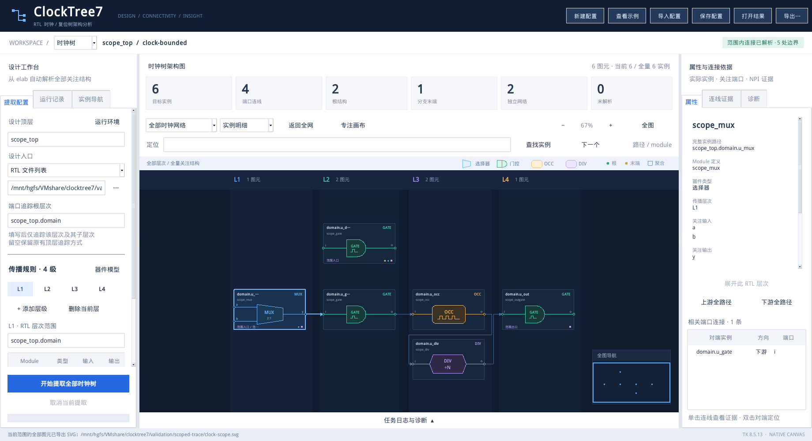

### 23.2 边界与分支末端

端口追踪遇到根层次的输入/输出接口，或下一对象离开根层次，就记录 `scope_boundary` 并停止该方向，不继续追出范围后再返回。

| 图中状态 | 含义 |
| --- | --- |
| 范围入口 | 驱动在本次追踪范围之外，保留范围内的入口端口作为来源，不推断外部源身份。入口可以位于后续传播层。 |
| 范围出口 | 输出继续越过追踪根边界。紫色标记和器件文字单独提示，不计入“分支末端”。 |
| 分支末端 | 在本次关注结构中没有已选下游，且没有未解析输出或被根范围截断的输出。 |

同一节点可以既有范围内下游，也有范围出口。边界表示明确的分析范围，不是连通错误；绿色状态仅表示**配置范围内**的连接与结构检查通过，不表示范围外网络已经验证。未知逻辑、缺失端口、缺失反向证据等仍会报诊断，不能用范围边界掩盖。

如果两个内部节点只能经过根外的缓冲/连线才能相连，严格模式不会把它们画成直接相连；应扩大追踪根层次以包含那条完整路径。

### 23.3 时钟、复位与历史配置

时钟树与复位树分别保存追踪根层次。切换、保存配置、导出结果和关闭重开均保留各自的字段；结果节点的范围入口/出口标记也随 JSON 和 SVG 保留。

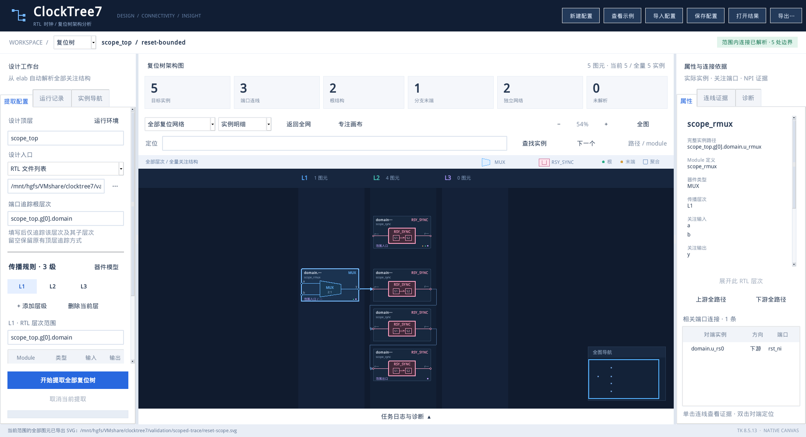

旧配置没有该字段，或输入框留空时，端口追踪保持原有行为。实例查询仍会使用每层已有的层次路径；某层路径也留空时，其实例查找根为设计顶层。不存在的非空层次会报错，不自动退回全芯片查询。

端口追踪根仍包含其本身及内部子层次；**实例查找仅取各层父路径下的直接子实例**。支持显式填写 `soc_top.g[0].domain` 这类 generate 父路径；使用精确层次，不填写 `*` / `?`，module 填定义名。路径本身恰好是所填 module 的实例时，也不会将它当作自己的子实例。

以前把 `soc_top` 填在各层、依赖递归搜索深层模块的配置，需要改成模块实际所在的父层路径后重新提取。找不到直接实例时会明确报告 `missing_module` 和 `search_mode=direct_children`，不会自动递归兜底。旧结果图仍可打开，其提取范围不会因软件升级而自动改变。

底层使用 NPI `npiInternalScope` 迭代直接作用域，跳过其下的 generate/其他作用域而不进入它们；并非先获取全部后代再过滤。新结果 `metadata.instance_search` 与查询记录 `search_mode` 均记录 `direct_children`，每条查询还记录 `recursive=false`。端口追踪继续可穿过追踪根内的中间子层次。

### 23.4 JSON 配置示例

`trace_scope` 位于配置顶层，独立于各层的 `hierarchy`：

```json
{
  "tree_type": "clock",
  "trace_scope": "soc_top.u_crg",
  "design": {"top": "soc_top", "elab": "/project/build/simv.daidir/kdb.elab++"},
  "layers": [
    {"index": 1, "hierarchy": "soc_top.u_crg.u_source", "modules": [
      {"module": "clk_mux", "kind": "mux", "clock_inputs": ["clk0_i", "clk1_i"], "clock_output": "clk_o"}
    ]},
    {"index": 2, "hierarchy": "soc_top.u_crg.u_domain", "modules": [
      {"module": "clk_gate", "kind": "gate", "clock_inputs": ["clk_i"], "clock_output": "clk_o"}
    ]}
  ]
}
```

复位配置使用相同的 `trace_scope`，模块与端口继续使用 MUX / RSY_SYNC 及 `reset_inputs/reset_output`。

### 23.5 内存收益与运行记录

本模式消除了额外的全芯片实例统计，减少范围外候选句柄及端口追踪；完整 KDB 仍由 Verdi 导入，因此不能仅凭范围变小承诺总内存降到某一固定数值。大芯片仍应核对作业实际限额和峰值。

日志新增 `CT7_IMPORT_BEGIN/END` 和各规则的 `CT7_ENUM_BEGIN`，帮助区分导入、查找及追踪阶段。结果 `metadata.scoped_queries` 记录实际查询范围与候选数；`summary.trace_scope`、`scope_limited`、`scope_boundaries`、`scope_output_instances` 记录范围语义。未引入提取超时，仍支持当前目录重复运行。

<a id="disk-index"></a>
## 24. 大图内存优化、结果索引与分页

新提取结果同时生成完整 JSON 和磁盘索引。打开大图与启动恢复时，工具先读取配置、统计与索引，显示层次概览；展开范围、搜索定位或点击连接后，再读取相应实例及路径证据。首次打开没有索引的大型旧 JSON，会在后台建立索引，等待完成即可。

全网概览仍覆盖全部关注实例。特别宽的层次展开后用“上一组 / 下一组”翻页，范围栏显示组数；跨组连接可在实例属性中查看。精确定位超大图时显示实例邻域，按“返回全网”回到整体概览。

属性区的连接列表每页最多 500 条，用“上一页 / 下一页”查看其余连接。连接总数来自完整索引；点选任意一条才读取双向 NPI 证据。全量 JSON 导出继续包含所有实例、连线及证据，SVG 导出当前投影范围。

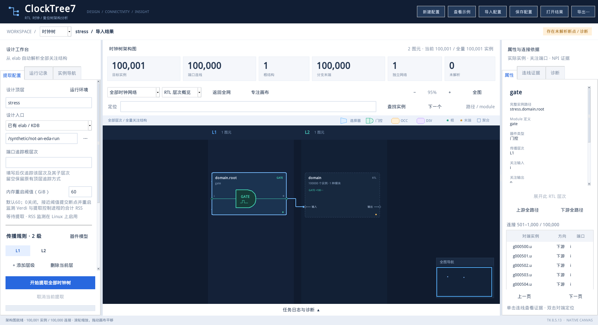

历史恢复保存配置清单和结果数据库快照；原 JSON 被移动后，缓存快照仍能恢复。索引损坏或丢失时，可以重新打开原 JSON 建立索引。共享部署、只读路径及实测数据详见 [内存优化说明](MEMORY.zh-CN.md)。

<a id="memory-restart"></a>
## 25. 监测内存、自动重启 Verdi 并续跑

### 25.1 设置和读取内存

左侧“端口追踪根层次”下方新增“内存重启阈值（GiB）”。默认 **60**，可输入非负数字，**0** 关闭内存轮换。启动后显示当前合计 RSS、阈值和重启次数；提取结束后显示 Verdi 阶段峰值。时钟/复位各自保存设置，关闭重开会恢复。单独调整阈值不会让已有连接结果失效。

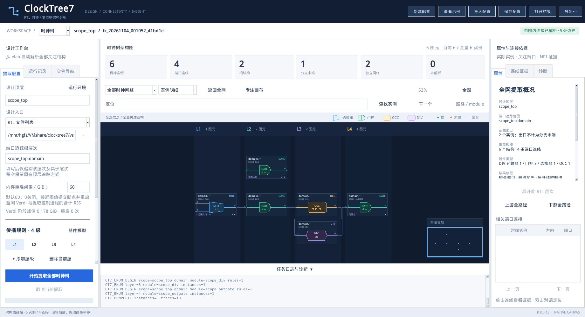

该读数是 Linux 上 Verdi、其后代及提取控制进程的合计 RSS，周期性每秒采样，并在每条 module 查找结束后立即额外采样；包括共享映射的重复计数，不等同于整机总占用或 dsub 调度器记账。GUI 及 Verdi 退出后的结果生成阶段不在该读数内。

### 25.2 超过阈值后如何继续

1. 接近阈值（默认约 54 GiB）时，工具请求在当前完整模块查询或端口追踪结束后保存并轮换 Verdi。
2. 触及阈值（默认 60 GiB）时，结束本次 Verdi 进程组，撤回未提交记录，从最后完整断点重试。当前没做完的 module 查询或追踪批次可能重做。
3. 新 Verdi 重新导入原库，按名称重建 NPI 句柄；跳过已完成查询，继续后面的工作。已完成实例、连线和证据不会重复写入。
4. 相同断点连续 3 次发生内存失败且没有进展，会停止并报错，保留进度与日志，不跳过失败模块，不给出完整通过结论。

仍然没有提取运行超时。`memory.json` 显示实时状态和断点位置；`memory-restarts.jsonl` 保存全部轮换记录；任务日志含 `CT7_MEMORY_*`、`CT7_RESUME` 标记。

### 25.3 配置、限制和故障处理

保存配置会包含顶层 `"memory_limit_gib": 60`，缺少该字段时默认也是 60。CLI 可以追加 `--memory-limit-gib 60`，或使用 0 关闭。

如果导入 elab、恢复已选端口或单个 NPI 查询本身就超过阈值，重启不能使该操作变小，需要缩小层次、拆分查询或增加内存。应保持同次任务的 RTL/elab 输入不变。采样无法保证抢在所有瞬时峰值或调度器 OOM 之前；60 GiB 也不一定等于集群“60G”的单位。

内存轮换在同一任务内自动执行。整个控制进程被杀后，可重新打开 GUI 选择“从断点继续”，详见 [第 27 章](#crash-recovery)。主提取按钮仍创建新任务并归档旧发布结果。完整机制、文件含义、实测边界及验收命令见 [内存优化与重启续跑](MEMORY.zh-CN.md)。

### 25.4 自定义阈值的实际验证

60 GiB 是默认值，输入框可修改。虚拟机已使用 0.375、0.5、0.625 GiB 等小阈值，让真实 Verdi 进程实际申请内存并触发重启，没有替换 RSS 读数。时钟和复位小型 RTL 的五组检查均在重启两次后完成，实例、连线和双向证据与不中断运行一致。

下图为阈值 0.375 GiB、观测峰值约 0.438 GiB、重启两次的真实界面。GUI 修改为 0.42 GiB 后保存配置、关闭并重开，仍恢复该自定义值及已完成结果。完整表格及复现命令见 [自定义阈值实测](MEMORY.zh-CN.md#实测与复现)。

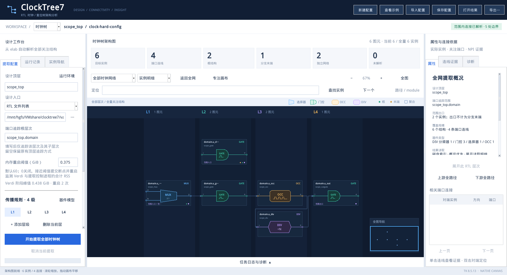

### 25.5 每条 module 完成后的独立断点

每条配置中的 module 查找规则处理完毕后，工具立即保存一个独立断点，记录层级、完整查找路径、module、匹配数量、新增实例数量、完成序号和原始数据位置。即使多条规则共用同一批 NPI 候选句柄，也分别保存。完成断点后会额外检查一次实际 RSS，收到监控进程的继续/轮换确认后，才进入下一条规则。

运行时左侧显示最近的 module 断点；结束后显示提交数量。以下截图中时钟样例已提交 5 条查找断点，重启两次后结果仍完整。

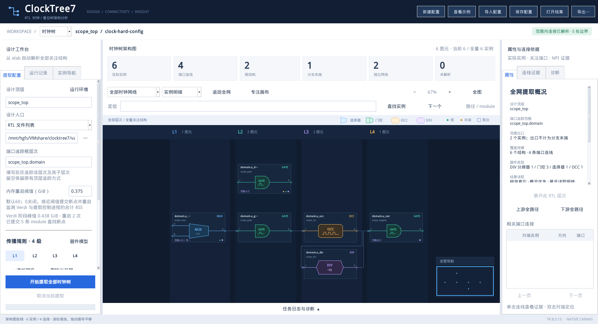

查看任务工作区的 `checkpoint.json`：`completed_modules` 是已完成规则数，`last_module` 记录最后模块。各独立快照保存在同目录 `module-checkpoints/00000001.json` 等文件；`memory.json` 给出该目录路径。任务根目录的 `module-memory-checks.jsonl` 保存每次额外内存检查，日志可搜索 `CT7_MODULE_CHECKPOINT`、`CT7_MODULE_MEMORY_CHECK`、`CT7_MODULE_SKIP`。

重试恢复已提交前缀并跳过完成的规则，从未完成规则继续；当前查询组还没结束时，可能重新获取该组候选句柄。零匹配或不存在的层次会保存相应失败状态和诊断，断点本身不代表检查通过。将阈值设为 0 后，逐 module 断点仍然保存。

<a id="runtime-stages"></a>
## 26. 运行阶段节点、日志与闪退定位

### 26.1 在界面查看运行到哪里

架构图上方新增“运行定位”流程条：**准备 → 导入 → 查找 → 追踪 → 拓扑 → 索引 → 结果 → 显示**。绿色勾表示该节点已完成，蓝色表示运行中，灰色表示尚未进入，红色表示失败，黄色表示中断。内存保护轮换时显示重启状态和第几次 Verdi；重新导入、恢复句柄的状态会继续更新。

| 节点 | 实际操作与定位信息 |
| --- | --- |
| 准备 | 读取/校验配置、自动寻找 Verdi、准备本次工作目录。 |
| 导入 | 启动 Verdi、读取 elab 或 RTL、校验顶层/追踪范围；重启后恢复已选实例及端口句柄。 |
| 查找 | 范围内原生 module 查询、逐实例绑定关注端口、逐规则提交断点。显示 module、层次或具体实例。 |
| 追踪 | 各关注输入追驱动、各关注输出追负载。显示完整实例、端口、`driver/load` 方向和 trace ID。 |
| 拓扑 | 逐事件读原始证据并生成完整关注网络、边界和诊断。 |
| 索引 | 提交 SQLite 结果及连接证据索引。 |
| 结果 | 流式写出完整 JSON、索引指针和摘要。 |
| 显示 | GUI 恢复历史、读取结果、建立视图模型、计算布局、绘制画布。日志进一步区分 `session/load/layout/canvas`。 |

流程条下方同时显示最近提交的 module/追踪断点数。大任务在一个节点运行很久并不表示超时；工具仍不设置提取运行超时。实时流程在后台约每 0.1 秒读取进展，快操作可能在界面上一闪而过；持久日志保留阶段切换和每个关注端口的开始/结束记录。

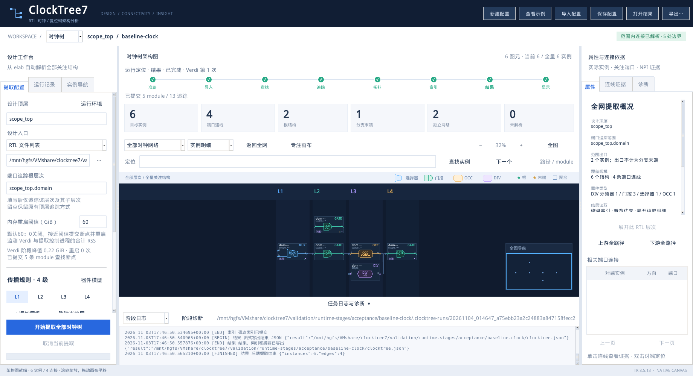

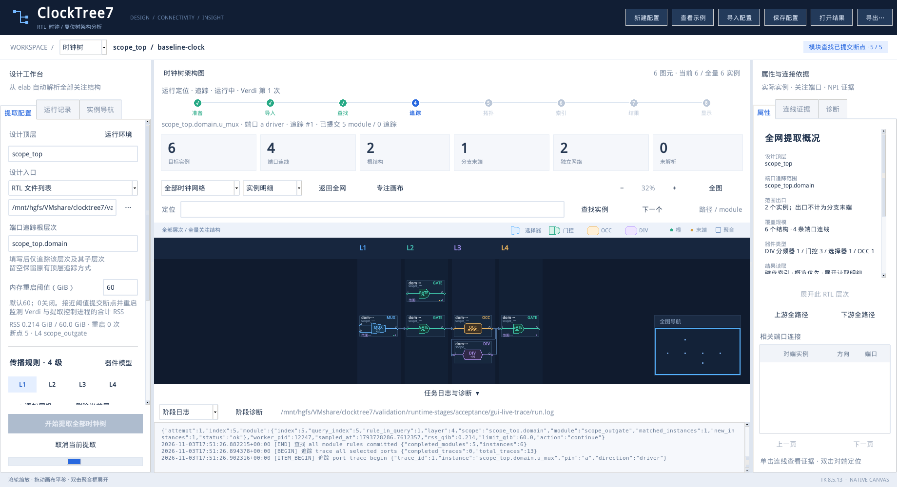

图中的当前端口为 `scope_top.domain.u_mux.a`，方向为 `driver`。运行中若已有上一次结果，仍可查看该结果图；当前提取状态由流程条和任务状态显示。新结果生成后自动加载。

### 26.2 点击节点、切换日志和打开诊断

1. 单击流程条中的节点，底部展开该阶段最近 160 条记录的快照。读取在后台进行，按行扫描，内存只保留有限条数。
2. 在“任务日志与诊断”的下拉框选择 **阶段日志 / Verdi 日志 / CLI 日志 / GUI 日志**。完整源文件路径显示在旁边；普通日志实时显示文件末尾，不把全部大日志加载到 GUI 内存。
3. 单击 **阶段诊断**，查看最后阶段、当前对象、最近完成阶段、最后提交断点、退出信号，以及对应日志路径。诊断是点击时的快照。
4. 在“运行记录”双击失败/中断的任务，可直接打开其诊断；部分结果如需查看，可通过“打开结果”单独选择对应 JSON。
5. GUI 自身异常退出后，重新打开并进入“阶段诊断”，其中 `previous_gui_issue` 保留上次 GUI 的失败/中断位置。

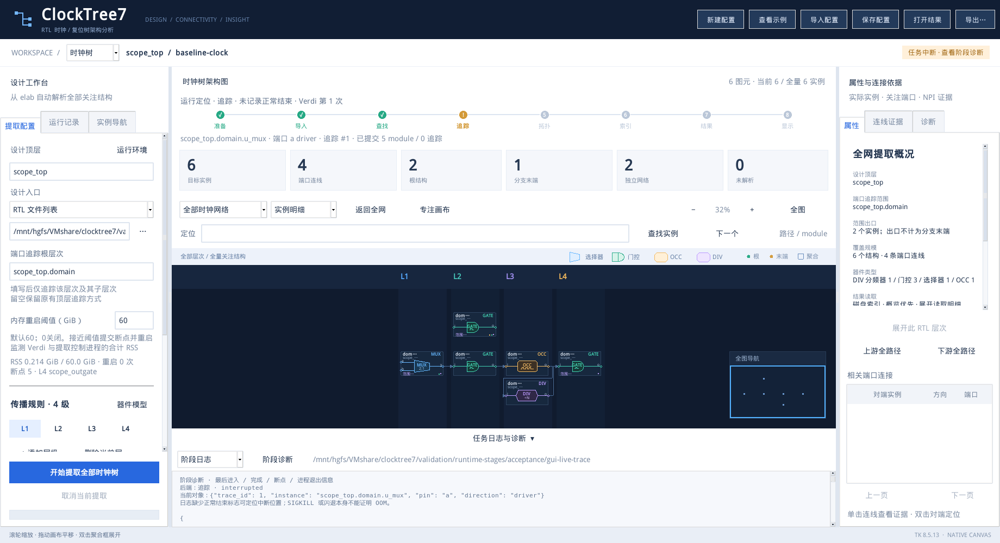

### 26.3 闪退后查哪些文件

阶段的开始记录写在重操作之前；主阶段日志和状态文件同步落盘，状态文件原子替换。Verdi 的逐实例/逐端口日志立即刷新到独立文件，控制进程来不及转发时仍可诊断。

| 文件 | 用途 |
| --- | --- |
| 任务目录 `run.log` | 人可直接阅读的阶段日志：时间、开始/结束/失败、当前 module/实例/端口。 |
| `run-events.jsonl` | 逐行 JSON 事件，便于脚本检索与统计。控制进程合并频繁的子操作状态；逐端口完整记录见 worker 日志。 |
| `run-status.json` | 当前阶段、最后进入/完成阶段、进程身份、第几次 Verdi、最近断点和失败信息的快照。 |
| `.clocktree-runs/<run-id>/run.*`、`run-events.jsonl`、`run-status.json` | 本次任务的独立阶段记录；根目录上述三个文件是当前运行的副本。后续同目录重跑不会覆盖此处的旧记录。 |
| 工作区 `attempt-0001/worker-events.jsonl` 等 | 各次 Verdi 的导入、原生查找、实例端口绑定和每个 trace 开始/结束；每次重启使用新的 attempt 目录。完整位置见诊断的 `logs.worker`。 |
| `verdi.log` / `cli.log` | Verdi 原始输出、`CT7_STAGE` 标记及 Python 标准输出/异常栈；`cli.log` 由 GUI 启动任务时生成。 |
| `memory.json`、`memory-restarts.jsonl`、`module-memory-checks.jsonl` | RSS、受控重启原因、逐 module 内存检查；结合阶段日志判别内存保护与普通异常。 |
| `gui-log-location.json`、`gui-log-location.previous.json` | GUI 日志位置；重开不会覆盖上一次 GUI 通道。只读导入结果可能没有这两个指针，可用下述 GUI 诊断命令。 |

GUI 日志保存在当前用户状态目录：Linux 默认 `~/.local/state/clocktree7/gui-logs/`（可由 `XDG_STATE_HOME` 改变），Windows 默认 `%LOCALAPPDATA%\clocktree7\gui-logs\`。每次打开 GUI 创建独立 `ui_<id>/gui.log`、`gui-events.jsonl`、`gui-status.json`，`latest.json` 和 `previous.json` 指向最近两次。配置/结果的自动恢复继续沿用原机制。

同目录重新提取时，旧阶段副本与旧提取证据一起归档到 `.clocktree-history/`；本次独立目录继续保留。若 Verdi 的旧版路径限制要求另设临时工作区，`runtime-location.json` 和诊断输出给出真实工作目录。

### 26.4 无需 GUI 或 EDA 的诊断命令

在工具目录运行，`--run` 指向出问题的任务目录：

```bash
python3 -m clocktree diagnose --run /project/clocktree-run
python3 -m clocktree diagnose --run /project/clocktree-run --json
python3 -m clocktree diagnose --run /project/clocktree-run/.clocktree-runs/<run-id> --json
python3 -m clocktree diagnose --gui-latest --json
```

Windows 使用 `python`。最后一个命令同时给出本机当前用户最近 GUI 和前一次 GUI 的日志位置。诊断只读日志，不启动 Verdi，也不重新提取。

判断方法：最后一条 `BEGIN/ITEM_BEGIN` 之后没有相应完成记录，说明停在该操作附近；例如 `stage=modules`、`detail=native instance query`、`module=clk_gate`、`scope=soc_top.u_crg` 表示范围内的该定义查找尚未返回。`stage=trace` 会带实例、pin、方向及 trace ID。`stage=layout/canvas` 则是 GUI 处理阶段。

诊断会检查本机进程身份；控制进程已消失且未记录正常结束时显示 `interrupted`。其他主机生成的日志不能据此确认其进程存活；仍可读取最后阶段。**退出信号 `SIGKILL`、无完成标志或最后 RSS 都不能单独证明 OOM**，根因还需结合 dsub/调度器或系统 OOM 记录。内存保护的主动轮换会另外记录 `RESTART` 及原因。

### 26.5 本次验证

VM 实际 Verdi 完成时钟 13/13、复位 11/11 关注端口追踪，完整图和双向证据与对照一致。测试在导入、原生 module 查询、逐端口追踪时分别杀死真实 Verdi；在查找、追踪、拓扑、索引和写结果时杀死整个控制进程；还在真实 Tk 布局与画布绘制时杀死 GUI。日志均定位到注入中断的阶段，追踪包含实例、端口和方向，重开 GUI 保留前次位置。

测试暂停器只存在于独立验收进程/临时 Tcl 工作区，生产代码不包含暂停开关。复现：`python3 scripts/check_runtime_stages.py --out validation/runtime-stages/acceptance`；有图形显示时再加 `--gui-only` 验证实时界面、节点筛选、GUI 闪退及重开。该测试验证日志定位机制，不代表已在商业芯片上复现 64G 内存故障。

<a id="crash-recovery"></a>
## 27. 闪退后提示原因并从断点继续

### 27.1 重开后的提示

新版任务在启动 Verdi 前保存恢复清单。GUI 重新打开后检查上次界面和任务，显示“恢复上次运行”窗口，包括最后阶段、已知退出原因、module/范围/实例/端口、已提交 module 和追踪数、继续方式及日志路径。

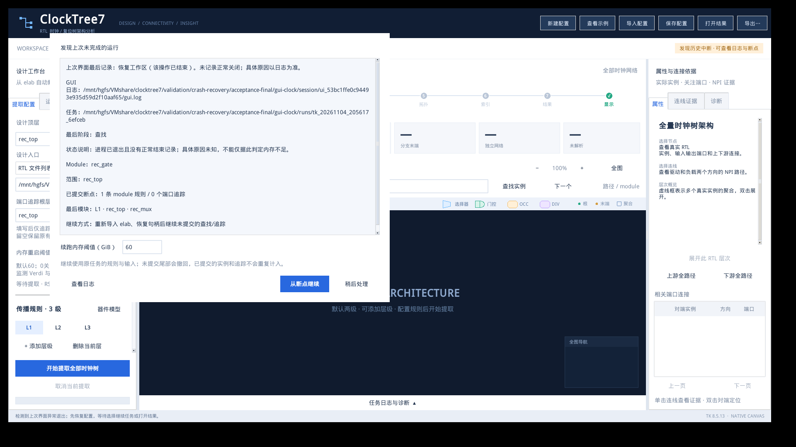

1. 阅读状态说明。若记录到 Python 异常、Verdi 退出信号或内存保护停滞，窗口显示该记录；进程突然消失而没有根因证据时明确显示“具体原因未知”。`SIGKILL` 不能单独证明内存不足，实际 OOM/dsub 原因仍需结合站点日志。
2. 如需调整资源，可修改窗口内的 **续跑内存阈值（GiB）**。它仅控制 RSS 保护，不替代 dsub 申请内存。
3. 点击 **从断点继续**。程序使用原任务配置，校验输入和实现版本，然后在同一逻辑任务下创建下一次 Verdi 工作目录。左侧临时编辑的新规则不会混入旧断点。
4. 进度继续显示在原有节点条，完成后自动加载恢复出的完整架构图。
5. **查看日志** 打开阶段诊断；**稍后处理** 仅关闭提示。之后可以在“运行记录”选择任务，再点击 **诊断 / 从断点继续**。

如果只是 GUI 消失而后端仍运行，窗口会显示 **观察现有任务**，此时禁止重复续跑。观察不启动新 Verdi，后端完成后加载结果；关闭观察窗口不取消原后台任务。

若上次 GUI 本身在读结果、布局或绘图时崩溃，第一次重开先恢复配置并显示提示，暂不自动绘制旧图，以免立即重复崩溃。缓存和原结果保留；点击 **打开已保存结果** 可再次打开。后端已经完成时，不重新提取。

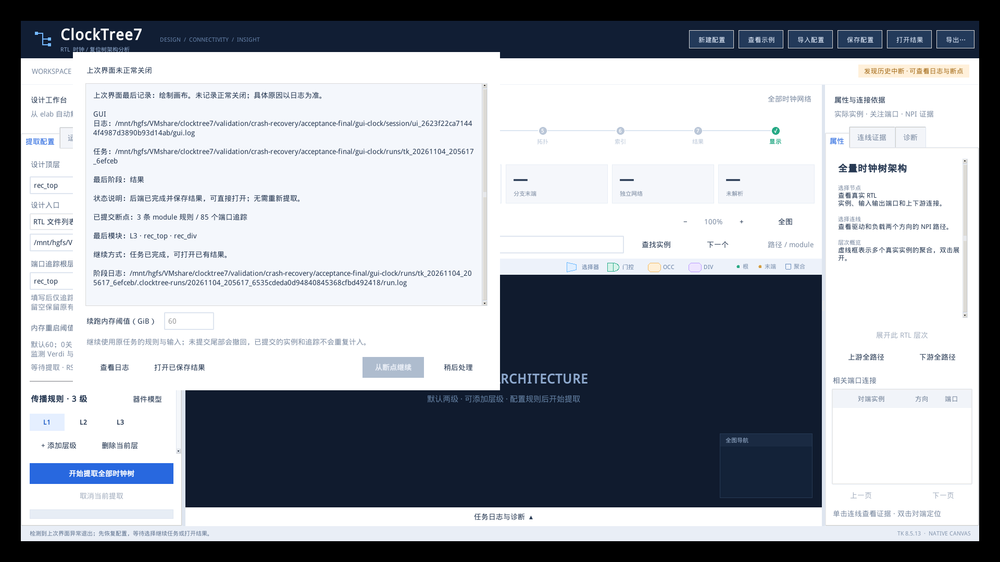

### 27.2 从哪个位置继续

| 闪退位置 | 恢复动作 |
| --- | --- |
| 导入 elab/RTL | 从初始断点重新导入，尚无已提交实例。 |
| 查找 module | 保留所有已提交 module 规则的实例，重做未提交规则；同一查询组可能重新取候选句柄。 |
| 追踪端口 | 保留完整已提交追踪批次，重做未提交批次。通常每 32 个完整追踪提交一次，轮换请求可提前提交。 |
| 拓扑、索引、结果写出 | 若原始证据的 `complete` 断点已提交，直接复用证据重建拓扑/索引/JSON，不再启动 Verdi。 |
| GUI 加载、布局、绘制 | 保留已生成结果，先提示，再由用户选择打开；不将显示失败当成提取失败。 |

恢复首先核验并停止属于原任务的残留 Verdi，再按断点的字节位置截掉 `raw.jsonl` 和 `targets.tcl` 的未提交尾部，丢弃未提交的 module 快照后缀。旧 NPI 句柄不能复用，新 Verdi 需要重新导入、按名称恢复实例和端口句柄。最终完整性仍检查全部关注结构、端口和双向证据，断点本身不表示检查通过。

### 27.3 dsub 与命令行恢复

若整个 dsub 作业被终止，需要先重新申请合适资源。在原设备、原输入路径和恢复工作区仍可访问的条件下运行：

```bash
python3 -m clocktree diagnose --run /project/clocktree-run --json
python3 -m clocktree resume --run /project/clocktree-run --memory-limit-gib 60
```

同一个输出目录已执行过其他新任务时，指定原任务的独立目录：

```bash
python3 -m clocktree resume --run /project/clocktree-run/.clocktree-runs/<原run-id>
```

省略阈值参数时使用原任务配置中的阈值。恢复没有提取超时。工具不会自行向调度器申请资源，也不会通过 Windows GUI 自动调用另一台机器的 Verdi。

### 27.4 恢复文件与拒绝续跑的情况

独立任务目录的 `recovery.json` 保存原配置、输入身份、工作区和实现指纹；`checkpoint.json` 及上一份备份保存提交游标；`raw.jsonl`、`targets.tcl` 保存已完成证据和名称清单。`attempt-*/worker-identity.json` 记录 Verdi 启动身份，`interruption-0001.json` 等保存每次恢复前的诊断与实际断点。恢复日志沿用原 `run-id` 并记录 `recovery_count`，旧发布结果归档。

RTL 文件列表、嵌套列表、RTL/静态 include、include/library 目录及 KDB 内文件以路径、大小和修改时间检查是否变化；不将大型 KDB 整体读入内存。这是变更检查，不是文件内容校验和。请在提取及恢复期间固定输入版本，不要人工保持时间戳覆盖设计。

输入变化、缺失或包含目前无法解析的动态文件列表语法；提取程序或 Verdi 启动程序改变；恢复工作区被清除；断点损坏且备份也无效；路径迁移或不同主机，都会显示具体阻止原因。此时不截断旧数据，先恢复原环境或新建任务。恢复过程的排他文件锁防止两个控制进程同时写入同一运行目录。

此前版本已经中断的任务没有 `recovery.json` 和输入快照，不能安全转换为可续跑任务；日志诊断和已有结果仍可查看。当前版本创建的新任务才具有完整的跨次恢复信息。共享文件系统必须正确支持本工具的文件锁与原子替换；磁盘丢失、损坏和硬断电不属于已验证的进程闪退恢复范围。

### 27.5 实际验收

VM 中完成了时钟/复位共 16 项真实 Verdi 与控制进程 SIGKILL 恢复检查，包含已提交 32 次追踪后继续；完整结果和双向 NPI 证据均与不中断对照一致。4 项真实 Tk 检查覆盖重开提示、按钮续跑、原后端仍活时观察，以及画布闪退后的配置优先恢复。OpenC910 22 实例 KDB 子网也通过追踪和结果阶段的跨次恢复。具体规模、脚本与限制见 [验证摘要](VALIDATION.zh-CN.md#闪退后重开提示与跨次断点续跑)。


<a id="target-extraction"></a>
## 28. 大设计：目标结构提取与全负载核验

### 28.1 选择提取方式

左侧“提取配置”的“端口追踪根层次”下方新增“连接提取方式”。时钟树和复位树都支持以下选项，选择会随配置、工作区草稿和启动历史保存。

| 选项 | 检查范围与证据 | 末端含义 |
| --- | --- | --- |
| 目标结构提取（大设计推荐） | 全部已配置实例的关注输入；Language Model driver 证据 | 没有已配置的下游器件；没有核验普通负载或输出范围外分支 |
| 全负载核验 | 关注输入追驱动、输出展开所有负载；driver/load 双向证据 | 根据负载追踪判断；范围出口单列 |

新配置以及没有 `extraction_mode` 字段的配置默认使用目标结构提取。旧结果仍按结果自身记录的证据模式读取，不会把历史双向结果改成单向结果。切换选项后必须重新提取才产生该模式的新结果；历史结果仍可打开。

操作顺序：

1. 选择时钟树或复位树，导入配置或填写设计入口。
2. 填写每层的直接实例查找路径及关注 module、输入和输出。子层次中的目标实例需要单独配置其实际父层路径。
3. 填写能够包含连接路径的“端口追踪根层次”，留空则追踪到设计顶层边界。
4. 选择“目标结构提取（大设计推荐）”，按需要设置内存阈值，再点击开始提取。
5. 在运行阶段查看当前输入端口、原生查询位置、扫描数和“公共路径复用”数。每个输入端口完成后立即提交断点。
6. 完成后查看状态“目标结构连接已解析 · 未核验普通负载”。点击连线时，driver 栏显示实际证据；load 栏说明本模式没有执行全负载核验，不能误读为缺失证据错误。
7. 如需普通负载统计，改选“全负载核验”再运行。该检查是独立任务，可能再次触发较重的 Netlist Model 查询。

JSON 配置可明确写入：

```json
"extraction_mode": "target"
```

全负载核验对应 `"extraction_mode": "full"`。此字段与 `tree_type` 相互独立。

### 28.2 为什么能恢复全部目标分支

工具建立目标输出实际连接对象的索引，并处理每一个目标输入。若一个输出驱动三个目标模块，三个输入的追踪结果会合并成三条边。MUX 的全部关注输入分别处理；同级、跳级、独立网络和提前结束的分支都会保留。连线依据 elab，不根据层级编号猜测。

每个公共信号首次使用时仍核对真实驱动，避免直接同网匹配掩盖额外别名驱动；后续输入复用已验证步骤。缓存最多保存 2,048 项、约 4 MiB 序列化数据，磁盘日志上限约 8 MiB，超过后淘汰并按需重查。这些是缓存容量限制，不是分支截断、追踪步数限制或 NPI 查询内存上界。

Language Model 临时句柄在每个输入端口结束时统一释放。跨进程保存的是对象名称、位信息和解析步骤，不保存旧 NPI 句柄。断点续跑会重导入同一设计、恢复目标索引，并校验任务输入和实现版本。

### 28.3 完整性、诊断和限制

- 目标结构完整要求所有关注输入完成解析、输出端口检查通过、全部 module 查询完成，且无致命诊断。缺失输出端口不能因为没有 load 追踪就被忽略。
- 一条边只有 driver 证据在此模式中是正常结果；工具不会补造 load 证据。
- 普通寄存器负载没有统计；“结构末端”不证明真实 RTL 输出没有其他负载，也不证明信号不通向追踪范围外。
- 存在未解析输入时，不将其实例标成已确认根结构；全图有未解析连接时，不声明已确认结构末端。
- 目前支持已验证的直接接线、静态总线位映射、拼接赋值、包装层端口、generate 常量索引、透明 assign、buf/not 和关注器件边界。未知逻辑、动态索引等明确保留诊断，不把所有表达式操作数当成时钟源，不自动回退到全 load 扫描。
- Verdi 2018 对某些实例数组的拼接/重复拼接高层连接返回 `npiNIY`（尚未实现），这种连接在目标模式中明确报未解析。数组表达式的源码顺序可能不同于端口声明顺序，工具不据此猜连线；可另用全负载核验。普通标量广播连接的实例数组已通过恢复回归。
- package 常量引用会通过 NPI 实际对象解析后判断静态索引；引用运行时变量仍视为动态索引。
- 此模式没有设置默认超时。内存阈值、取消、日志和闪退恢复保持有效。
- 目标范围不会自动裁剪整片 elab 的导入内存；仍需目标设备提供可用的 Language Model 和许可。现场商业芯片的原生库性能需要实测。

结果 JSON 的 `summary.extraction_mode`、`physical_loads_checked`、`terminal_semantics` 描述本次检查语义。`metadata.language_trace_stats` 记录当前 Verdi 尝试中的原生 driver 查询数、缓存命中数及输出端口命中数；有重启时该统计不是整个任务所有尝试的累加。

升级前已完成的结果可继续浏览。升级前未完成的任务如果实现签名不一致，需要重新提取；不要手动修改恢复文件绕过检查。

本次原生 Tk 界面与完整验收记录见 [目标结构模式验收报告](TARGET_MODE_VALIDATION.zh-CN.md)。

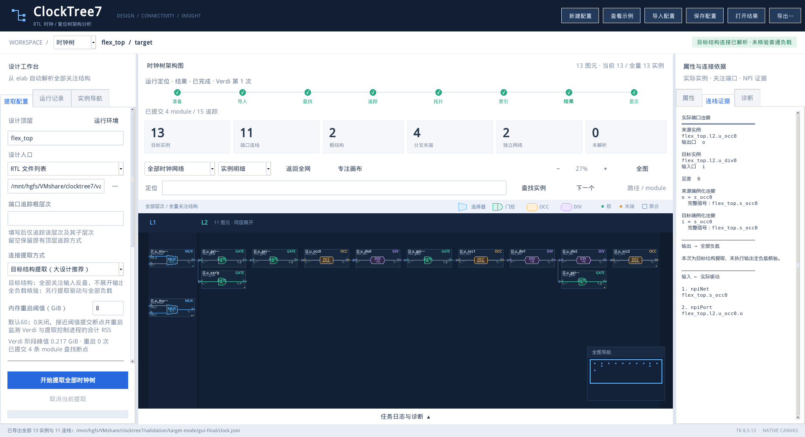

<a id="port-trace-timeout"></a>
## 29. 端口 trace 超时与当前例化跳过

### 29.1 设置阈值

在左侧“提取配置”中找到 **端口 trace 超时（秒）**，位于内存设置下方。窗口高度不够时，在左侧配置区域滚动。填写非负数字后再开始提取；允许小数，例如 `12.5`。默认 `0` 表示不限时，任务总运行时间始终没有上限。

配置文件对应顶层字段：

```json
"port_trace_timeout_s": 120
```

此例表示每个实际执行的输入或输出端口 trace 单独计时，阈值为 120 秒；不是整实例所有端口合计 120 秒。配置导入、保存、关闭后重开和时钟/复位工作区切换均保留该值。省略字段等同于 `0`，旧字段 `timeout_seconds` 仍不生效。

阈值在启动任务时读取。运行中修改界面值不改变已经启动的任务；从旧断点恢复时沿用原任务保存的阈值。如需重新追踪此前已跳过的实例，应调整阈值后新建提取，旧结果保留在历史中。

### 29.2 超时后工具怎么处理

1. 每个端口开始前，先提交此前已完成的追踪证据。
2. 外部控制进程监测当前端口耗时。超时时先保存当前完整实例路径、端口、方向、阈值、已用时间和追踪序号，再结束这一轮 Verdi 进程组。
3. 撤回当前未完成端口的原始数据，保留此前完整端口的结果和连线。
4. 重新导入设计并恢复已找到的实例。将触发端口记为 `trace_timeout`，本实例尚未处理的端口记为 `trace_skipped_timeout`，不再次调用这些端口的 NPI 追踪。
5. 继续其他例化，**包括同名 module 的其他实例**。例如 `top.u0` 超时只跳过 `top.u0` 的剩余端口，`top.u1` 不受此跳过决定影响。

即使原生 NPI 调用不返回，外部监控仍可结束 Verdi；不能只依赖 Tcl 定时回调。端口正常返回后，需要控制进程确认未超时，才能提交其结果并进入下一端口，避免超时处理误伤下一实例。开启该选项会增加每端口确认和断点写盘开销；默认 `0` 不增加这套确认流程。

Linux 默认使用本机通信传递临时开始/完成确认，断点和超时决定仍写入磁盘。共享目录上 1,026 路目标负载、1,024 个普通负载的本轮对照：关闭约 **20.4 秒**，开启约 **25.3 秒**，两次全部连线一致；上一版文件确认方式开启约 58.7 秒。这些是单次实测，其他设备的开销需重新测量，详见 [进一步压测报告](RESILIENCE_VALIDATION.zh-CN.md)。

### 29.3 看图、查属性与导出

| 显示 | 含义 |
| --- | --- |
| 器件卡片 `trace 超时` | 这个具体实例有端口触发超时 |
| `b · trace 超时` | `b` 是实际触发超时的端口，本次未完成证据已撤回 |
| `c · trace 跳过` | `c` 尚未追踪，因为本实例已经超时而跳过 |
| 属性 `此前 trace 已完成，证据保留` | 该端口在超时之前已经完成，其结果仍然有效 |
| 输出口 `y · 实例超时` | 目标结构模式没有执行输出 load trace，仅说明其所属实例发生输入超时 |

端口下一行仍显示实际 RTL 例化连接信号名。点击器件，在属性中查看触发端口、driver/load 方向、阈值、实际等待时间及每个端口的状态；鼠标悬停可看端口明细。

图中保留全部已找到的实例、已确认连线和独立分支。例如其他实例的输入反查已经证明它由超时实例的输出驱动，这条有效连线仍可显示。超时实例不会被当成已确认根或末端；顶部明确提示“X 个例化 trace 超时 · 连接不完整”。未完成的端口不能被解释为没有连接。

JSON 保存 `trace_timeout`、`port_trace_status`、超时边界和摘要计数。SVG 使用与 Tk 相同的器件标记。历史结果重新打开也能看到这些信息。CLI 正常生成了不完整结果时沿用退出码 `2`，并不意味着没有生成文件。

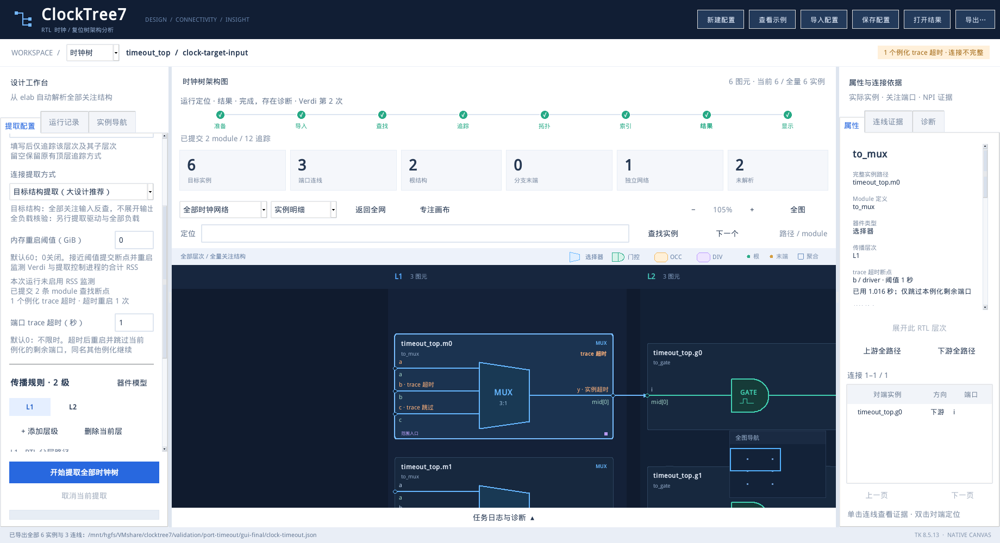

### 29.4 日志与再次闪退恢复

- `verdi.log`：`CT7_PORT_TIMEOUT` 记录触发实例、端口和阈值；`CT7_TIMEOUT_RESTART` 记录下一轮启动。
- `trace-timeouts.jsonl`：本任务的超时实例明细。
- `memory.json`：`trace_timeout_count`、`timeout_restart_count` 单独记录超时实例数和超时重启数；原有 `restart_count` 仍表示内存重启。
- `memory.json` 的 `trace_monitor_transport`：`socket` 表示本机通信，`file` 表示文件确认，`disabled` 表示未启用端口超时；自动回退原因记录在 `trace_monitor_fallback`。
- 每个任务工作目录的 `trace-timeouts.json`：带任务签名的持久跳过决定；配合 `checkpoint.json` 恢复。不要手动删除或改写这些文件。
- 阶段日志：追踪、超时、重新启动和后续继续都可定位到当前实例与端口。

如果超时决定保存后控制进程又突然退出，重开 GUI 可看到已保存的超时决定并从断点继续。工具先核对并停止旧 worker，再撤回未提交尾部；不会因重新打开而再次陷入相同实例的超时端口。恢复仍校验原输入、原设备和实现版本。

### 29.5 作用范围

- **目标结构提取**：对实际执行的输入 driver trace 计时；该模式不展开输出 load，因此没有虚构的“输出负载超时”。
- **全负载核验**：输入 driver、输出 load 分别计时；任何一个超时都只跳过当前实例的剩余端口。
- **时钟树与复位树**均支持；与内存阈值独立，内存监测设为 `0` 时端口超时仍生效。
- 阈值覆盖一个端口的整次 trace 工作，不是“最近一次进度之后的空闲时间”。即使计数仍增加，达到端口总耗时阈值也会跳过。
- **不覆盖** elab 导入、module 查找、枚举时端口绑定/输出校验、重启时句柄恢复、拓扑/索引/绘图。若卡在这些阶段，此选项不会把它误记为某个端口 trace 超时。
- 监测、系统调度和终止进程存在延迟；实际超时记录可能略大于设定值。重导入 elab 的时间不属于该端口阈值，超时不代表下一实例能在该秒数内立即开始。
- 无法从一个未完成端口的第 N 个 load 继续。该端口本次结果整体撤回，先前已经提交的其他端口不受影响。

实测范围、阻塞注入方法和逐项验收见 [端口超时验收报告](PORT_TRACE_TIMEOUT_VALIDATION.zh-CN.md) 与 [组合故障/规模压测报告](RESILIENCE_VALIDATION.zh-CN.md)。商业芯片原始故障库不在本次测试中，不能把测试电路结果等同于商业全芯片验收。

### 29.6 受限设备的通信方式

本机通信只绑定 `127.0.0.1` 的系统分配端口，每轮 Verdi 使用独立校验令牌，不需要外部服务器。创建本地监听失败时自动回退文件确认；原因写入 `memory.json`。若设备允许监听但限制子进程连接，可在启动工具前显式选择文件方式：

```bash
export CLOCKTREE_TRACE_TRANSPORT=file
bash clocktree.sh gui
```

恢复默认使用 `unset CLOCKTREE_TRACE_TRANSPORT` 后重新启动工具。此环境变量不改变 GUI 的秒数阈值、跳过范围或断点规则。运行中通信断开会停止当前任务并保留已提交证据，不能把通信异常当作端口已完成；修复环境后可以在同一实现版本下从断点继续。

### 29.7 深层设计的展开错误

本次 Verdi 2018 环境在极深 RTL 上可能只用 Warning 报告超过层次上限并跳过展开。工具现在把已知的这条信息作为导入失败处理，日志保留原警告；导入 KDB 时，如果标准旁置编译日志仍在，也会检查。若层次句柄存在但 module 定义为空，查找阶段会明确提示该路径没有已展开的 module 定义。

遇到这些提示，先在“阶段诊断”和 `verdi.log` 查看原始错误，再核对现场编译设置或换用完整数据库。端口超时、增加工具的传播层级、反复重试都不能补回编译器没有展开的结构。工具的传播层级数与 RTL 实例嵌套深度是两个概念；本轮的 50 层警告来自该 Verdi 编译环境，不是工具新增的层级上限。

<a id="workbench-v3"></a>
## 30. 分支布局、快速导航、搜索历史、子系统与完整问题表

本章介绍 3.0 界面。前面章节的启动、设计入口、直接父层查找、断点和端口超时操作继续适用；旧截图中的固定层级画布可通过“按层排列”切换回来。时钟树和复位树共用本章的画布与问题表。

### 30.1 新版工作台入口

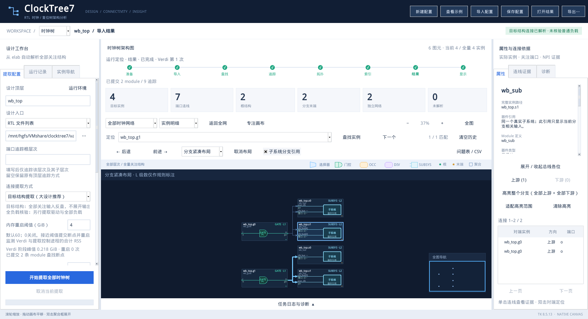

画布工具栏提供布局模式、导航后退/前进、问题表和取消布局。右侧属性区提供带数量的上游、下游入口，以及整个分支高亮、适配高亮、清除高亮。搜索框可直接输入，也可以从下拉历史中选择。

默认采用“分支紧凑布局”。L1～LN 仍表示规则中的传播级数，用于逆序检查及器件标签；器件位置根据实际连接排列。因此 L5 可以出现在 L2 旁边，同层串接也可以沿水平方向展开。切换“按层排列”可恢复分层背景和固定的层级顺序；这两种布局使用同一份已证明连接。

拖动时复用已有图元；连续滚轮缩放期间暂时隐藏细小文字，停止后恢复器件名、端口和实际信号。远景的概览框和简化外观只改变显示精度，不删除 JSON 中的实例、端口和连接。全图导航小图中拖动只改变视口框。

布局正在计算时，画布显示“正在计算布局”。可切换到其他视图，旧计算会被丢弃；点击“取消布局”恢复此前已完成的视图。此操作只取消绘图计算，不取消正在进行的 EDA 提取；取消提取仍使用左下方的“取消当前提取”。

### 30.2 快速跳转上下游

1. 单击器件，在右侧确认真实实例路径、输入和输出。
2. 点击“上游（数量）”或“下游（数量）”。数量按相邻器件去重。
3. 只有一个相邻器件时直接定位；有多个时弹出列表，可搜索实例、端口或实际信号。
4. 列表每页 100 条端口连接，同一个器件可以因为多个端口出现多行。双击条目或点击定位即可跳转。
5. 使用“后退”“前进”恢复此前选中的器件及视口；目标已在当前视图时不会重新布局。大图中目标不在当前页时进入其局部邻域。

对于“器件引用”，上游入口只沿该引用所属分支返回。子系统没有下游输出。未解析连接不会产生可跳转的虚构器件。

### 30.3 整个分支高亮

选择器件后点击“高亮整个分支”。高亮范围为该器件的全部上游边与全部下游边的并集：

- MUX 的全部已解析输入路径都保留。
- 上游器件分出的其他旁支不被顺带选中。
- 子系统引用只使用该引用显示的输入端口；不会把同一真实子系统的另一时钟输入加入本分支。
- 高亮在平移、缩放、翻页和层次聚合后保留；聚合线表示其包含的真实边中存在高亮边。
- “适配高亮范围”可从局部邻域回到全网概览并适配高亮，“清除高亮”恢复正常显示。

高亮表示静态连通关系，不代表 MUX 当前选择状态、时钟实际运行状态或复位是否有效。

### 30.4 搜索历史与布局偏好

在搜索框按 Enter 或点击“查找实例”属于一次显式搜索；无匹配的查询也会保存。连续输入过程不写历史。

- 每个设计、每种分析类型分别保存最近 100 条记录。
- 相同查询去重并移到最前；空白查询不保存。
- “清空历史”只清除当前设计、当前分析类型的记录。
- 关闭后重新启动，恢复搜索下拉列表、布局模式和子系统引用开关。
- 设计身份由顶层、elab/文件列表路径及基础目录区分；同一设计换到另一文件路径会形成另一组历史。

历史与偏好单独写入用户状态目录的 `ui-preferences.json`，不会因为增加一条搜索而重写大图 JSON 或索引。指定 `--session-dir` 时位于该目录。不要把个人历史提交到 GitHub。

### 30.5 添加输入型子系统

`SUBSYSTEM` 可用于时钟树和复位树。该模型代表关注信号进入的子系统边界：可以关注多个输入，没有关注输出；真实 RTL 中未选择的输出不会变成图上的输出。

操作顺序固定为：

**填写 module 与直接父层 → 读取 elab 的 input 端口 → 正则筛选 → 勾选并确认 → 保存器件规则 → 启动主提取。**

1. 先填写设计顶层及 elab/KDB 或 RTL 文件列表。
2. 在目标 L 层填入子系统实例的**直接父层路径**。例如实例为 `soc.u_periph.u_uart`，则父层为 `soc.u_periph`；不会递归寻找该父层内部更深的同名 module。
3. 添加器件，类型选择 `SUBSYSTEM`，填写 **module 定义名**，例如 `uart_subsystem`。
4. 点击“读取 elab 输入端口 → 正则筛选 → 勾选确认”，打开前处理窗口。
5. 点击“① 读取输入端口”。工具启动独立 Verdi 进程，导入设计，在指定父层匹配实例，只读取 formal input 的名称、方向、实际位宽及适用实例。此阶段没有 driver/load 追踪。
6. 输入正则，点击“② 正则筛选”。在表格第一列勾选需要的端口，可用“勾选全部匹配口”或“清空勾选”。
7. 点击“③ 确认端口”返回编辑窗口；关注输入框显示已确认名单，输出框禁用。
8. 点击“保存规则”。完成其他器件后，再点击左下角“开始提取全部时钟树”或复位树按钮。

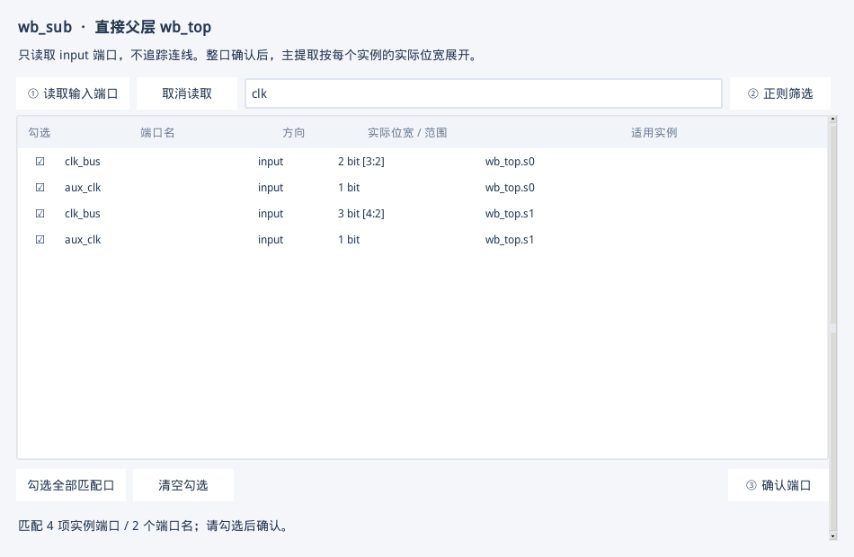

同一 module 有多个实例时，表格逐实例显示。例如 `s0.clk_bus` 是 `[3:2]`、`s1.clk_bus` 是 `[4:2]`，会显示两行。勾选按端口名作用于匹配的全部实例；主提取再逐实例核对是否存在及其位宽。当前配置不支持同一规则下按实例分别勾选不同的端口名单；这种需求应拆成不同父层规则。

“取消读取”终止本次独立读取进程，保留已保存规则；关闭前处理窗口也会停止尚未结束的读取。读取失败的具体原因显示在窗口底部，日志位于运行目录下 `.input-discovery/<任务编号>/preprocess.log`。前处理没有人为设置的总时限。

### 30.6 正则、确认状态与总线

正则使用 Python `re.search`，默认区分大小写，对 **elab formal 端口名**匹配，不搜索 RTL 源码中的信号声明。

| 目的 | 正则示例 |
|---|---|
| 名称中包含 `clk` | `clk` |
| 名称以 `clk_` 开头 | `^clk_` |
| 只选择两个已知名称 | `^(clk_bus|aux_clk)$` |
| 关注复位输入 | `(^rst|reset)` |
| 用户明确需要忽略大小写 | `(?i)clk` |

非法正则、零匹配或没有勾选任何匹配口时，不能完成确认。修改正则后需要重新筛选并确认；修改 module 或该规则的父层路径后，需要重新读取并确认。器件编辑窗口中的关注输入不能绕过确认手工扩大。

确认后，名单写入时钟规则的 `clock_inputs` 或复位规则的 `reset_inputs`，`input_regex` 只保存为编辑辅助。**主提取不重新运行正则，也不自动把后来新增的同名模式端口加入关注范围。** 使用外部 JSON 配置时，可直接给出明确的 input 名单；其中只有 `kind: subsystem` 可以省略输出字段。

一维总线按整个 formal 端口勾选，预览显示实际范围。主提取按每个实例的 elab 范围逐位追踪，如 `clk_bus[4]`、`clk_bus[3]`、`clk_bus[2]`。图中默认按端口分组，双击子系统或点击属性区的展开入口查看各位，再次操作可收拢。属性、连接列表、原始证据和 JSON 保留逐位信息。

本轮实际验证了参数化的一维 packed 总线及非零下标。未能可靠取得范围、复杂多维或不支持的映射会进入问题表；不会按猜测的位宽补连。若需显式位选，应在外部配置中提供已知的具体位，并检查结果诊断；不要把未解析总线视为验收通过。

### 30.7 独立输入网络与器件引用

假设同一真实实例 `soc.u_cpu` 的 `core_clk` 来自分支 A，`debug_clk` 来自分支 B。工具把两个输入作为独立端口终点，不因为它们在同一个子系统框内就认为 A、B 连通。

默认开启子系统器件引用：在 A、B 末端分别显示 `soc.u_cpu` 的引用框，各自只展示本分支有关输入，并明确标记“器件引用”和真实路径。这是两个显示位置，**真实实例总数仍只算一次**。一个上游输出同时连接该实例的多个输入时，可以在同一引用中显示这些输入。

关闭引用开关后显示单个实际子系统框；其输入仍保持各自网络归属。Tk、SVG、结果索引和历史恢复使用相同语义。超时或未连接端口保留状态标记，不产生输出，也不借子系统内部逻辑跨接到另一个输入。

点击“专注画布”可暂时收起左右面板，为分支和端口留出更多空间；“恢复面板”返回完整工作台。

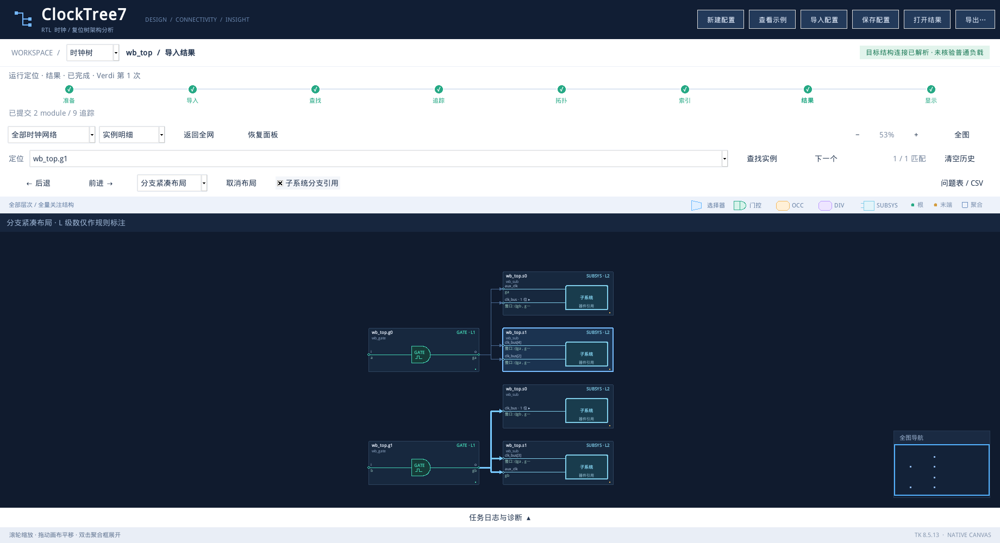

### 30.8 阅读连接证据

单击连线，默认先显示：

```text
wb_top.g0.o（ga）
  → wb_top.s1.clk_bus[4]（{ga, gb, ga}）

验证结论：输入反查已找到此输出。
输出全负载方向：未执行。
规则层次：L1 → L2
反查映射：输入位 ← formal 端口 ← 父层信号 ← 来源输出
```

实际显示的信号名和表达式来自该结果中的 elab 绑定信息；上面是说明格式。目标结构模式只证明输入反查到来源输出，未执行输出全负载核验时会明确说明。全负载模式中两个方向都有证据时显示双向核验结论；缺少方向或逆序层连接会提示检查。

摘要只读取最多 8 步映射，长路径标出节选范围。勾选“原始证据”才读取并显示完整 NPI 类型和逐步路径，取消勾选回到摘要。选择连接列表中的不同真实边，可检查共用画布线段下每一条真实连接。

### 30.9 完整问题表

点击工具栏“问题表”，或右侧“诊断”页中的问题表入口。它包含全部诊断记录及未解析端口，不再只显示前 500 条 JSON。

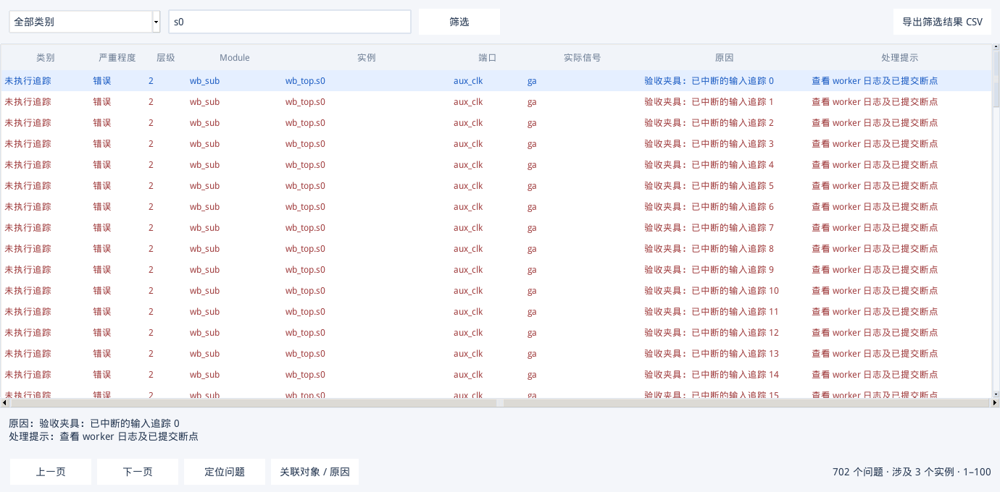

表格列为类别、严重程度、层级、module、实例、端口、实际信号、原因、处理提示。选择一行后，下方显示完整原因和提示，长字段也可以横向滚动查看。

| 操作 | 行为 |
|---|---|
| 分类下拉框 | 分别查看端口超时、随实例跳过、缺失端口、未解析逻辑、多驱动、逆序层、环路等 |
| 搜索并按 Enter / 筛选 | 匹配实例、module、端口、信号及原因等文本，也搜索关联实例 |
| 上一页 / 下一页 | 每页 100 条，覆盖全部记录 |
| 双击 / 定位问题 | 定位真实器件，并标出相关端口；规则问题定位对应 L 层和 module；运行失败打开阶段日志 |
| 关联对象 / 原因 | 查看同一问题的全部关联对象，列表同样分页，可双击关联实例定位 |
| 导出筛选结果 CSV | 导出当前筛选条件下的**全部**问题，不限于当前页；包含问题编号和关联对象数 |

右下角分别显示“问题数”和“涉及实例数”。一条环路问题可以涉及多个实例，同一实例也可以有多个问题；两种数量不会混为一谈。正常 `scope_boundary` 范围边界不加入未解析错误。

elab 导入失败、没有生成结果时，问题表也能显示当前运行失败项并定位阶段日志。此时没有实例可定位，涉及实例数可以为 0。历史中断应先在“运行记录”选择该任务，再打开问题表或阶段诊断。

CSV 使用带 BOM 的 UTF-8；可直接用支持 UTF-8 的表格工具打开。以 `= + - @` 开头的 RTL 文本会加文本前缀，防止表格软件误当作公式。

### 30.10 兼容、验证与限制

旧配置、旧结果及历史快照继续可读。旧索引需要时在用户缓存中升级，保留原历史文件；原始真实实例 ID、连接证据和提取断点不因改变布局而重写。升级实现后恢复未完成任务仍遵循原有版本指纹检查，不强行使用不兼容断点。

性能以 VM 实测为准：8,195 实例实图拖动 P95 25.0 ms、缩放 P95 26.4 ms，停止缩放后约 148 ms 恢复细节；10 万节点合成图通过概览、局部展开、搜索、全分支高亮及重复操作稳定性检查。大图按需显示概览和局部，未同时绘制 10 万个详细器件。

详细测试环境、旧版对比、真实 NPI/KDB 用例、便携包和已知限制见 [本轮逐项验收报告](WORKBENCH_VALIDATION.zh-CN.md)。这些数据不是商业芯片数据库的性能保证。
