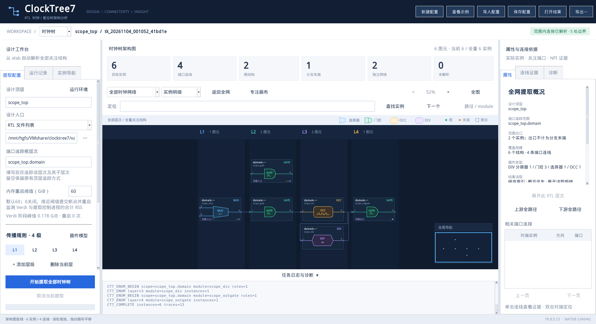

# 内存优化与 Verdi 重启续跑

更新日期：2026-11-04。适用于原生 Tk 工作台和 Linux Verdi/NPI 提取后端。

## 设置与观测

GUI 左侧新增 **内存重启阈值（GiB）**。默认 `60`，`0` 关闭内存轮换；时钟/复位配置分别保存，关闭重开会恢复。调整阈值不改变已经证明的连接，不要求为查看已有图重新提取。



配置 JSON 的顶层字段为 `"memory_limit_gib": 60`；缺少该字段也默认使用 60。命令行可以覆盖配置：

```bash
bash clocktree.sh extract --config my_config.json --out . --memory-limit-gib 60
```

每秒采样一次 Linux `/proc`，合计当前提取控制进程、Verdi 及其后代/进程组的 RSS。不会把其他用户或其他提取任务的进程计入本次 RSS。共享映射可能重复计数，这是保守的 RSS 合计，不等同于唯一物理页占用或调度器记账。GUI 和 Verdi 退出后的 Python 结果处理不在该读数中。

`1 GiB = 1,073,741,824 bytes`。应核对目标集群“64G”的实际单位和计费范围，给 GUI、文件缓存及其他作业开销留余量。采样不是操作系统硬限额；单次内存突增仍可能先触发调度器 OOM，不能保证 64G 商业任务一定完成。

## 保存断点后轮换

| 条件 | 工具行为 |
| --- | --- |
| RSS 达阈值的 90%，默认约 54 GiB | 请求轮换。当前完整模块查询或端口追踪结束后提交进度，正常退出 Verdi，再启动新 Verdi。 |
| RSS 触及阈值，默认 60 GiB | 结束本工具拥有的 Verdi 进程组并回收子进程；回退未提交的数据后，从最后完整断点重试。 |
| 同一断点连续 3 次内存失败，无法推进 | 停止任务并保留断点、已提交证据和日志，报告停留阶段；不会跳过模块或生成“完整”的旧结果。 |
| 正常 EDA 错误、用户取消 | 不作为内存超限自动重试；取消会同时停止控制进程与独立的 Verdi 进程组。 |

未设置提取运行超时。单次查询在阈值以下运行很久时，工具仍会等待。

模块查询按 **精确查找根层次＋module 规则** 分组；完成一组即提交。端口追踪通常每 32 个完整追踪提交一次，收到轮换请求时会提前提交当前已完成追踪。强制结束可能重做当前模块查询或尚未提交的追踪批次。

断点同时记录 `raw.jsonl` 和实例清单的已提交字节位置。重启前将两个文件的未提交后缀截掉，再启动全新 Verdi 工作目录。已提交记录保留一次；完整追踪、完整实例和结束标志才参与最终验收。

**NPI 句柄不能跨进程保存。** 新 Verdi 必须重新导入原库，按实例路径流式读取清单、重建关注端口句柄，再执行未完成查询或追踪。所有目标端口仍参加连接识别，跨模块、跨层及全部扇出不会因分批运行被删掉。

正在使用的 RTL/elab 输入应保持不变。若 Verdi 导入本身、恢复已选端口所需的基线，或单个查询就超过阈值，反复重启无法解决；需缩小查找范围、拆分查询或增加内存。本版本不会把一个超大 NPI 原子查询自动拆成更小层次。

## 运行文件与恢复范围

| 文件 | 内容 |
| --- | --- |
| `memory.json` | 当前/峰值 RSS、配置阈值、当前阶段、工作进程 PID、重启次数、最近 32 次重启摘要。 |
| `memory-restarts.jsonl` | 逐条追加的完整重启审计记录。 |
| `verdi.log` | 每次导入、查询、追踪及 `CT7_MEMORY_SOFT/HARD/RESTART`、`CT7_RESUME` 标记。 |
| `.clocktree-runs/<本次任务>/checkpoint.json` | 当前完整断点；同时保留上一份断点作为损坏回退。 |
| 同目录 `targets.tcl` | 已提交实例与端口的名称清单，按数据列表流式解析；不会直接作为脚本执行。 |
| 同目录 `attempt-0001/` 等 | 每次全新 Verdi 的工作区和编译日志。 |

结果 `metadata.memory_protection` 记录该次运行的内存策略与重启摘要。含空格/中文的输出路径仍使用原有安全工作区映射，真实位置保存在 `runtime-location.json`。

自动续跑的范围是**同一提取控制进程内的 Verdi 内存轮换**。若整个 dsub 任务或控制进程被杀，不会自动在另一新任务中接着旧断点执行。在当前目录重新发起提取仍按“新任务”处理：旧结果、日志和内存记录归档，避免混用不同配置的证据。

## 已实现的内存优化

- 取消非必要全芯片统计；相同查询根与 module 只查一次，及时释放临时句柄列表。
- 追踪 FIFO 取出后回收；队列只携带路径前缀 ID，分支共享前缀，终点即时写出，不积攒完整结果列表。
- Python 按 JSONL 事件处理并释放，覆盖状态只保留必要集合；证据路径写入 SQLite，不在内存中复制所有分支路径。
- 完整 JSON 按记录和路径写出，保持独立可移植性。新增 SQLite 索引是可重建的加速副本，缺失时可从 JSON 重建。
- GUI 恢复索引和小型配置，概览按需聚合；展开、定位和点选证据才读取明细。宽层次分页、连接列表每页 500 条；搜索与全量 JSON 导出仍覆盖全部结果。
- 超大图的精确定位显示有限邻域，完整连接可在属性中分页查看；“返回全网”回到涵盖全部结构的聚合概览。分页或邻域视图不表示删掉了提取结果。

索引位于结果目录 `.clocktree-indexes/`，旁边的 `*.json.index.json` 指向不可变数据库。相同输出目录重跑会创建新索引，已打开的旧视图仍能读取旧数据库。历史恢复保存小型清单及数据库快照；仅复制主 JSON 到其他设备也能重新建立索引。只读结果目录的索引改存用户缓存。

核心拓扑分析仍需要与选中实例及连线数量有关的内存；这些优化不把完整 Verdi KDB 导入变成局部加载，也不承诺全流程固定内存。

## 实测与复现

CentOS 7.9、Python 3.6.8、Tk 8.5.13、SQLite 3.7.17、Verdi O-2018.09-SP2：

| 检查 | 优化前峰值 RSS | 优化后峰值 RSS | 范围 |
| --- | ---: | ---: | --- |
| 同一 OpenC910 原始证据生成图与 JSON | 426.19 MiB | 73.41 MiB | Python 后处理，6,984 实例 / 6,983 连线；不含 Verdi。 |
| 打开结果、生成概览、准备会话快照 | 203.32 MiB | 19.51 MiB | Python 数据模型；不含原生 Tk 窗口、字体与 Verdi。 |

降低内存增加了磁盘工作：该次后处理由约 2.1 秒增加到约 19.8 秒。耗时受文件系统和缓存影响，不作为商业芯片的性能承诺。

原生 Tk 新进程自动恢复 OpenC910 索引的验收峰值约 70.78 MiB；100,001 实例 / 100,000 连线的合成 GUI 压力检查约 91.50 MiB，验证全网聚合、展开翻页、十万扇出连接分页和路径高亮。这是界面压力数据，不是十万实例的真实 NPI 提取证明。

内存保护检查分开执行：真实子进程分配 128 MiB，在 0.12 GiB 阈值下触发两次实际 RSS 重启；真实 Verdi 时钟和复位提取在确定位置注入 55/61 GiB 读数，分别验证正常轮换及强制回退，恢复后的实例、连线和双向证据一致。注入验证没有实际分配 60 GiB，尚未获得商业芯片在 64G 任务额度下的实测结论。

源码中可复现：

```bash
python3 scripts/check_scoped_trace.py --out validation/low-memory/scoped
python3 scripts/check_memory_resume.py --soc
python3 scripts/check_memory_gui.py
python3 scripts/check_indexed_gui.py
```

后三类 GUI 检查须在图形会话中运行。`profile_low_memory.py` 支持分别运行旧版后处理、索引后处理和两种结果打开基准，测量各自独立进程的 RSS。完整原始记录保存在本机 `validation/`，不随源码包分发。
