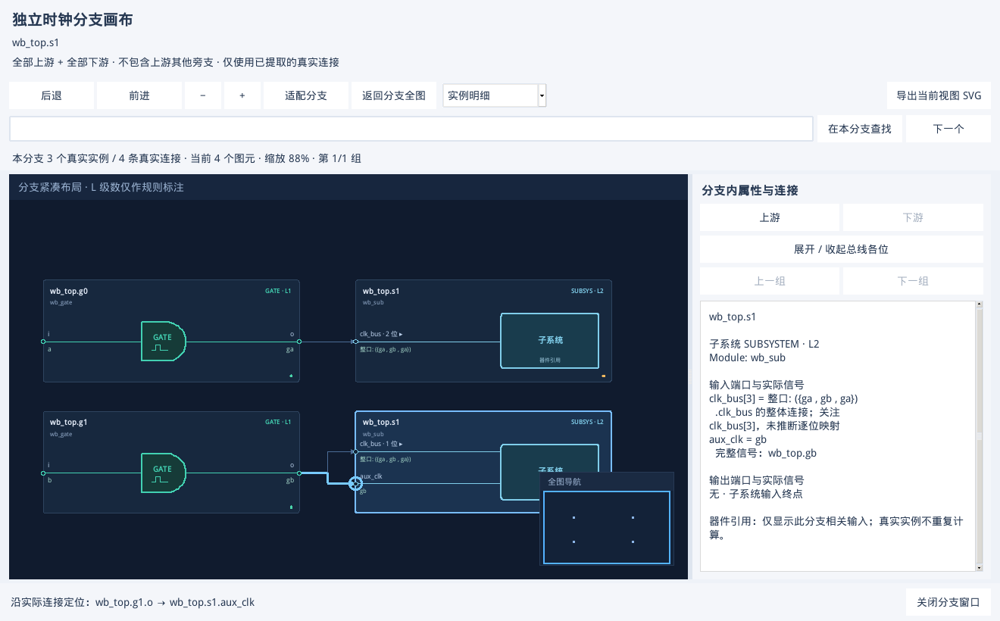

# 多输入器件跳转修复验收

日期：2026-11-10。修复从上游定位到多输入器件时，可能落到该实例另一个输入分支的问题。共享目录中的主 GUI 与独立分支窗口均已更新。

## 原因与修复

旧跳转只携带实例 ID，定位时取第一个具有相同真实实例 ID 的显示引用。子系统的不同输入分属不同分支时，该引用不一定是当前连线的目标；导航历史也使用可能随布局改变的显示 ID。

现在跳转携带真实实例、连线 ID、输入/输出端口及引用来源。候选列表保存具体端口连线，同一实例的不同输入不会提前合并为一个定位目标；在大图局部邻域中会保留所选连线及两个端点。后退/前进和总线重建使用这些稳定信息重新找到对应引用，不依赖引用的显示顺序。

- 普通 MUX 和子系统均标出确切端口；蓝圈指向目标，当前连线高亮。已有整个分支高亮保持原范围。
- 主画布的直接跳转、上下游候选列表、右侧连接列表和独立分支窗口共用相同定位规则。
- 多个输入共用一个上游输出时，直接返回优先使用刚才经过的连线；对应端口不同则保留候选列表。
- 当前视图仅包含另一输入引用时，重新显示正确分支；结果已切换的旧候选窗口不能跳转到新结果。
- 原始实例、端口、连线 ID 和证据未改写，没有新增连接，也不改变提取流程。

## 验收结果

| 检查 | 数据与结果 |
| --- | --- |
| 自动回归 | 最终 **260 passed、1 skipped，14.07 秒**。本次新增 6 项，覆盖内存/索引定位、同实例多输入、同输出返回、引用重排、未连接输入和局部邻域保留所选边。辅助口/缺失端口诊断定位仍可找到真实器件。 |
| VM 原生界面 | **Python 3.6.8 / Tk 8.5.13**。使用已保存的 Verdi 2018 NPI 时钟和复位结果，各有 4 个真实实例、7 条边；内存与 SQLite 索引两种路径，共四种组合全部通过，**0 Tk callback 错误**。 |
| 原问题复现样例 | `wb_top.g0`、`wb_top.g1` 分别驱动同一 `wb_top.s1` 的不同输入；图中 g0 引用先出现。选择 g1 → s1.aux_clk 后，选中 g1 对应引用和 aux_clk，未误选先出现的 g0 引用；源信号为 gb。 |
| 主画布入口 | 候选列表、右侧连接列表和只有一个对端端口的直接跳转均正确；返回上游、后退/前进、展开/收起总线、先切到另一独立网络再定位均通过。 |
| 独立分支窗口 | 从包含 s1 全输入的分支窗口内定位 g1，再选择 aux_clk，正确落到 g1 引用；分支窗口的后退/前进同样保留确切输入。 |
| MUX 与辅助口 | 普通 MUX 的 b 输入和经过的连线正确标出；辅助选择口的问题定位仍可用。 |
| 大图截断边界 | 使用 **129 节点 / 128 连线**合成图，将测试中的明细上限临时设为 8，强制第 128 条边不在首批邻域中。跳转后仍包含该边和两个端点，同一真实实例不同引用之间的跨邻域后退/前进正确；候选列表第二页 28 条记录可准确跳转。此项是确定性边界回归，不是商业规模压测。 |
| 既有分支功能回归 | 重新运行原分支脚本，时钟/复位的原生双击、主图保持、多窗口独立、取消及关闭清理均通过。8,195 实例已有 NPI 结果中，选定分支为 2 实例 / 1 连线，与源边集合相同。 |
| 大索引与资源 | 100,000 节点 / 99,999 连线合成图完整保存在分支索引中，概览聚合为 2 个图元，搜索、局部定位及取消通过。反复开关 5 次局部分支，RSS 均为 **82,208 KiB**，私有索引均清理；0 callback 错误，最终日志没有 Tk 析构告警。 |

首轮界面回归还发现“多个输入共享一个上游输出”返回时会选该引用的第一条边，已补充保留刚经过的连线，再完整复测。首次 Windows 全量自动测试中的一个既有内存断点用例在 `tkinter.Tcl()` 初始化时遇到 Conda `init.tcl` 临时读取错误；未修改系统 Tcl 设置或删改该测试，随后全量通过，最后一次结果如上。



截图中上下两个框属于同一个真实子系统 `wb_top.s1`。下方框的 `aux_clk` 与 g1 的输出相连，蓝圈和高亮保留了这条实际连接。

## 复现与记录

```bash
python3 scripts/check_navigation_gui.py \
  --out validation/navigation-check \
  --clock validation/workbench/subsystem-3/target/clocktree.json \
  --reset validation/workbench/subsystem-edges/reset-target/resettree.json
```

需要原生图形显示或 Xvfb，输入是现有 NPI 结果。共享目录中的最终记录为：

- `validation/navigation-20261110-final/acceptance.json` 和同名 `.log`：本次跳转验收。
- `validation/navigation-branch-regression-20261110/acceptance.json` 和同名 `.log`：已有分支窗口与大索引回归。
- `validation/navigation-20261110-tests-final.log`：完整自动测试。
- [可随源码分享的 JSON 汇总](NAVIGATION_FIX_VALIDATION.json)。

本轮验证的是结果浏览和定位，没有重新 elaboration 或重新提取开源/商业 SoC；修复可用于旧结果，重新打开 GUI 加载结果即可。该报告不代表用户现场超大商业 KDB 的全流程验收。
