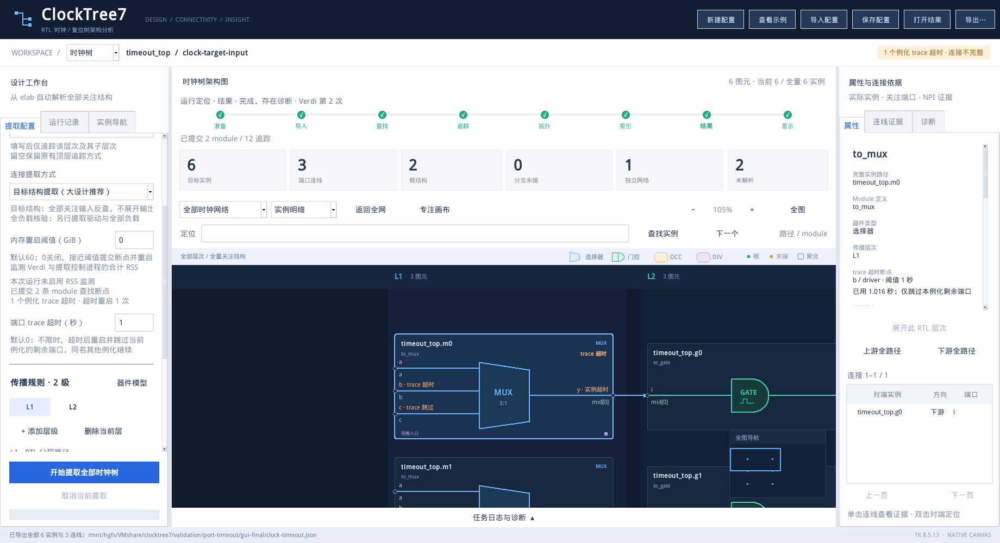

# 端口 trace 超时验收报告

日期：2026-11-06。实现位于共享目录 `D:\VMshare\clocktree7`，VM 使用 `/mnt/hgfs/VMshare/clocktree7` 的同一份代码。用户确认的跳过范围为**当前例化实例**，不是同名 module 的所有实例。

本报告保留端口超时初版的实测数据。后续已将临时文件确认改为本机通信，并扩大组合故障与规模检查；最新性能、修复和验收见 [进一步压测报告](RESILIENCE_VALIDATION.zh-CN.md)。

## 行为与实现

- GUI 新增 `端口 trace 超时（秒）`，配置键 `port_trace_timeout_s`，默认 `0` 不限时。接受非负有限数字，支持小数；时钟树和复位树工作区独立保存。
- 目标结构模式计时每个实际输入 driver trace；全负载模式计时输入 driver 和输出 load trace。不改变实例查找、elab 导入或任务总时长。
- Python 控制进程独立于 Verdi/Tcl 计时；超时后先持久保存实例跳过决定，再结束所属 Verdi 进程组，撤回当前未提交追踪，重新导入并继续其他实例。
- 正常返回的端口也需要控制进程确认才可提交，避免监督线程采样间隙漏掉超时，或处理超时时 worker 已走到其他实例。
- 已完成端口证据保留。触发端口与未执行端口分别记录 `trace_timeout`、`trace_skipped_timeout`；目标模式的输出标明没有执行 load trace。
- Tk 器件和端口、属性、JSON、SVG、结果索引、历史恢复均保留超时状态。结果标为连接不完整；不将超时实例误判为根或末端。
- 超时决定绑定原任务配置签名，跨次恢复仍生效。超时重启与内存重启单独计数。

## 验收环境与方法

原生环境为 CentOS 7.9、Python 3.6.8、Tk 8.5.13、Verdi O-2018.09-SP2，以普通 `host` 用户执行。VM 可用物理内存约 16 GiB，未申请或分配 60 GiB。

阻塞用例仅修改每次任务工作目录里的 Tcl 副本，在当前端口追踪入口同步执行 `/bin/sleep 10`，模拟无法响应 Tcl 定时回调的原生阻塞，并故意写入未提交的损坏数据。生产的外部计时、信号终止、断点回退、跳过逻辑以及其他实例的 NPI 追踪均实际执行。此方法验证阻塞处置机制，不等同于复现商业芯片内部 NPI 故障。

## 逐项结果

### 端口与实例：9 项通过

| 用例 | 设置阈值 | 实际触发耗时 | 结果 |
| --- | ---: | ---: | --- |
| 时钟树，目标结构，MUX 输入 b | 1 s | 1.003 s | b 超时、c 跳过，其他 MUX 实例继续 |
| 时钟树，全负载，MUX 输入 b | 1.25 s | 1.257 s | b 超时、c/y 跳过 |
| 时钟树，全负载，MUX 输出 y | 1.75 s | 1.750 s | y 超时，a/b/c 已完成证据保留 |
| 复位树，目标结构，MUX 输入 b | 1.5 s | 1.505 s | b 超时、c 跳过，其他实例继续 |
| 复位树，全负载，MUX 输入 b | 1.25 s | 1.273 s | b 超时、c/y 跳过 |
| 复位树，全负载，MUX 输出 y | 1.75 s | 1.755 s | y 超时，已完成输入保留 |
| 阈值 0，端口注入 0.3 s 延迟 | 不限时 | 无超时 | 一次启动完成，连接完整 |
| 512 个普通负载、6 个关注结构 | 10 s | 无超时 | 一次启动完成，3 条目标连接完整 |
| 超时决定保存后 SIGKILL 控制进程 | 1.5 s | 1.501 s | 新进程恢复跳过决定、停止旧 worker、继续其他实例 |

上述超时用例均确认：只标记一个具体实例；同名的另两个 MUX 继续追踪；trace 序号连续无重复；损坏尾部清除；实例总数仍为 6；3 条可由下游反查证明的连线保留；超时结果不声明连接完整。内存监测设为 `0`，证明端口超时独立生效。每次超时共启动两轮 Verdi，内存重启计数为 0、超时重启计数为 1。

超时场景总运行用时约 8.3–10.1 秒，包含重新导入与后续提取，不能与 1–1.75 秒的端口阈值混为一谈。

证据：`validation/port-timeout/native-accepted/acceptance.json`。计时精度修正后的最终跨进程恢复复核另存 `validation/port-timeout/recovery-final/acceptance.json`。重跑：

```bash
source scripts/eda_env.sh
python3 scripts/check_trace_timeout.py --out validation/my-port-timeout
```

### 原生 Tk：两个独立进程通过

真实 Xvfb/Tk 窗口检查了阈值默认值、非法输入拒绝、小数保存、时钟/复位独立草稿、重开恢复；实际载入超时结果，检查触发端口/跳过端口/已完成端口和未执行输出 trace 的区别；导出 JSON、SVG 后核对状态及端口信号。界面回调错误为 0。

实际截图已查看，端口信号和超时标签可辨识；MUX 末端信号与范围入口标记保留间距。




证据：`validation/port-timeout/gui-final/acceptance.json`，另有两个进程的 `write.json`、`read.json`。运行方式：

```bash
xvfb-run -n 178 -s '-screen 0 1920x1080x24' python3 scripts/check_trace_timeout_gui.py \
  --out validation/my-port-timeout-gui --fixtures validation/my-port-timeout
```

### 1,026 路目标负载压测

同一 RTL 含 1,026 个目标负载、1,024 个普通寄存器负载，共提取 1,027 个关注实例、1,026 条连线。两次均实际执行 Verdi，无故障注入。

| 设置 | 总耗时 | Verdi/控制进程合计峰值 RSS | 结果 |
| --- | ---: | ---: | --- |
| 端口超时 0，关闭 | 19.234 s | 0.241 GiB | 完整，无超时 |
| 端口超时 10 s，开启 | 58.705 s | 0.247 GiB | 完整，无误触发，连线集合与关闭时完全一致 |

两次均为 5 次原生驱动查询、1,025 次公共路径缓存命中。开启超时增加逐端口状态发布、确认和断点写盘，因此存在明显时间开销；这里是 VMware 共享目录的实测，不能保证其他设备的耗时比例。已去除重复断点写盘并缩短确认等待，开启状态由初版 86.622 秒降至 58.705 秒。默认 `0` 保持原有不握手的执行路径。

证据：`validation/port-timeout/stress-accepted/acceptance.json`。重跑：

```bash
python3 scripts/check_trace_timeout.py --out validation/my-timeout-stress --stress --count 1024
```

### 回归与内存保护

- Windows 单元/协议回归：**165 passed、1 skipped**。跳过项为 Linux Verdi wrapper/symlink 平台限定测试；VM 实际 Verdi 用例另行执行。新增 16 项覆盖计时、确认竞争、断点回退、实例跳过、Tcl 主循环、配置及信号显示，包含小数阈值精度和恢复文件缺失时拒绝继续。
- 原有目标/全负载模式的 **21 项原生 NPI 回归通过**，包括时钟/复位、2/10 层、范围边界、位映射、多驱动、未知逻辑与缺失端口诊断。
- **5 项真实 RSS 压力用例通过**，并验证极低阈值无进展时停止。时钟/复位的软阈值 0.5 GiB 在 0.475 GiB 提交轮换；硬阈值 0.375 GiB 在 0.437–0.438 GiB 终止回退；CLI 覆盖阈值 0.625 GiB 在 0.687 GiB 终止。每个用例实际轮换两次，图与对照证据一致，没有注入伪造 RSS。

证据：`validation/port-timeout/regression/matrix.json`、`validation/port-timeout/rss/acceptance.json`。

## 边界

1. 商业大芯片原始故障库未提供，尚未在该库验收；本次不宣称消除了 Verdi 导入内存或所有内部阻塞。
2. 超时是主动接受不完整结果的可选策略；图中仍保留未知处。将阈值调高或设为 0 后，需新建提取才能重新检查已跳过实例。
3. 重启需要重新导入 elab，耗时和底座内存仍由设计规模决定。设置过低可能造成频繁重启。
4. 监测与进程调度有延迟，非硬实时计时；导入、查找、枚举绑定和恢复句柄不计入端口 trace 阈值。
5. 历史完成结果可浏览；实现升级前的未完成任务仍受版本签名校验约束，不应手工修改断点绕过检查。

操作细节见 [GUI 手册第 29 章](GUI_USER_MANUAL.zh-CN.md#port-trace-timeout)。
