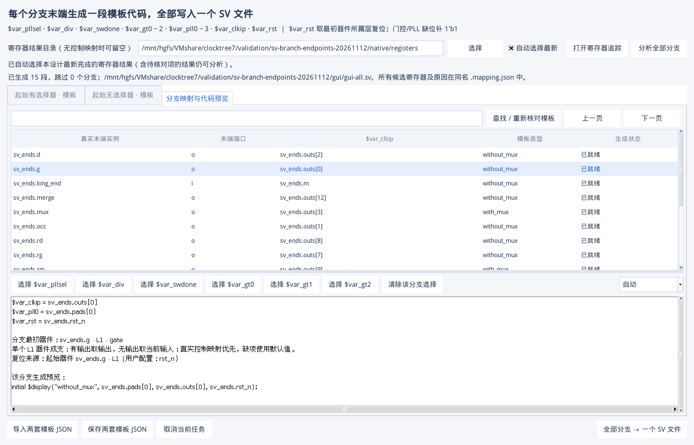

# SV 分支末端与单个 L1 器件验收

日期：2026-11-12。源码及主要测试数据位于共享目录 `D:/VMshare/clocktree7`，Linux VM 通过 `/mnt/hgfs/VMshare/clocktree7` 执行。原生环境为 Python 3.6.8、Tk 8.5、Verdi O-2018.09-SP2 与 VCS O-2018.09-1。

## 本轮行为

- 分支按各自真实末端计数，包含提前停在 L1 或其他层的末端。中间器件不重复生成；多输入末端选择器汇合到一个输出时只生成一段。
- 最初器件按连接先后确定，可为 MUX、门控、DIV、OCC、穿线或子系统。同层串接不按名称或布局位置判断；后面的 MUX 不冒充最初器件。
- 单个 L1 器件构成完整分支：有输出时 clkip 取输出实际连接，无输出时取相关输入；非 MUX 的 pll0 取该 L1 器件输入，后续 PLL 槽位补 `1'b1`。单个 MUX 保留全部已配置输入。
- 无实际控制配置时，pllsel、swdone、gt0/1/2 为 `1'b1`，div 为 `0`。已配置辅助口仍严格要求真实寄存器映射；多候选继续由用户选择，未完成不补默认值。
- SUBSYSTEM 各输入/bit 分开计数。穿线按已证明的通道到达具体末端输出，支持一输入多输出，不合并不同通道。
- 新结果明确标注 L2+ 起点但没有 L1 器件/接口证明时报告问题。既有已证明 L1 层次 input 直达后续层的兼容分支保留，其复位仍属于最初真实器件。
- GUI 显示“末端端口”、实际最初器件和单 L1 解释；映射 JSON 增加 `branch` 元数据。计划版本变化会要求重新分析，原提取连接及模板保留。

## 自动测试与原生验证

| 项目 | 实测结果 |
| --- | --- |
| 主机完整自动测试 | 359 passed，1 skipped；15.16 秒 |
| 新增专项测试 | 13 个：四类单 L1 器件、输入子系统、内存/索引图、同层串接和不同末端层、末端 MUX 汇合、真实控制及多候选、穿线独立通道与多输出、非 L1 截断起点、旧计划失效 |
| VM 实际 KDB 提取 | 14 个真实实例，5 条连接，L1/L3/L5 均有末端；无未解析和诊断 |
| 辅助寄存器追踪 | 4 个实际辅助端口、5 个 bit，全数确认；包括 `Q[7]`、`Q[5:4]`、`Q[2]` 和 sw_done 的已证明数据输入 |
| SV 末端数 | 15 段，其中 12 个单 L1 端点、3 个多器件分支；无中间器件重复、无 MUX 输入翻倍 |
| 默认值与精确信号 | 所有单 L1 端点逐项核对；选择器保留两路实际 PLL；子系统 `[3:2]` 位序和穿线 x/y/z 对应均正确 |
| 生成 SV | 全部写入一个文件，15 个代码段、0 跳过、无残留变量；VCS `-kdb=only` 编译/展开通过，未宣称功能仿真 |
| 原生 Tk | GUI 后台分析、导出、端口列、起点及单 L1 预览通过；两次独立 GUI 启动恢复 15 个分支，回调错误 0 |
| 旧 SV 原生回归 | 有/无起始 MUX 两条分支；三门控真实先后顺序不变；多 sw_done 先跳过一段，选择后生成两段；VCS 通过 |
| L1 接口旧回归 | 时钟 target/full、复位 target/full 四组均为 6 实例/4 边、0 未解析；负例仍有 1 个预期未解析 |
| 便携包预检 | VM 独立目录解包，清空 PYTHONPATH、禁止用户 site；291 个载荷文件校验通过，重新生成 KDB、追寄存器、验证全部 15 分支并编译生成 SV 通过 |

完整 pytest 在 Windows 主机执行。VM 未安装 pytest，VM 验收使用仓库自带的标准库测试脚本及真实 Verdi/Tk，不将该环境描述为已经运行 pytest。



## 一万分支压力与存储复测

合成 10,000 个独立 L1 门控末端，逐个验证 pll0/clkip，并导出包含全部模板变量的 10,000 段代码。此测试验证分支计划和导出规模，不冒充一万器件实际 Verdi 提取，也不代表十万节点画布性能。

| 结果目录 | 分析、导出、全量映射核对及完整性检查 | Python 峰值 RSS | 段数 / 跳过 | SQLite 完整性 |
| --- | ---: | ---: | ---: | --- |
| VMware 共享目录 HGFS | 27.188 秒 | 36.94 MiB | 10,000 / 0 | `ok` |
| VM 本地文件系统 | 4.778 秒 | 36.78 MiB | 10,000 / 0 | `ok` |

首轮暴露的查询问题：SQLite 将 `walk JOIN nodes` 选择为每个分支扫描全图节点，压力随总图规模放大。现用 `CROSS JOIN` 固定以当前分支队列为外层，通过实例主键查询相关器件；同样覆盖根查找、器件排序、门控祖先和候选检索。没有减少分支或省略映射来取得这些数值。

首轮 HGFS 压测还发生 `sqlite3.DatabaseError: database disk image is malformed`，没有成功导出，保留失败目录 `validation/sv-branch-endpoints-20261112/scale`。当时主机曾在 VM 写入期间打开该 SQLite 文件查询执行计划；这与共享文件系统的一致性风险相关，但没有足够证据确定唯一原因。后续避免跨系统并发打开活动数据库，在共享目录和 VM 本地目录的两次完整重跑均通过。**查询优化解决的是全表扫描，不宣称修复 HGFS 底层一致性问题。** 首轮不是有效性能基线，不计算加速倍数。

需要降低此类存储风险时，可继续从共享目录运行源码，将任务结果放在 VM 本地目录，例如：

```bash
cd /mnt/hgfs/VMshare/clocktree7
python3 -m clocktree gui --runs /home/host/clocktree7-runs
```

已有失败计划不当作完整结果使用；重新点击“分析全部分支”会创建新计划，保留原提取与模板。

## 证据与复现

共享目录下的完整证据根为 `validation/sv-branch-endpoints-20261112/`，包含：

- `native/acceptance.json`、`native/all.sv.mapping.json`：实际 elab、逐项变量与编译结果。
- `scale-fixed/acceptance.json`、`scale-local.json`：两种文件系统的压力指标及完整性检查。
- `gui/gui-write.json`、`gui/gui-read.json`：独立 GUI 写入/重开结果。
- `legacy-sv/acceptance.json`、`legacy-l1/acceptance.json`：既有行为回归。
- `packages/`：预检包和完成提交后生成的正式便携包；测试日志、KDB、用户会话不提交到 GitHub。

原生验收：

```bash
python3 scripts/check_sv_branch_endpoints.py --phase native --out /path/to/new/native
python3 scripts/check_sv_branch_endpoints.py --phase scale --count 10000 --out /path/to/new/scale
xvfb-run -a python3 scripts/check_sv_branch_endpoints.py --phase gui-write --source /path/to/new/native --out /path/to/new/gui
xvfb-run -a python3 scripts/check_sv_branch_endpoints.py --phase gui-read --source /path/to/new/native --out /path/to/new/gui
```

每次复测使用独立新目录，保证不覆盖已有证据。本轮没有取得用户商业芯片数据，验收范围为上述真实测试 KDB、已有回归及合成压力数据。
