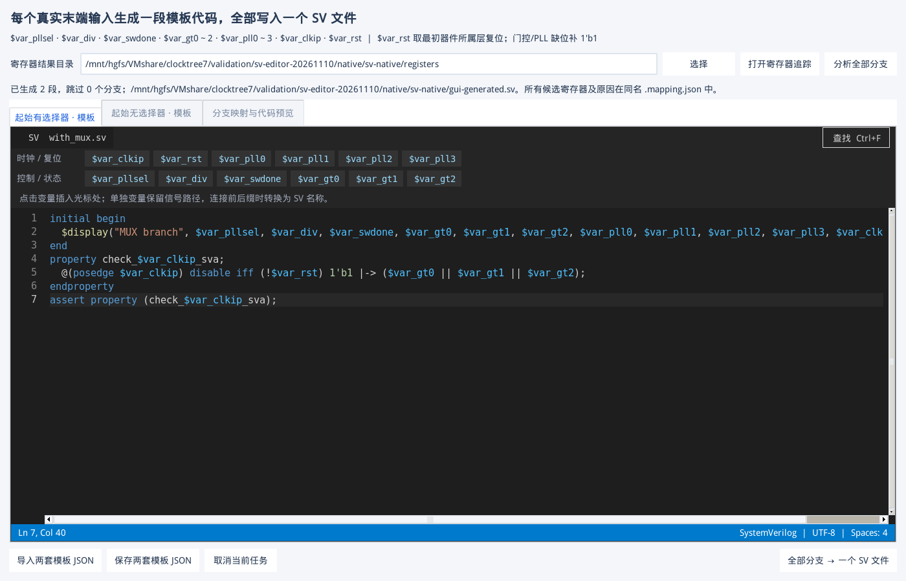

# SV 模板代码编辑器与前后缀变量验收

日期：2026-11-10～11。范围：原生 Tk 模板编辑、变量按钮、变量边界解析与名称转换；不改变 elab 提取、寄存器位映射或真实时钟树连线。

## 1. 交付行为

两套模板页使用同一套原生 Tk 深色代码编辑器：SystemVerilog 关键字、类型、注释、字符串、数字、系统任务与模板变量分色；行号、当前行、光标行列、双向滚动、缩进、撤销/重做和查找。

编辑区上方提供 12 个变量按钮。点击 `$var_pll0` 就在当前光标处插入完整的 `$var_pll0`；存在选择区域时替换所选文字。两个页签互不串写。现有模板 JSON、分支计划及正常退出后的历史恢复继续有效。



用户确认的名称规则已经实现：

```systemverilog
// 模板：$var_clkip = top.u.clk
check_$var_clkip_sva: assert property (@(posedge $var_clkip) 1'b1);

// 生成：名称使用下划线；表达式保留真实 RTL 路径。
check_top_u_clk_sva: assert property (@(posedge top.u.clk) 1'b1);
```

变量名采用最长的已知名称匹配，支持后接下划线后缀与 `${var_clkip}` 明确边界；`$var_pll10`、`$var_gt00`、未知变量及缺失右花括号仍报错。替换是一次性字面处理，不执行模板、不递归展开替换值；`$display` 等系统任务与 `$$var_clkip` 字面文本保持原样。

## 2. 实现与兼容

- `sv_template_text.py` 为编辑器和生成器提供同一套变量解析，避免高亮接受但导出拒绝的两套规则。最多缓存 8 份解析结果。
- 单独变量仍是原始信号路径；与标识符前后缀相连时，路径和位选分隔符转换为下划线，必要时加前导下划线。
- 编辑器将连续修改合并后着色，每批最多处理 180 段并让出 Tk 事件循环。继续修改会取消过期任务；关闭时取消待执行回调。
- 行号只绘制当前可见行，长文本不会创建数万个行号图元；撤销历史有上限。
- 保持 Python 3.6 / Tk 8.5 和离线环境兼容；不用 Monaco、浏览器、Pygments 或新装第三方运行依赖。

## 3. 自动测试与真实 GUI

| 验收项 | 结果 |
| --- | --- |
| 全部自动测试 | **300 passed, 1 skipped**；跳过项为 Windows 不执行的 Linux wrapper/symlink 检查 |
| 原生按钮操作 | 12 个按钮逐个发送真实 Tk 鼠标按下/抬起事件，插入完整变量名并验证光标位置 |
| 编辑行为 | 选择替换、Ctrl+Z/Ctrl+Y、Tab/Shift+Tab、多行缩进、换行缩进、查找通过 |
| 语法与诊断 | 关键字、类型、数值、系统函数、跨行注释、字符串、中文与未知变量标签检查通过 |
| 生命周期 | 连续修改取消旧着色；6 次关闭/重建无遗留回调错误 |
| 原生模板窗口 | 两次独立 GUI 启动，模板、候选选择和计划恢复通过 |
| 实际 SVA 编译 | 从真实 KDB 生成的两分支 SV 含 `property check_$var_clkip_sva` 模板，VCS 编译通过 |
| 20,000 末端合成扩展 | 20,000 组绑定、10,000 组歧义候选、最终 20,000 段文本全部逐项匹配独立预设；重复导出 SHA-256 一致 |
| 便携包 | 独立目录 268 个文件清单校验、4 项环境/SV/GUI 回归与 5,000 行编辑器循环通过 |

环境为 VM Python 3.6.8、Tcl/Tk 8.5.13、Verdi O-2018.09-SP2、VCS O-2018.09-1。旧 Tcl 不支持 BMP 之外的字符；初始化会兼容该差异，不因字符能力探测导致编辑窗口打不开。中文已实测，未将该 VM 上的 emoji 显示列为通过。

## 4. 长模板实测

脚本：`scripts/check_sv_editor.py`；记录：`validation/sv-editor-20261110/editor-03/acceptance.json`。

固定窗口 1240×820，**20,000 行 / 877,780 字符**，完整替换和着色 12 轮，同时验证滚动、连续修改、取消与关闭：

| 指标 | 实测 |
| --- | ---: |
| 滚动/编辑更新 P95 | **19.03 ms** |
| 滚动/编辑更新最大值 | 32.32 ms |
| 单批着色最大耗时 | 6.85 ms |
| 每次全文着色 | 2.99～3.21 秒 |
| GUI 心跳间隔 P95 | 14.34 ms |
| GUI 心跳最大间隔 | 104.31 ms |
| GUI RSS | 首轮 59.92 MiB；末轮 82.35 MiB |
| 最后 4 轮 RSS 波动 | **0.52 MiB** |
| Tk 回调错误 | **0** |

这些数值区分了交互更新与全文着色。一次性替换大段文本、获取完整文本和布局仍有成本，没有把整份大模板瞬间完成着色作为验收结论。RSS 在有上限的解析缓存填充后趋于稳定。

## 5. 回归与独立包

共享目录中的真实 KDB、GUI、SVA 编译与批量输出记录位于 `validation/sv-editor-20261110/native/`。原生 GUI 首次测试暴露了 Tcl 8.5 字符能力探测问题；修复后重新通过。加入 SVA 模板使复位变量引用次数增加，相关旧测试断言已按实际模板更新后复跑，没有放松复位来源检查。

20,000 个合成末端首轮正确生成 10,000 段、保留 10,000 个多寄存器分支待选。独立预设检查全部绑定与候选，选择接收寄存器后，最终 **20,000 段**全部逐段一致，且每个分支的起始层复位均正确。重复导出 SHA-256：`fd7a8aaf80e7f9240869b9adcf165a908ebb5429a4cdc7a8c9158b5c2995378c`。取消导出保留旧文件，临时文件清理通过。

这项合成压测用于绑定、名称替换、完整文本、重复导出和取消核对；VCS 编译使用前述真实 KDB 两分支样例。共享目录下的计划分析 441.19 秒、首轮导出 97.28 秒、选定候选后的全量导出 82.26 秒，进程峰值 RSS 74.23 MiB；不将这些后台任务耗时混作编辑器响应时间。记录为 `native/sv-scale/acceptance.json` 与 `native/sv-oracle/acceptance.json`。

便携包在 `/home/host/clocktree7-portable-qa/clocktree7-sv-editor-20261110-rc1` 独立解压，清除 `PYTHONPATH`、设置 `PYTHONNOUSERSITE=1`。环境自检、真实 KDB/SVA 编译、GUI 写入和独立重开共 4 项通过；两套模板按钮互不串写、1050×700 窗口下按钮/导出入口可见。5,000 行编辑器再循环 12 轮，更新 P95 23.00 ms，最后 4 轮 RSS 波动 0.26 MiB，0 回调错误。

验收摘要已复制到 `validation/sv-editor-20261110/portable-suite.json`、`portable-editor-acceptance.json` 及 `portable-gui-write.json` / `portable-gui-read.json`。候选包清单如实记录提交前工作副本；最终清单与测试版本的运行时代码进行哈希核对。没有使用用户实际 EDA 项目或用户会话作为 GUI 测试数据。

## 6. 使用方法

打开“分支 SV 模板”，进入任意模板页，定位光标后点击变量按钮；也可以直接输入或粘贴代码。编辑模板后重新核对分支并导出即可，本次功能不要求重新读取 elab 或重新追踪寄存器。

语法高亮与变量校验不等于 SV 语义验证。完整路径转换为名称后，模板声明仍需放在合适作用域，并避免作者定义的重名；未知连线和多寄存器候选仍按原有规则提示。完整操作说明见 [GUI 手册第 33 章](GUI_USER_MANUAL.zh-CN.md#sv-templates)。
