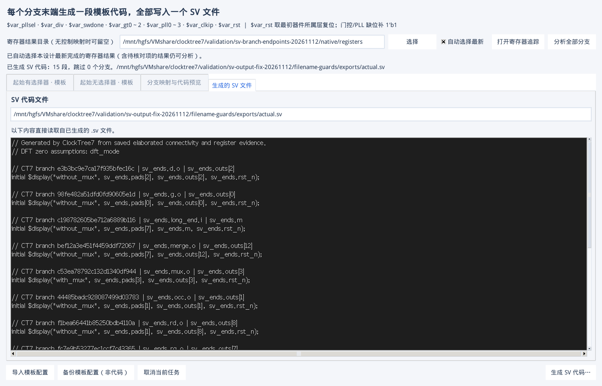
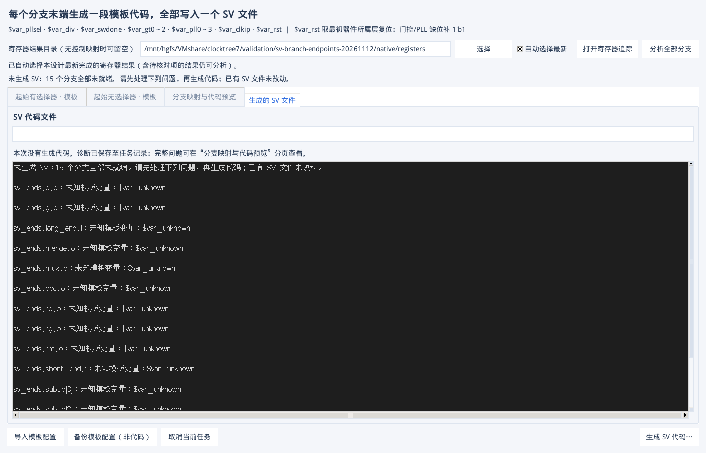

# SV 代码导出与 JSON 区分修复验收

日期：2026-11-12。修改在共享目录 `D:/VMshare/clocktree7` 完成，原生导出在 Linux VM 的 Python 3.6 / Tk 8.5.13 环境执行。

## 实际复现

这次没有只调用 `export(path)` 跳过文件对话框。测试实际调用“分析全部分支”按钮、“生成”按钮和 Tk 保存对话框，填写文件名并点击 Save；同时走了模板配置备份流程。

旧版本的正常通路能导出含 15 段模板替换结果的 `.sv` 文件；但将两套模板改为未知变量、使全部分支不就绪后，真实界面只留下 `blocked.sv.mapping.json`，没有 `blocked.sv`。子进程仍返回 `0`，状态按“已生成 0 段”呈现。这一情况明确复现了“只有 JSON，没有 SV”的结果。模板备份入口也会产生 JSON，旧导出界面没有专门展示最终代码文件。

没有用户现场文件，不能把上述复现说成已经证明现场唯一原因。本轮修复覆盖零段未生成误判、配置备份与代码生成混淆，以及代码文件错误扩展名这几条路径。

## 修复行为

1. 主操作改为“生成 SV 代码…”，保存对话框只提供 SystemVerilog `.sv` 类型；后端也校验后缀。无后缀时补 `.sv`，错误后缀明确拒绝，避免将配置或诊断覆盖成另一种内容。
2. 模板设置入口改为“备份模板配置（非代码）”，只接受 `.json`，完成后明确提示生成代码应使用右下角按钮。
3. GUI 导出目录只写用户指定的 `.sv` 文件。诊断 JSON 保存到任务目录，每次导出使用不同文件名；候选、原因与原证据仍保留。
4. 成功后自动切换到“生成的 SV 文件”，显示真实路径及从磁盘读取的代码。预览上限 256 Ki 字符，文件中的完整代码不截断。
5. 全分支跳过时返回退出码 `2`，界面明确显示“未生成 SV”和具体原因，不展示旧代码冒充本次成功；已有 SV 不覆盖。部分生成仍输出已就绪代码并显示跳过数。
6. 再次打开窗口时，仅在架构、寄存器结果及计划仍匹配时恢复上次代码预览。寄存器更新时仍要求重新分析，避免旧代码被误认为采用新映射。
7. CLI 保留标准输出中的机器可读摘要，真正源码由 `--out file.sv` 指定；新增 `--report` 可将诊断另存。未指定 `--report` 的 CLI 调用继续保留同名映射文件，兼容原有使用方式。

## 验收结果

| 项目 | 结果 |
| --- | --- |
| 完整自动测试 | 367 passed，1 个 Windows 平台条件跳过；12.63 秒 |
| 新增导出回归 | 8 项：实际 SV 与独立诊断、错误扩展名保护、报告路径碰撞保护、零段失败及旧文件保护、部分生成 |
| 原生 Tk 完整导出 | 实际按钮 + 保存对话框，15 段代码，无残留 `$var_`，内容为 SystemVerilog 文本 |
| 导出文件检查 | 目标目录最终仅 `actual.sv`；不存在 `blocked.sv` 或目标目录内的诊断 JSON |
| 扩展名互换 | 把模板备份命名为 `.sv` 被拒绝；把代码命名为 `.json` 被拒绝，均不写错文件 |
| 真实文件预览 | GUI 文本与磁盘 `.sv` 全文一致；关闭/重新打开 SV 窗口后仍一致 |
| 全部跳过 | 15 个分支均报告未知变量；退出码 `2`，显示“未生成 SV”，不误报成功 |
| VCS 编译/展开 | 实际 GUI 导出的 15 段代码与测试 RTL 一起执行 `vcs -kdb=only`，通过；不宣称运行功能仿真 |
| 最新寄存器结果回归 | 自动最新、手动覆盖、分析后出现新结果、原目录结果更新、两次独立 GUI 启动均通过，回调错误 0 |

完整证据在 `validation/sv-output-fix-20261112/`：

- `baseline-dialog/acceptance.json`：旧行为及原生文件对话框操作记录。
- `filename-guards/exports/actual.sv`：真实生成的代码文件。
- `filename-guards/acceptance.json`：新行为、文件全集和退出码。
- `filename-guards/compile/compile.log`：生成代码的 VCS 编译/展开日志。
- `auto-latest/write.json`、`auto-latest/read.json`：寄存器结果选择与独立 GUI 启动回归。

测试夹具来自已实际提取的 `scripts/check_sv_branch_endpoints.py` KDB 样例；测试脚本 `scripts/check_sv_export_files.py` 不需要用户提供额外截图或现场数据。
