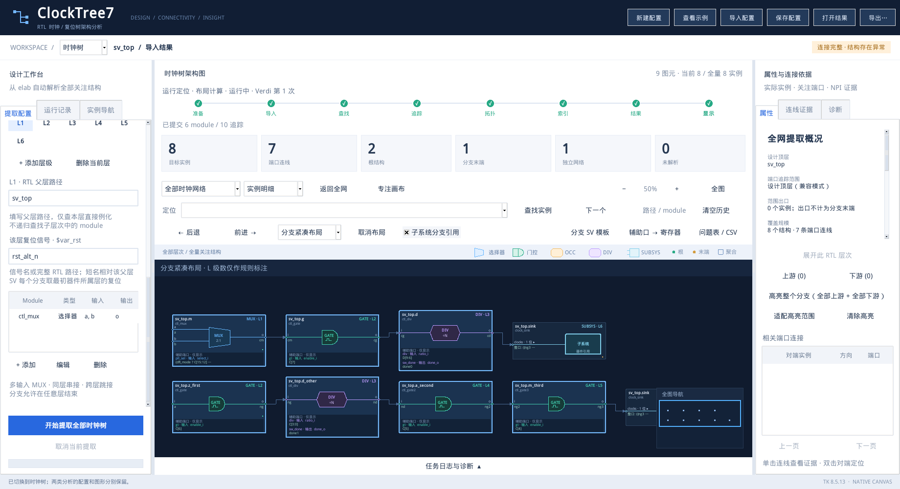
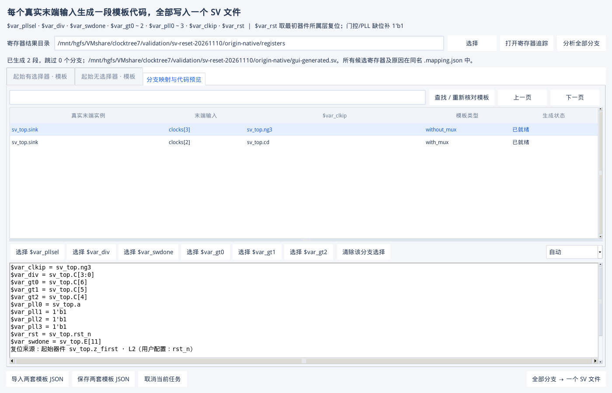

# 每层复位信号与 SV `$var_rst` 验收

日期：2026-11-10。增加每层可选 `reset_signal`，原生 Tk 的 RTL 父层路径下填写；按用户最终确认，时钟树分支只使用最初器件所属规则层的复位绑定 `$var_rst`。操作和路径示例见 [手册 33.6](GUI_USER_MANUAL.zh-CN.md#layer-reset)。

## 实现与兼容

- 相对名称补最初器件的实际父层；设计顶层/实例根开头的完整路径和 `$root.` 路径原样使用。静态 bit 保留，通配规则按实际实例解析父层。
- 两套时钟分支模板都接受 `$var_rst`。缺少复位时，仅使用该变量的分支显示问题并跳过，不填常量。原有不使用该变量的模板、配置及历史计划继续可读。
- 保存、切层、添加/删除层、两种工作区与独立启动恢复均保留此字段。复位修改不会改变已提取节点和边，不必重提取时钟树或辅助寄存器；SV 分支计划需重新分析。其他设计/module/层次规则同时改变时拒绝套用旧图。
- 复位来自用户配置，预览及反馈 JSON 明确记为 `user_config`，保留层号、层次、原填写值和替换值。不是新增 NPI 追踪结论，不自动判断有效电平。

## 验收结果

| 项目 | 结果 |
| --- | --- |
| 自动检查 | **246 passed、1 skipped**；新增 9 项参数化/独立用例：5 种路径写法、起始层选择与部分跳过、多个起始器件一致/冲突、修改元数据不复制图数组与旧计划失效、无效复位及旧计划提示。 |
| 真实 KDB | Verdi 2018 / Python 3.6，VCS 构建含 `rst_n`、`rst_alt_n`、`rst_upstream_n` 的 RTL；时钟结构与辅助寄存器追踪完成。 |
| 正确取层 | MUX 起始 `sv_top.m` 属 L1，得到 `sv_top.rst_n`；无 MUX 起始 `sv_top.z_first` 属 L2，得到 `sv_top.rst_alt_n`。L3～L6 填 `rst_upstream_n`，没有被误用。 |
| 原有行为 | 仍是第一次 1 段生成、1 段因 sw_done 多目的跳过；确认 E[11] 后 2 段，门控顺序和缺位 `1'b1` 不变。 |
| 编译 | 包含 `$var_rst` 替换结果的两段 SV，在测试平台上下文中由 VCS 编译通过。 |
| 提取后修改 | Tk 将 L1 改为 `rst_alt_n`、L2 改为 `rst_n`，不重新提取架构或重跑寄存器追踪；两套模板分别得到新值，原架构配置及节点/边未修改。 |
| UI / 保存 | 切换层、添加后删除层、配置 JSON 导出并加载、时钟/复位工作区分别保存通过；复位字段和预览实际截图已检查。 |
| 两次启动 | 第二个独立 Tk 进程恢复 L1 `rst_alt_n`、另一工作区 L2 `reset_workspace_n`、模板、候选选择及生成计划；0 callback 错误。 |
| 空值与层级 | 一条分支从 L2 开始并在 L5 结束，采用 L2；另一条从 L4 开始且复位为空，仅该分支跳过。补齐 L4 后，两条在同一子系统结束的分支使用各自起始复位。旧模板不使用 `$var_rst` 时两条均生成。 |

原始证据：共享目录 `validation/sv-reset-20261110/origin-native/`，包括 `acceptance.json`、`gui-write.json`、`gui-read.json`、`gui-reset-config.json`、实际生成 SV 与映射反馈。可分享汇总见 [JSON 报告](SV_RESET_VALIDATION.json)。

## 便携验收

候选包 `clocktree7-sv-reset-20261110-rc1` 在 VM 全新独立目录中验证，清除 `PYTHONPATH`、设置 `PYTHONNOUSERSITE=1`，未借用共享目录 Python 模块。235 个内容文件及 SHA-256 清单一致，另有 MANIFEST。

`doctor --self-test --gui`、重新生成真实 KDB、寄存器追踪、起始层复位绑定、VCS 编译、两次独立 Tk 启动全部通过。另以 1,000 个合成末端复验：500 段生成、500 个多寄存器分支按预期跳过，末页和取消保留原文件通过。候选清单标记 `source_dirty: true`，是提交前快照；正式包从干净提交生成后补录。

## 环境与边界

本轮 Windows Anaconda 的一次重复全量检查在旧 doctor 用例遇到 `init.tcl` 临时读取失败；已读取该次 doctor JSON 确认失败位置，单独复测通过，未删测试或修改产品来规避。VM 的 Python 3.6 / Tk 8.5 实际 GUI 检查通过。完整测试最终计数和便携验收记录在 JSON 报告中。

本功能验证的是配置绑定和模板生成，不是复位树追踪或复位信号存在性验证。商业设计的真实复位名、极性以及模板逻辑由用户配置；复杂转义标识符和动态表达式当前不支持。修改复位后分析分支，若需补齐旧图中缺失的总线 bit 连接，仍可能读取原 elab。

未因本次配置字段增加而重跑全部历史万分支压力、画布帧率或开源全套 KDB 回归；其原始结果保留在既有报告中。
