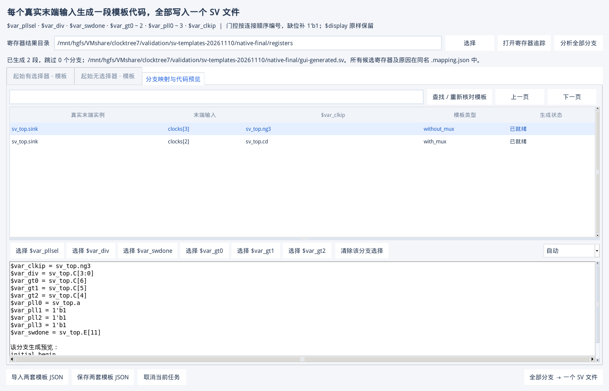

# 时钟树分支 SV 模板验收

日期：2026-11-10。实现位于共享目录，在 Linux VM 中使用 Python 3.6、Tk 8.5、Verdi O-2018.09-SP2 和 VCS 实测。支持离线运行，无第三方 Python 运行时依赖。原生 Tk 操作见 [手册第 33 章](GUI_USER_MANUAL.zh-CN.md#sv-templates)。

## 本次实现与判定规则

有/无起始 MUX 分别使用用户模板。一个真实末端实例的一个关注输入 bit 对应一段代码，所有就绪段写入一个 SV；显示引用、MUX 多输入和寄存器多候选都不增加段数。不同真实末端连接同一网名仍分别生成。

`$var_gt0～2` 按实际边从前到后编号，缺位填 `1'b1`。`$var_pll0～3` 按 MUX 关注输入顺序，或无 MUX 时取分支起始输入；不存在的槽位统一 `1'b1`。已有但未解析的控制口不补常量。多寄存器分支先跳过，候选选定后整文件重新生成；原始 NPI 证据和架构边不改变。

## 实际验收

| 检查 | 实测结果 |
| --- | --- |
| 自动回归 | **237 passed、1 skipped**；新增 SV 21 项，包含索引交接、直接/拼接位序、错误变量、独立子系统输入、同网不同真实末端、门控 0～4 个、候选分页及共享文件访问冲突。 |
| 真实 KDB | 新建两种分支并经 VCS 编译成 KDB；主提取、寄存器追踪、分支计划全部使用实际 Verdi。 |
| MUX 分支 | pll_sel → `D[5:2]`，div → `D[9:6]`，gt0 → `C[7]`，sw_done → `E[10]`；pll0/1 → a/b，pll2/3 与 gt1/2 均为 `1'b1`。 |
| 无 MUX 分支 | 物理顺序 `z_first → a_second → m_third` 得到 gt0/1/2 = `C[6]` / `C[5]` / `C[4]`；div → `C[3:0]`，pll0 → a，pll1/2/3 均 `1'b1`。 |
| 末端 bit | 同一个 SUBSYSTEM 的 `clocks[2]` → `sv_top.cd`，`clocks[3]` → `sv_top.ng3`；没有将整个 `{ng3, cd}` 错当成每位的信号。 |
| 多寄存器 | 无 MUX 分支 sw_done 到 `E[11]`、`E[12]`。首次 1 段生成 / 1 段跳过，选择 E[11] 后同一文件 2 段 / 0 跳过，段数不重复。 |
| 部分向量候选 | 一个完整向量之外还有只覆盖部分 bit 的寄存器时，同样反馈该寄存器并要求确认；不会静默忽略它后自动选完整候选。 |
| 超过一页候选 | 单元验收 205 个不同寄存器候选，反馈 JSON 全量包含，未截成首 100 条。 |
| SV 编译 | 生成片段加入独立 `template_checks` module，与真实 fixture 一起由 VCS 编译成功；`$display` 保留，所有约定 `$var_*` 已替换。 |
| 原生 Tk | 两模板输入、后台分析、候选选择、部分导出、完整再生成、窗口内操作按钮可见；第二次独立 GUI 启动恢复模板、选择和计划，0 callback 错误。截图已检查。 |
| 取消 | 后台导出真正收到 SIGTERM，保留原 SV，没有遗留本次临时文件；主界面不被大图导出阻塞。 |
| 原有 SoC KDB 回归 | 正式出包后重新提取 OpenTitan 15 实例/10 边、PULP 62 实例/48 边、OpenC910 已选直接父层子网 30 实例/29 边，节点和边集合与原参考完全一致。 |



## 万分支压力

以实际已验证的两种分支拓扑为原型构造 **10,007 节点、10,000 个真实末端输入** 的合成结果。此压力测试不将虚构实例送入 Verdi；寄存器映射来自真实 KDB 验证，末端的实际连接作为明确的合成数据提供。

| 同一 VM / HGFS 目录 | 首轮完整版本 | 优化后 |
| --- | --- | --- |
| 分支计划 | 84.654 s | 79.902 s |
| 单文件导出与全量反馈 | 136.681 s | 48.833 s |
| Python 压测进程峰值 RSS | 48.207 MiB | 48.145 MiB |
| 生成 / 按预期跳过 | 5,000 / 5,000 | 5,000 / 5,000 |
| 末页 / 取消保护 | 100 行、通过 | 100 行、通过 |

导出复用一个 SQLite 连接；已经确定器件绑定的变量不重复向上遍历；分支顺序使用索引；进度文件合并至约 4 次/秒。模板与反馈逐段写入，不累积完整 SV 字符串。

以上是同一机器两次实测，未做严格的 CPU/文件缓存隔离。RSS 包括压力脚本持有的合成图，不包括 Verdi（此合成阶段没有运行 EDA）。这些数值不能作为商业全芯片性能上限；当前的一次性计划仍需约 80 秒，已放在后台并可取消。

## 发现的问题及修复

1. VM SQLite 3.7 不支持递归 CTE。改成磁盘临时队列的非递归遍历后，真实 KDB 和 Tk 通过。
2. Tk 后台原先把 SQLite 索引当 JSON 打开。改用小型索引引用描述文件，保留当前配置/展示覆盖，不在 Tk 主线程复制整份大索引；新增自动验收。
3. 最初 Tk 布局中底部导出按钮超出窗口。先给操作区保留空间，并给模板/预览加水平滚动；真实截图与按钮边界断言通过。
4. 第一轮 10,000 末端测试在第 7,892 项遇到 HGFS `PermissionError`：Windows 正在读进度文件时，VM 无法替换同名文件。对这种非数据的临时进度冲突保留警告并继续，在后续 tick 更新；实际计划/导出写失败仍报错。专门注入该冲突的自动测试通过，后续完整万分支测试通过。
5. 多位信号存在一个完整寄存器候选和额外部分候选时，最初逻辑可能遗漏部分候选。已改为明确列出并要求选择，增加独立反例。

## 复现与证据

```bash
python3 scripts/check_sv_templates.py --out /path/qa/native
python3 scripts/check_sv_templates.py --out /path/qa/native --phase gui-write
python3 scripts/check_sv_templates.py --out /path/qa/native --phase gui-read
python3 scripts/check_sv_templates.py --out /path/qa/scale --phase scale \
  --native-source /path/qa/native --terminals 10000
```

真实 EDA 在有许可的图形会话中执行；隔离 GUI 验收使用独立 Xvfb display 及 `-noreset`。`native` 的原始结果位于共享目录 `validation/sv-templates-20261110/native-final`，压力位于 `scale-02` 与 `scale-final`，失败的 `scale-01` 保留。可分享的数字摘要为 [JSON 报告](SV_TEMPLATES_VALIDATION.json)。

## 便携目录验收

候选包 `clocktree7-sv-templates-20261110-rc1` 解压到 VM `/home/host/clocktree7-portable-qa/clocktree7-sv-templates-20261110-rc1`，清除 `PYTHONPATH` 并设置 `PYTHONNOUSERSITE=1`。230 个内容文件与 SHA-256 清单全部一致，另有 MANIFEST；不借用共享目录的 Python 模块。

- `doctor --self-test --gui`：实际时钟/复位 golden、Tk、保存恢复及 EDA 环境通过。
- 新功能：独立目录重新建立真实 KDB、追踪辅助寄存器、部分/完整模板生成与 VCS 编译通过。
- Tk 两次独立启动：模板、候选选择、代码预览、生成与历史恢复通过，0 callback 错误；使用 `--no-screenshots`，无需第三方截图包。
- 1,000 末端合成复验：500 段生成、500 分支按预期跳过，末页/取消/原文件保留全部通过。

候选包记录 `source_dirty: true`，为提交前验收快照。正式包 **`clocktree7-sv-templates-20261110`** 从干净提交 **`7364c05a3978867f221615f59ed2595095459070`** 生成；在另一个全新 VM 目录再次完成上述全部检查，230 个内容文件校验通过。正式包的 1,000 末端复验为计划 0.765 s、导出 0.376 s、峰值 RSS 20.703 MiB（VM 本地磁盘，不能与 HGFS 万分支耗时直接比较）。正式运行使用系统 Python，不依赖共享目录源码或 Python 用户包。

| 正式文件 | SHA-256 |
| --- | --- |
| `clocktree7-sv-templates-20261110.zip` | `537ee8d986b3f2dbec2d43987491d5d529db83f4a944da94f45fe023e1ba3625` |
| `clocktree7-sv-templates-20261110.tar.gz` | `3b7af2154c0da85b451c0107029e75dc3f4ddb98a0b6482fa0b04d3bb8119653` |

归档位于共享目录 `validation/releases/`。代码和候选验收报告经 GitHub Desktop 提交上传，正式出包结果以单独的文档提交补录；包内代码与上述干净提交一致，旧寄存器专用包保留。

## 范围与限制

当前模板功能用于时钟树；所有终点是用户配置的关注结构末端，不自动枚举未配置的普通负载。全树连接不完整时保守阻止生成。动态 bit、未知表达式、无法安全表示的转义标识符、并行门控导致无法排序等会反馈，不填造假的寄存器值。

模板是文本替换，产品不执行用户模板，也不承诺任意模板都能单独编译。实际 VCS 验收覆盖本报告的测试模板及其上下文；用户的任务/断言/模块命名仍需按自己验证平台定义。多寄存器及非直接依赖需要人工核对；选择端点不会自动恢复逻辑表达式。

本轮未重新跑全部历史画布帧率测试，也没有取得现场超大商业芯片的库。上述 SoC 复验检查既有连接集合，未给这些开源项目另行配置全部控制口并生成全项目 SV；辅助寄存器压力与恢复见对应报告，不把连接回归冒称为新增 SV 已覆盖每个商业设计。
