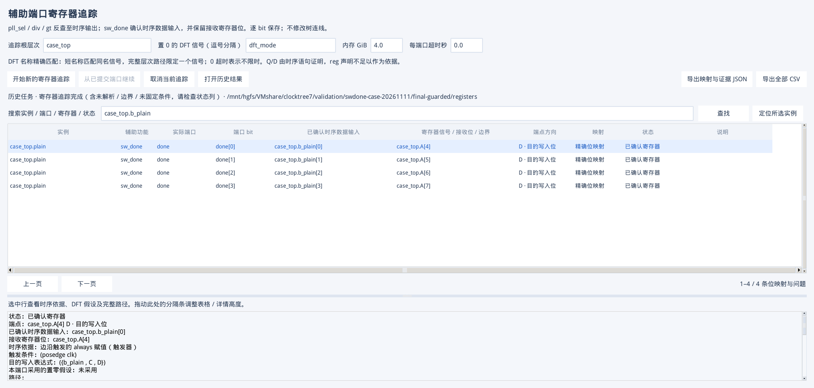

# sw_done：case 内时序拼接赋值识别修复

验证时间：2026-11-11 至 2026-11-12。共享代码目录：`D:/VMshare/clocktree7`；实际测试在 Linux VM 的 Python 3.6.8、Verdi O-2018.09-SP2、VCS O-2018.09-1、Tk 8.5.13 中执行。

## 问题与修复

原实现已能识别普通时序赋值 `A <= {B,C,D}`，但其过程控制检查会拒绝 `npiCaseItem` / `npiCase`。VM 原生最小样例复现了 `unsupported_procedural_control:npiCaseItem`；NPI 已返回完整的赋值、case item、case、事件控制和 always 祖先链，问题发生在工具自己的判断中。

修复后，只有外层存在真实时钟边沿触发依据的时序数据赋值才放行 case 控制。NPI 读取当前 case 的选择表达式、分支标签、默认项和分支顺序；不扫描其他层次，不解析 RTL 源码猜测连接。依据原手册 `VC_APPS_NPI.pdf` 第 1472–1473 页 Case / CaseItem 对象关系及第 3248 页支持列表，使用 `npiUpperStmt`、`npiCondition`、`npiCaseItem`、`npiExpr` 与 `npiCaseType`。

对于 `A[7:0] <= {B[3:0],C[1:0],D[1:0]}`，确认 `B[0]→A[4]` 到 `B[3]→A[7]`：B 是已证明的时序数据输入，A 的对应位是接收寄存器位。表格、CSV、JSON 同时保存两者，SV 的 `$var_swdone` 使用 `B[3:0]`。B 不需要声明成 reg。

运行时 case 选择决定写入时机，不把直接数据位关系变成未知组合逻辑。已知 DFT 零值/别名条件仍会排除不可能的分支；casez/casex 按通配与前项优先处理，默认项不能抢在显式匹配之前。多个接收寄存器仍保留为多个候选，不自动选择其中之一。

组合 always/initial 的 case 不因此获得时序证明，case/if 选择条件或时钟敏感项的引用也不会被算作 D 输入。动态选择、缺失分支元数据、复杂延迟/循环仍遵循原有未解析处理；本轮没有扩大 case 锁存器证明范围。

补测确认 Verdi 2018 会将 `'1` 与 `1'b1` 都返回为相同的一位 `'b1` 元数据，而它们在更宽的无符号 case 比较中的扩展不同。无法区分时返回 `ambiguous_case_literal_extension`，不错误确认或排除分支；同宽比较不受影响。若接口保留了明确的填充字面量，则按该元数据处理。该限制同时适用于丢失此信息的 X/Z 字面量。

## 验收结果

| 项目 | 结果 |
| --- | --- |
| 全量自动测试 | **346 passed，1 skipped**；平台跳过项为 Windows 不适用的 Linux 包装测试 |
| 新增 case 单元测试 | **15 项通过**：普通/默认/嵌套、DFT 排除与别名、casez/casex 优先级、X/Z 区分、位宽与符号、负例及元数据缺失/歧义 |
| 真实 KDB case 矩阵 | **1,032 组精确输入/接收位映射**，逐项集合比较无缺失/多出；每组保存真实 case 祖先证据 |
| 原生场景 | 多标签、default 在前、always_ff 异步复位加使能与嵌套 case、升序/非零下标/重排、DFT 别名、通配优先、无关动态拼接位 |
| 千 load 压力 | 同一 sw_done bit 经 case 写入 1,000 个接收寄存器；全部保留，未只取第一个；整矩阵追踪 **13.357 秒**，峰值 RSS **0.241 GiB** |
| 负例 | 组合 case 4 bit、initial case 4 bit、字面量扩展歧义 4 bit 明确未解析，纯选择条件 1 bit 排除；没有假阳性寄存器 |
| SV | 选择千 load 中的指定接收候选后，生成 **9 段**，跳过 **4 个刻意构造的负例分支**；VCS 编译/elab（`-kdb=only`）通过 |
| 原生 Tk / 导出 | 表格显示 B 的 4 bit 与 A[7:4]；详情可查时序依据；CSV/JSON 数量一致；GUI 回调错误 0 |
| 已完成任务恢复 | 同一版本恢复已完成任务，不重启 Verdi、不重复增加结果 |
| 原拼接回归 | 旧千 load 场景 **1,041 组映射**、8 条预期负例通过，保留别名、多寄存器候选与原有 SV 行为 |
| 原宽位映射回归 | **546 组映射**通过，覆盖 1–128 位升序/降序控制总线及 32 个随机稀疏 load 接收位；没有未解析或多出结果 |

压力数据来自本 VM 合成测试，不代表商业整芯片导入内存。VCS 验收是编译及 elaboration，不把它表述为运行仿真通过。早期测试脚本的候选参数传递及 HGFS 链接器限制已修正；最终验收以 `final-guarded` 为准。

## 升级和证据

更新工具并重新启动 GUI，点击“开始新的寄存器追踪”，完成后重新分析 SV 分支。无需因此重提取原时钟树。旧结果可以查看，但旧的未解析项不会自动变成成功；未完成任务继续受实现指纹校验，不跨版本强行续用。

本地证据位于 `validation/swdone-case-20261111/`：`baseline-rows.json` / `baseline-actions.json` 是原生复现，`fixed-rows.json` / `fixed-actions.json` 是最小样例修复，`final-guarded/oracle.json` / `acceptance.json` / `generated.sv.mapping.json` 是最终验收，`regression-concat/acceptance.json` 和 `regression-bits/acceptance.json` 是原功能回归。测试日志、KDB 和用户会话不上传 GitHub。

复跑：`python3 scripts/check_swdone_case.py --out <新目录> --fanout 1000 --gui`；GUI 需 X 显示或 Xvfb。
