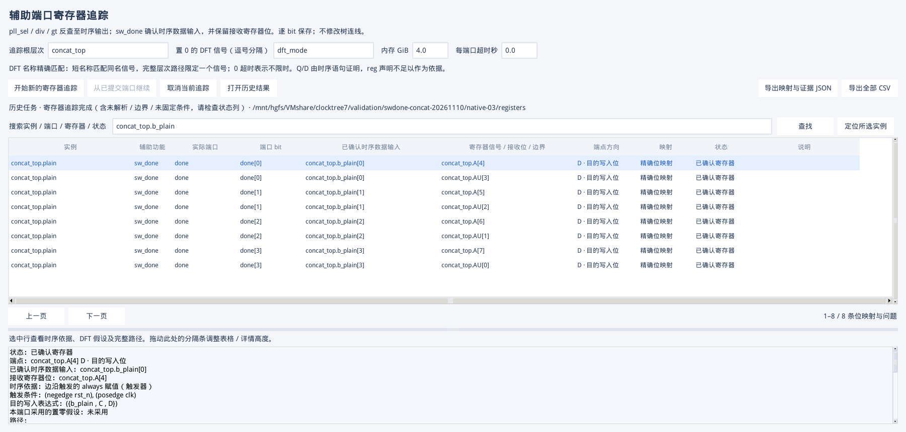
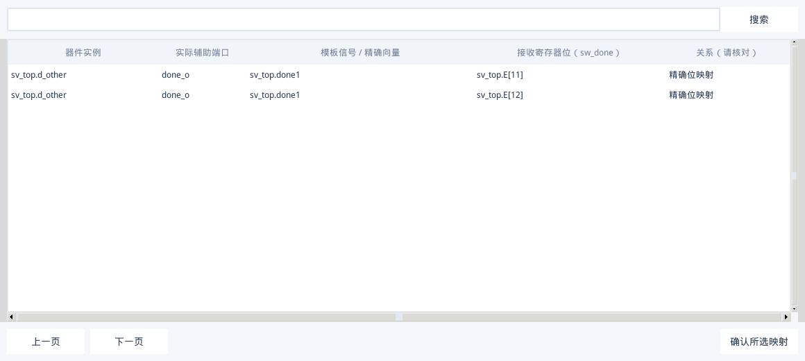

# sw_done 时序拼接输入识别修复与验收

日期：2026-11-10。范围：辅助口寄存器追踪、逐位结果、原生 Tk 显示、SV 模板绑定；不改变时钟树/复位树连线。

## 1. 修复后的行为

```systemverilog
wire [3:0] B;
wire [1:0] C, D;
reg  [7:0] A;
always @(posedge clk) A <= {B, C, D};
```

沿 `sw_done` 的 load 路径到达上述赋值时：

| 确认的时序数据输入 | 接收寄存器位 | 含义 |
| --- | --- | --- |
| `top.B[0]` | `top.A[4]` | 时钟沿采样进入 A 的第 4 位 |
| `top.B[1]` | `top.A[5]` | 时钟沿采样进入 A 的第 5 位 |
| `top.B[2]` | `top.A[6]` | 时钟沿采样进入 A 的第 6 位 |
| `top.B[3]` | `top.A[7]` | 时钟沿采样进入 A 的第 7 位 |

`B` 无需声明为 `reg`。时序判定来自 NPI 赋值语句、所属过程和时钟沿/已证明保持条件。结果标记“已确认寄存器”，单独显示“已确认时序数据输入”与接收位；新 SV 计划将 `$var_swdone` 绑定到 `top.B[3:0]`，并保留 `top.A[7:4]` 的证据。



## 2. 复现与原因

在 VM 的 Verdi O-2018.09-SP2 上检查了旧实现：普通拼接和 `always_ff` 能找到目的 A 的位，但没有把 B 作为单独的时序输入保存和展示。因此不能将旧行为概括为所有拼接都无法识别。

另一个可稳定复现的问题是整式失败：`A <= {B, payload[idx], D}` 中运行时动态位选导致整个 RHS 解析报错，已能确定的 B 也丢失。函数调用项同样可能阻断整式映射。旧基线记录保存在 `validation/swdone-concat-20261110/baseline-results.json`。

实现保持 NPI 对象分析，不用 RTL 文本正则代替时序证明：

- load 路径按拼接项的 elab 位宽独立计算偏移，保留可证明的直接输入。
- 不相关的未知项不删除 B 的映射；可能包含 B 的未知项仍保留未解析记录。未知位宽不能用于推测偏移。
- 重复拼接、升序/降序声明、静态选位、截断和 `dft_mode=0` 分支保留逐位顺序。
- `data_input` 保存真实命名的 D 输入，`capture_target` 保存接收位；原有 `endpoint` 继续是接收位，兼容旧索引和追踪证据。
- 同一接收位从两个中间输入接收数据时，两种输入都保留，不按接收位丢弃后一条；重复证明不会重复计数。存在多种输入而不能唯一组成向量时，阻止自动绑定并列出输入路径。
- 同一 B 扇出到多个寄存器时仍保留不同寄存器候选，用户确认后生成。候选窗口可搜索 B 或接收位 A，并支持水平滚动。



## 3. 验收环境与结果

环境：Windows 工作副本 `D:\VMshare\clocktree7`；VM Python 3.6.8、Tk 8.5、Verdi O-2018.09-SP2、VCS O-2018.09-1。测试先用 VCS 生成 KDB，再用真实 NPI 追踪，非伪造 NPI 返回值。

| 检查项 | 实测结果 |
| --- | --- |
| 全部自动测试 | **282 passed, 1 skipped**，9.64 秒；跳过项为 Windows 不执行的 Linux Verdi wrapper/symlink 测试 |
| 本次真实 KDB 专项 | **2,041 对**输入/接收位与独立预设集合完全一致；**8 条**预期负例诊断完全一致 |
| 原生 Tk | 100 行分页、按 B 搜索得到 8 行、详情双路径、CSV 全部 2,049 行、完整 JSON；无 Tk 回调错误 |
| SV 绑定 | 单目标使用确认的 B；两个寄存器共用 B 仍要求选择；同一接收位存在多个输入时阻止自动生成 |
| 已完成断点恢复 | 不重启 Verdi、不增加查询日志、不增加映射 |
| 便携包独立目录 | 262 个文件清单校验通过；2,041 对专项映射、8 条负例和原生 Tk 检查通过；10 项环境/寄存器/SV 回归全部通过 |

专项样例 `scripts/check_swdone_concat.py` 的逐项预设如下：

| 场景 | 已证明输入/接收位对数 | 预期未解析 |
| --- | ---: | ---: |
| 普通拼接、异步复位、升序接收总线、always_ff | 8 | 0 |
| 标量到非零位 A[10] | 1 | 0 |
| 反序拼接与非零寄存器范围 [31:16] | 4 | 0 |
| 嵌套和重复拼接 | 6 | 0 |
| 旁边存在不相关动态位选 | 4 | 0 |
| DFT 置零选择功能分支 | 4 | 0 |
| 穿透组合 reg 后到真正时序接收点 | 4 | 0 |
| 两个中间输入写入同一寄存器位 | 2 | 0 |
| 同一输出扇出到 2,000 个时序负载 | 2,000 | 0 |
| 拼接中同时有 B 和动态 B[idx] | 4 | 4 |
| 拼接中同时有 B 和不透明函数调用 | 4 | 4 |

共享目录最终专项记录：`validation/swdone-concat-20261110/native-03/acceptance.json`。计时从架构提取后启动寄存器追踪开始，包含追踪、导出、SV 校验和 GUI 检查，共 **14.68 秒**；工具记录的 Verdi 峰值 RSS 为 **0.262 GiB**。该小型高扇出样例的内存数值不能代表商业芯片完整 elab 的内存需求。

8 条负例是验收设计的一部分，不是漏报：任务运行完成，但汇总中的 `complete=false`、`all_bits_have_register=false` 如实反映仍有未知路径。已证明的 B 映射与未知路径同时保留，不以删掉诊断换取“全部通过”。

已有回归还覆盖 1,000 负载、7 项基线/轮换/阈值重试/硬崩溃恢复/超时/配置变更拒绝/三次无进展停止检查、546 对随机位映射（宽度 1～128）、进度 GUI、两次独立 GUI 启动恢复、SV 候选选择及生成代码的 VCS 编译。恢复验收使用真实 Verdi 工作进程，内存阈值场景由 QA 注入 RSS 采样值触发，没有实际申请 64 GiB。共享目录记录位于 `validation/swdone-concat-20261110/regression/`。

最终运行时代码还从便携包独立解压至 `/home/host/clocktree7-portable-qa/clocktree7-swdone-concat-20261110-rc1`，清除 `PYTHONPATH`、设置 `PYTHONNOUSERSITE=1`，复跑上述专项与 10 项回归全部通过。结果已复制到共享目录中的 `portable-concat-acceptance.json`、`portable-suite.json`、`portable-bit-matrix-acceptance.json`、`portable-recovery-acceptance.json` 和 `portable-sv-acceptance.json`。候选包制作于提交前，清单如实标记 `source_dirty=true`；最终交付包与该候选包的运行时代码进行哈希比对，文档补充不代替运行时验收。

## 4. 更新后的操作

1. 使用新版本打开包含辅助端口配置的架构结果。
2. 打开“辅助口 → 寄存器”，选择 **“开始新的寄存器追踪”**。
3. 在结果中查看“已确认时序数据输入”和“寄存器信号 / 接收位 / 边界”两列；可按 B 或 A 搜索。
4. 若需要 SV，打开模板窗口重新分析分支。确认多目标候选，再生成文件。

旧配置、已完成寄存器结果、旧 SV 计划仍可读。旧结果缺少 `data_input` 时继续采用其原接收位，不静默改写历史 SV；要使用新 B 输入必须重新追踪和分析。未完成旧任务受实现指纹检查，升级后不能把旧断点与新算法混用。

## 5. 保留的边界

单独的 `reg/logic` 声明、组合赋值、时钟/敏感列表引用不能证明 D 输入。反相或组合运算中的操作数不直接标记为 D 输入。动态索引本身、无法解析的函数、未知宽度、复杂 case/循环和未支持的锁存器结构仍明确标为未解析；本次未宣称扩展这些结构的完整语义支持。

本次未获得用户商业设计及对应日志，因此针对用户描述的 RTL 模式、已发现的阻断形式和本工具的真实 Verdi 2018 环境验收，没有宣称复现过用户的完整商业项目。
