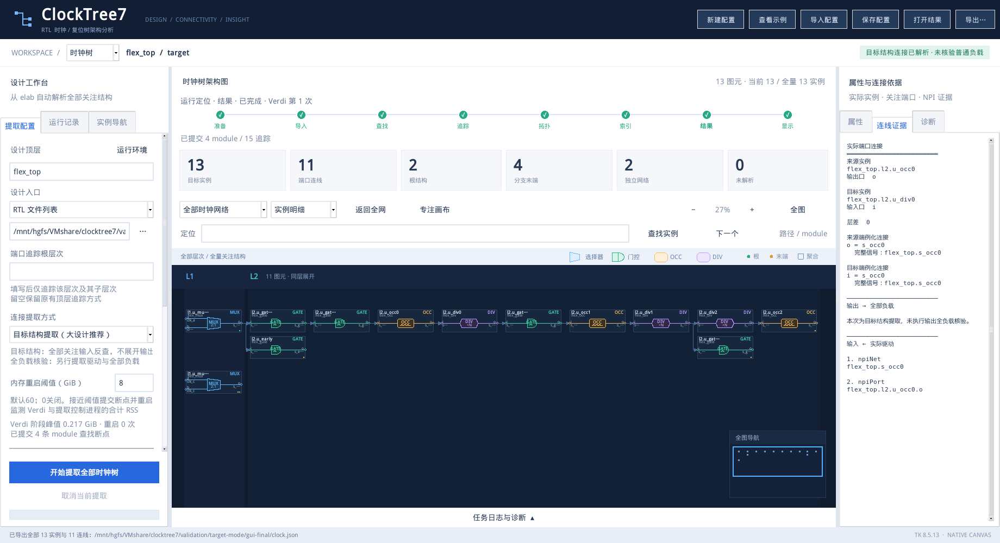
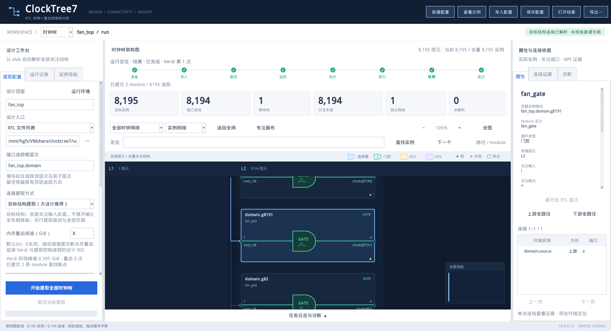

# 目标结构提取模式：实现与验收

日期：2026-11-06。测试在共享目录 `/mnt/hgfs/VMshare/clocktree7`、普通用户 `host` 下运行，使用真实 Verdi O-2018.09-SP2、CentOS 7.9、Python 3.6.8、Tk 8.5.13。本文区分连接正确性、压力测试和已知限制；测试通过不等于现场商业芯片已验收。

## 实现内容

1. 默认 `target` 模式使用 Language Model，从每个目标输入向上追驱动。枚举仍只查配置层次的直接实例；追踪在指定根层次及其子层次中进行。建立目标输出索引，在器件边界停止，不展开其内部选择/门控逻辑。
2. 公共信号首次使用时核对实际驱动，之后复用已验证步骤。保留多驱动、全部目标分支、同层连接、跳级、独立网络和提前结束分支。没有设置 load 数量上限或默认运行超时。
3. 输入逐端口提交断点、释放临时句柄。缓存保存名称和步骤，不跨进程保存 NPI 句柄；容量限制为 2,048 条或约 4 MiB 序列化数据，落盘缓存约 8 MiB。淘汰后可重新查询，不丢分支。
4. GUI 可选“目标结构提取（大设计推荐）”或“全负载核验”；历史配置恢复该选项，历史结果按自己的证据模式显示。目标模式明确提示普通负载未核验，边只包含真实 driver 证据；输出端口仍独立验证。
5. 存在未知逻辑、动态位选择、缺失端口或原生接口未支持对象时，保留诊断并标为不完整。未解析输入不冒充根；全图未解析时不声明已证明末端。
6. 修复 GUI 观察活后台任务时，完成状态两个快照之间的竞争：原控制进程还活着时继续观察，完成后自动载入结果。

## 逐项验收

| 项目 | 实测与判据 | 结果 |
| --- | --- | --- |
| 时钟/复位、多层级 | 两级及十级；实例、边、末端集合与独立 golden 完全一致 | 通过 |
| 所有目标分支 | MUX 多输入、扇出、汇合、同层连接、跳级、提前末端、独立网络 | 通过 |
| 两种证据模式 | 时钟、复位 target/full 的目标连线一致；full 保留双向证据，target 仅 driver | 通过 |
| 查找与追踪范围 | 普通 module / generate 根层次，开启及关闭追踪根边界，直接实例查询不递归 | 通过 |
| 真实 RTL 端口名 | 别名、位选、位置端口、长名称、常量、未连接及原始表达式 | 通过 |
| 透明连接 | assign、拼接赋值、包装层、反相、buf/not 原语、配置的向量端口位 | 通过 |
| 多驱动 | 直接目标输出加额外别名驱动同时保留；不靠同网索引提前终止 | 通过 |
| 静态/动态索引 | generate 常量、package 参数加 genvar；运行时索引与 package 变量拒绝猜连线 | 通过 |
| 复杂实例数组 | 拼接/重复拼接、升序范围、反序命名端口：target 明确报告 NIY；full 恢复 11 实例/9 边 | 边界诊断通过；target 不支持此连接 |
| 输出/覆盖检查 | 缺失输出、未完成输入、假 load 记录不会获得完整状态 | 通过 |
| 崩溃恢复 | 时钟/复位共 16 项 SIGKILL；新控制进程继续，连接、边界及证据与不中断基准一致 | 通过 |
| GUI 崩溃恢复 | 时钟/复位按钮续跑、观察仍活后台、画布中断后重开，共 4 项 | 通过，无回调异常 |
| 同目录重跑 | 新复位任务完成后恢复旧时钟任务；新结果归档，原始证据逐字节保持 | 通过 |
| 模式与历史 | 两个全新 GUI 进程验证时钟/复位草稿、模式、结果恢复，JSON/SVG 导出 | 通过 |
| 大图显示 | 8,195 实例索引概览、定位末端 g8191、实际端口信号名和连接列表 | 通过，实际截图已检查 |

原生连接矩阵共 **21 项**，包含预期应拒绝或报未解析的负面用例，不能将其解释为 21 种设计都能完整提取。记录：`validation/target-mode/native-final/matrix.json`。

恢复矩阵记录：`validation/target-mode/recovery-accepted/`。时钟基准 42 实例/41 边/43 次输入追踪；复位基准 21/20/22。模块断点后恢复、追踪前缀回退、中文损坏尾部、进程组回收、拓扑/索引/导出阶段复用已有证据均检查过。恢复夹具采用标量广播连接的实例数组；复杂拼接数组单列为负面用例，不掩盖 NPI 限制。只有一个完成标记，无重复 trace ID。GUI 记录：`validation/target-mode/gui-final/`。

## 真实开源项目 KDB

| 项目与范围 | 实例 / 连接 | 与既有全负载参考的集合比较 |
| --- | --- | --- |
| OpenTitan clkmgr，原配置全部目标 | 15 / 10 | 完全一致 |
| PULP SoC，原配置全部目标 | 62 / 48 | 完全一致 |
| OpenC910，时钟源/缓冲与一个门控父层子网 | 30 / 29 | 完全一致 |

脚本由记录中的实际父层构建直接查询规则；只用旧结果的实例位置生成规则，再独立比较连线，不把期望边输入给提取器。OpenTitan/PULP 为迁移旧的递归查找配置，将每个实际父层放到单独测试层，仍出现层级逆序/非 L1 根等布局规则诊断；**连接完整性通过，不宣称这两个测试配置的层级拓扑检查通过**。OpenC910 子网的连接及层级拓扑均通过。本次没有重新验收 OpenC910 全芯片 6,984 个目标。

记录：`validation/target-mode/soc-accepted/acceptance.json`。第三方源码、商业手册及 KDB 均不随仓库发布。

## 压力与真实内存阈值

以下均为真实 Verdi，全部目标边与独立期望集合一致；未跳过任何目标分支。

| 目标负载数 | 同网普通负载数 | 额外背景实例 | 提取总时间（秒） | 采样峰值 RSS（GiB） | 原生 driver 查询 / 缓存命中 |
| ---: | ---: | ---: | ---: | ---: | ---: |
| 130 | 128 | 0 | 5.952 | 0.221 | 5 / 129 |
| 1,026 | 1,024 | 0 | 25.443 | 0.241 | 5 / 1025 |
| 8,194 | 8,192 | 0 | 166.257 | 0.393 | 5 / 8193 |
| 130 | 128 | 250,000 | 11.278 | 0.432 | 5 / 129 |
| 130 | 128 | 1,000,000 | 28.776 | 1.030 | 5 / 129 |

“背景实例”是同一导入顶层内另一个子树的触发器实例。测试通过 NPI 查到第一个及最后一个背景实例，确认它们确实已 elaborate。目标输出本身同时连接表中的目标负载及普通负载；百万背景用例不是百万目标负载。每次仍导入整个夹具，没有仅导入目标子模块。

时间包含导入、查找、追踪和结果处理。RSS 是工具在 Verdi 阶段按 `/proc` 采样的控制进程加 Verdi 进程树 RSS，不是操作系统记录的精确峰值，不包含 GUI 和后处理；虚拟机、共享盘和简单 RTL 夹具的结果不能外推为商业芯片性能。

测试在导入后安装只用于测试的 Tcl 调用守卫：公开 `npi_nl_*`、L1 Netlist 和 load 入口被调用会报错；目标用例全部通过。守卫看不到 Verdi C++ 内部实现，不据此宣称其内部绝无推导。

真实内存压力测试直接在 Verdi 临时测试脚本中分配非零内存，生产 `/proc` 采样器没有注入读数：

| 模式 / 条件 | 生效阈值 GiB | 两次触发读数 GiB | 结果 |
| --- | ---: | --- | --- |
| 时钟 / 软阈值 | 0.5 | 0.475 / 0.475 | 两次重启、三次 Verdi，证据与基准一致 |
| 时钟 / 硬阈值 | 0.375 | 0.437 / 0.438 | 两次重启、三次 Verdi，证据与基准一致 |
| 复位 / 软阈值 | 0.5 | 0.475 / 0.475 | 两次重启、三次 Verdi，证据与基准一致 |
| 复位 / 硬阈值 | 0.375 | 0.438 / 0.438 | 两次重启、三次 Verdi，证据与基准一致 |
| 时钟 / 硬阈值，CLI 覆盖 | 0.625 | 0.687 / 0.688 | 两次重启、三次 Verdi，证据与基准一致 |

软阈值在模块/输入结束后提交并轮换；硬阈值回收旧进程组、回退未提交尾部后重试。极低 0.001 GiB 阈值连续三次无进展后停止，保留日志且不发布结果。以上是小阈值下的真实 RSS 验收，没有申请或分配 60 GiB。

原始记录：`validation/target-mode/stress-accepted/stress.json`、`validation/target-mode/rss-accepted/acceptance.json`。


## 兼容性与交付

Windows 全量单元测试 **149 通过、1 项 Linux 专属检查跳过**，记录 `validation/target-mode/pytest-final.log`。过程中本机 Conda 的 `init.tcl` 偶发读取失败；失败用例单独复测及最后一次完整运行均通过，未修改用户 Tcl 环境。

离线候选包解压到 VM 独立目录 `/tmp/ct7-target-package-20261106/clocktree7-target-candidate-20261106-1`，166 个载荷文件逐项 SHA256 校验通过。清除 `PYTHONPATH` 后，使用解压包执行 `doctor --self-test --gui`：实际时钟 13 实例/11 边、复位 12/12 与 golden 一致，两个架构在原生 Tk 渲染，配置/结果存储恢复通过。没有从共享仓库导入 Python 代码。报告位于 `validation/target-mode/portable-candidate/doctor_20261106_014420_7f6d3a73/doctor.json`。

正式包名称为 `clocktree7-target-20261106`，ZIP/tar.gz 写入共享目录 `validation/releases/`。包中包含新后端、手册及可复现测试脚本；不包含 EDA、许可证、第三方 SoC、KDB、原始验证记录或用户历史。最终包的 MANIFEST 记录实际源码提交和文件校验和；目标设备仍须运行自检和工程验收。

## 限制与现场复测

- 目标模式末端是“没有已配置的下游器件”，不代表没有普通寄存器负载，也不代表输出不经过范围外。需要这些证据时另选 full。
- Verdi 2018 对某些实例数组连接返回 `npiNIY`。手册第 1506–1507 页的数组表达式列表保持源码关联顺序，不能把它与声明端口索引直接对应；反序命名端口实测证实这种猜法会连错。该限制已显式保留。动态索引、未建模的组合逻辑也不推测为透明连接。
- Language Model 同样可能在复杂设计内部执行昂贵工作。本次测试证明没有调用公开的 Netlist Model / load 入口，不能证明 Verdi 内部完全不做推导，也不保证所有原生调用必然在固定时间内返回。
- 不自动裁剪 elab 导入范围。64 GiB 商业芯片现场库没有提供，本次未复现该现场任务，不宣称已消除其所有卡死或 OOM 原因。
- GUI 恢复说明已知信号/错误和最后阶段。缺少调度器或内核证据的 SIGKILL 仍显示原因未知，不能仅凭闪退认定 OOM。
- 升级前的完整结果可浏览；未完成任务若引擎签名变化须重新开始。缓存和断点不能复制到另一主机、另一输入版本后强行复用。

## 复现

在已启用 Verdi 的 Linux 终端，使用新的输出目录：

```bash
python3 scripts/check_target_mode.py --out validation/target-mode/new-matrix
python3 scripts/check_target_mode.py --stress --counts 128 1024 8192 --background 250000 1000000 --out validation/target-mode/new-stress
python3 scripts/check_real_memory_threshold.py --out validation/target-mode/new-rss
python3 scripts/check_crash_recovery.py --out validation/target-mode/new-recovery
python3 scripts/check_crash_recovery.py --out validation/target-mode/new-recovery --gui
python3 scripts/check_crash_recovery.py --out validation/target-mode/new-recovery --reuse
python3 scripts/check_target_gui.py --out validation/target-mode/new-gui --fixtures validation/target-mode/new-matrix --large validation/target-mode/new-stress/8192/run/clocktree.json
```

GUI 检查需要显示会话，可用 Xvfb；恢复测试中的暂停、尾部损坏和真实分配压力只注入测试工作副本。产品无测试超时或模拟 RSS 开关。SoC 复测脚本 `scripts/check_target_soc.py --out <新目录>` 需要本机既有参考结果和 KDB。




