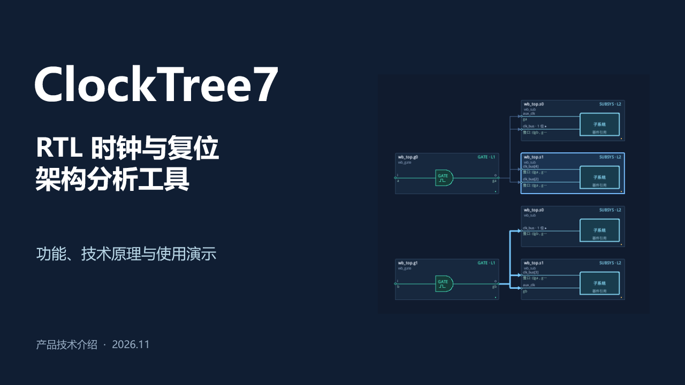

# ClockTree7 产品介绍

34 页中文演示文稿，介绍 RTL 时钟树与复位树架构分析工具的功能、提取原理和实际操作流程，含逐页讲稿备注及源码、手册与验收资料引用。

**[下载 PPTX](https://github.com/ysyx-22040210-yudian/clocktree7/raw/refs/heads/main/presentations/clocktree7-product-20261110/ClockTree7_Product_Introduction_20261110.pptx)** · [查看仓库中的文件](ClockTree7_Product_Introduction_20261110.pptx)

## 内容

| 页码 | 内容 |
| --- | --- |
| 1–9 | 产品范围、原生 Tk 工作台、时钟与复位器件、层次规则、子系统端口及全分支浏览 |
| 10–15 | elab/NPI 提取、目标结构模式、连接证据、大设计内存控制、断点及异常恢复 |
| 16–21 | 辅助端口、实际时序寄存器终点、精确 bit 映射、分支 SV 模板及变量绑定 |
| 22–29 | 加载配置、筛选子系统输入、提取、精确输入导航、问题定位、寄存器追踪和 SV 生成演示 |
| 30–34 | 已有性能实测、验收范围、离线部署、能力边界与项目试点 |

## 使用

- 用 PowerPoint 或兼容软件打开 PPTX。文字、表格和性能图表保留为可编辑对象，截图已嵌入文件，无需访问本机图片目录。
- 采用 16:9 页面，使用 Microsoft YaHei 与 Consolas 字体。其他系统可安装对应字体，减少字体替换带来的排版变化。
- 讲稿备注包含每页讲解建议和依据链接。演示使用工具的实际样例截图，不含商业客户 RTL/KDB。
- 内容口径保留制作时的源码提交 `507990b13d0f5bb5d73abefb35255ec832b82040`。后续完整压测与修复结果参阅[全方位回归报告](../../docs/FULL_REGRESSION_20261110.zh-CN.md)。

## 附带制作资料

`deck.mjs`、`polish.mjs`、`final-polish.mjs` 为原稿制作回调，`dimensions.json` 记录原始截图尺寸，`manifest.json` 记录版本和 PPTX 校验值。这些文件用于后续维护，阅读和演示只需下载 PPTX。

源文件采用 Artifact Tool/Artifact Session API，按 manifest 中的顺序执行，并引用仓库 `docs/images` 下的原图。原稿保留制作环境的路径，其他环境维护时需按实际仓库位置调整。
